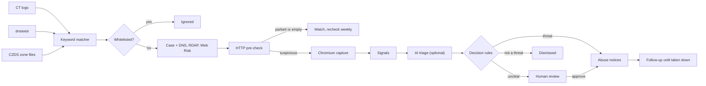

# Kalkan

Find lookalike phishing sites, capture evidence, and drive takedowns to completion.

[](https://github.com/portakalp/dmca-brand-protection/actions/workflows/ci.yml)

Kalkan is a brand-protection service. It watches for new domains that imitate a customer's brand, captures the suspicious ones in a sandboxed browser, decides with explicit rules whether a site is a threat, sends abuse notices to the host, registrar or registry, and keeps checking until the site is gone. Customers follow the results in a web panel; operators review unclear cases in an internal ops panel.

This repository is a self-hostable portfolio version. The demo customer is **Mintera Bank**, a fictional digital bank, and every domain, person and number in the demo data is made up.


## What it does

1. **Discover.** New domains come from Certificate Transparency logs, dnstwist permutations of the official domains and ICANN CZDS zone files. A matcher compares each one with the brand's keywords, including typo, homoglyph and IDN variants.
2. **Filter and enrich.** Domains on the customer's whitelist are ignored. The rest open a case and get DNS, RDAP (registrar, host and abuse contacts), ASN and Google Web Risk data.
3. **Capture.** A cheap HTTP pre-check sets aside parked, empty and redirecting sites. Suspicious ones are opened in Chromium with a desktop and a mobile profile. Screenshots, HTML, a HAR file and a form inventory are stored as evidence with SHA-256 hashes.
4. **Score.** Perceptual hashes, favicon matches, text similarity and form signals (password, card or IBAN fields that post to another domain) are computed. Optionally, Claude classifies the page from its screenshots and text.
5. **Decide.** Plain rules in code confirm, watch, dismiss or send a case to a person. The AI never sends anything on its own; without AI, every case goes to human review.
6. **Notify and follow up.** Approved cases get notices per channel behind several safety gates. The follow-up engine rechecks every six hours, reads replies and escalates. A site that stays down for 72 hours counts as taken down.



## Highlights

- **SSRF-safe networking.** Every request to a candidate site goes through one HTTP client that resolves the name itself, refuses private, loopback, link-local and other non-public addresses, connects to the checked IP and checks every redirect again. On a self-hosted server, Chromium reaches the internet only through a small egress proxy (`python -m kalkan.net.egress_proxy`) that applies the same rules.
- **Sandboxed browser.** `worker-browser` runs Chromium with its sandbox on (a seccomp profile adds only what the sandbox needs; there is no `--no-sandbox`), all capabilities dropped and `no-new-privileges`. It sits on an internal Docker network with no route out and has no database or cloud credentials. It records bot challenges and never solves them.
- **Tenant isolation in two layers.** The API filters every query by customer and runs as its own Postgres role under row-level security. 124 integration tests in `test_tenant_isolation.py` check, table by table, that the API role can neither read nor write another customer's rows.
- **AI that cannot be talked into sending.** Page text, RDAP data and inbound e-mail reach the model only inside labeled untrusted blocks. Answers are requested as structured output and validated again in code. Notice text is written only from structured fields and falls back to a fixed paragraph if it fails checks. The send decision lives in pure functions under `backend/src/kalkan/decision/`.
- **Safe by default.** Global and per-customer dry-run, a global send switch (`sending_enabled`) that starts off, per-channel daily limits and a signed letter of authorization are all checked again at the moment of sending. Locally, mail goes to Mailpit.
- **Reliable job hand-off.** The API never talks to Redis: it writes jobs to a transactional outbox that the scheduler dispatches. A reconciler rebuilds lost jobs from the case state, and every job is idempotent.
- **Immutable evidence.** Each file is hashed before upload and written to a path that is never overwritten (GCS generation preconditions, hard links on the filesystem backend). The evidence ZIP carries a manifest with the hashes.
- **Observability.** Structured logs, Prometheus metrics, 14 alert rules with promtool unit tests, Alertmanager mail and Grafana dashboards. `make alert-test` fires a real alarm into Mailpit.
- **Tests.** 1,616 backend tests (1,029 unit, 583 integration, two end-to-end pipeline tests, a benchmark and an alarm test), 45 panel unit tests, 24 panel Playwright tests with axe accessibility checks, and 115 tests for the optional edge Worker. No test makes a real network call.

## Screenshots

| | |
| --- | --- |
|  **Threat detail:** takedown progress, side-by-side comparison, automated review, who runs the site, abuse notices, timeline and the evidence package. The seeded demo case's screenshots, notices and timeline are illustrative design data. |  **Threats:** every case, with filters, sorting and CSV export. |
|  **Ops review queue:** the official site and the candidate side by side, every signal, and a keyboard shortcut for each decision. |  **Monthly report:** a PDF printed by the browser worker, plus a CSV export. |
|  **Whitelist:** domains Kalkan never reports, with CSV import and export. |  **Dark theme:** every screen has a light and a dark theme. |

Evidence capture of the bundled fixture sites: the official site and its clone, which swaps the customer number for a card number field and adds an urgent banner.


The customer panel also works on a phone.

## Quick start

You need Docker with the Compose plugin, `make` and `git`. Python, Node.js and the databases all run in containers.

```sh
git clone https://github.com/portakalp/dmca-brand-protection.git kalkan
cd kalkan
make demo
```

The first build takes a few minutes. `make demo` creates `.env` from `.env.example` if it is missing, builds and starts the stack, runs the migrations, seeds the Mintera Bank workspace, creates an ops operator and prints every URL and login:

| Service | Address | Login |
| --- | --- | --- |
| Customer panel | http://localhost:3000 | `security@mintera.example` (owner), `analyst@mintera.example` (viewer) |
| Ops panel | http://localhost:8081 | `operator@kalkan.local` |
| Mailpit (every e-mail the stack sends) | http://localhost:8025 | none |
| API docs | http://localhost:8000/api/docs | none |

Passwords are printed by `make demo` and saved in `.local/demo-credentials.json` (git-ignored, readable only by you). Every sign-in asks for a TOTP code. Scan the printed `otpauth://` link into an authenticator app, or print the current code:

```sh
make demo-code EMAIL=security@mintera.example
make demo-code EMAIL=operator@kalkan.local
```

Other demo commands:

| Command | What it does |
| --- | --- |
| `make demo-info` | Print the URLs and logins again |
| `make demo-browser` | The demo plus the Chromium worker, which captures the bundled fixture sites |
| `make demo-down` | Stop everything; the data is kept |
| `make demo-reset` | Stop and delete the volumes (asks first) |

Every port binds to `127.0.0.1`. If one is taken, move it, for example `API_PORT=8010 make demo` (likewise `WEB_PORT`, `OPS_PORT` and `MAILPIT_PORT`). If `make demo` fails with `Pool overlaps with other one on this address space`, move the compose subnets as described in [docs/self-hosting.md](docs/self-hosting.md#addresses-and-ports). AI stays off in the demo, even if `ANTHROPIC_API_KEY` is exported in your shell, so it costs nothing and calls no external service. The demo workspace is read-only, even for its owner. [docs/self-hosting.md](docs/self-hosting.md#on-a-laptop) has the details.

## Self-hosting

[deploy/selfhost](deploy/selfhost/README.md) runs Kalkan on one Linux server with Docker Compose and Caddy, which obtains the HTTPS certificates. It needs no cloud account: evidence can live on the local filesystem (`STORAGE_BACKEND`), mail goes through any SMTP server (`EMAIL_PROVIDER=smtp`), and AI, the browser worker, the CT stream and monitoring are optional Compose profiles. [docs/self-hosting.md](docs/self-hosting.md#on-one-linux-server) covers installation, backups and upgrades.

An optional reference deployment on Google Cloud (Cloud Run, one VM, Cloudflare in front) lives under [infra/](infra/terraform/README.md). Nothing else depends on it.

## Architecture

Two halves talk only through PostgreSQL. The customer API (FastAPI) and panel (Next.js) read the database and the object store and write jobs to an outbox. The pipeline runs as Dramatiq workers with Redis as the broker, plus a scheduler and a CT stream consumer. PostgreSQL is the single source of truth; Redis only carries jobs.

| Process | Role |
| --- | --- |
| `api`, `web` | Customer API and panel, and the evidence pages for abuse desks |
| `worker-default` | Discovery, enrichment, pre-check, signals, decisions, notices, follow-up |
| `worker-browser` | Chromium captures and the monthly report PDFs |
| `worker-ai` | Claude triage, confirmation, notice text and reply classification (optional) |
| `scheduler` | Periodic jobs, outbox dispatcher, reconciler, metrics |
| `ops` | Internal operations panel (FastAPI, Jinja2, HTMX) |

[docs/architecture.md](docs/architecture.md) covers the data model, the case lifecycle, every pipeline stage and the deployments.

## Tech stack

| Area | Tools |
| --- | --- |
| Backend | Python 3.12, FastAPI, SQLAlchemy 2, Alembic, Dramatiq, APScheduler, Pydantic, uv |
| Data | PostgreSQL 16 with row-level security, Redis with ACLs, GCS or the filesystem for evidence |
| Browser | Playwright with Chromium, perceptual hashing |
| AI | Anthropic Claude with structured outputs, prompt caching and a monthly budget (optional) |
| Customer panel | Next.js, React, TypeScript, Tailwind CSS, shadcn/ui, TanStack Query |
| Ops panel | Jinja2 and HTMX |
| Operations | Docker Compose, Caddy, Prometheus, Alertmanager, Grafana, Sentry (optional) |
| Reference cloud | Terraform, Google Cloud Run, Cloudflare Workers |
| Quality | pytest, ruff, mypy, Vitest, Playwright, axe, promtool, tflint, shellcheck, gitleaks, GitHub Actions |

## Project layout

| Path | Contents |
| --- | --- |
| [`backend/`](backend/) | The Python package `kalkan`: API, workers, scheduler, ops panel, CLI, migrations and tests |
| [`web/`](web/) | The customer panel |
| [`deploy/selfhost/`](deploy/selfhost/) | Docker Compose, Caddy, Postgres and Redis setup for one server |
| [`infra/`](infra/) | The local Compose stack, Dockerfiles, alert rules, and the optional Google Cloud and Cloudflare reference deployment |
| [`fixtures/`](fixtures/) | Fictional fixture websites (official site, clone, lure page and others) and recorded RDAP, CZDS and Web Risk data |
| [`eval/`](eval/) | Output folder of the AI evaluation harness |
| [`docs/`](docs/) | Product, architecture, operations and security documents |

## Testing

```sh
cp .env.example .env     # once, if make demo has not created it
make test                # backend unit and integration tests (starts Postgres, Redis and the rest)
make lint                # ruff, ruff format --check, mypy
make e2e                 # the whole pipeline on the fixture clone: Chromium, Mailpit, follow-up
make web-lint web-test   # the panel: eslint, prettier, tsc, Vitest
make web-e2e             # the panel in Playwright with axe (needs make up)
make infra-check         # Terraform, Compose files, Caddyfile, alert rules, shellcheck, all in Docker
```

Integration tests use their own database, so they never touch the demo data. HTTP is faked, AI tests replay recorded responses and e-mail goes to Mailpit. The browser tests need Chromium once: `uv run --project backend playwright install chromium`. CI runs lint, unit, integration, benchmark, image build, Terraform, panel, edge Worker and VM file checks on every pull request and every push to `main`. [docs/development.md](docs/development.md) lists every target and test layer.

## Documentation

| Document | Contents |
| --- | --- |
| [docs/product.md](docs/product.md) | What the service does, roles, panels, business rules and metric definitions |
| [docs/architecture.md](docs/architecture.md) | Technical design: data model, pipeline, scanning, AI, decisions, notices, API, deployments |
| [docs/decisions.md](docs/decisions.md) | The decision log; code comments cite its entries as `K<number>` |
| [docs/self-hosting.md](docs/self-hosting.md) | The laptop demo and a one-server deployment |
| [docs/operations.md](docs/operations.md) | Running it: ops panel, alarms, logs, rollbacks, incidents and restores |
| [docs/security.md](docs/security.md) | Trust boundaries, threats and their controls, residual risks |
| [docs/load-test.md](docs/load-test.md) | A local load check of a CT burst, with sizing advice |
| [docs/development.md](docs/development.md) | Repository layout, make targets, tests, CI and conventions |
| [deploy/selfhost/README.md](deploy/selfhost/README.md) | The self-hosted Compose stack in detail |

## Status and scope

This is a portfolio version of a working system. The demo data describes a fictional bank and fictional domains. Notices are dry-run by default: locally, previews go to Mailpit, and the global send switch starts off. No real abuse report is sent unless you configure a mail provider, sign a letter of authorization for a customer, turn off dry-run and turn the send switch on. The code does not solve CAPTCHAs, bypass bot protection or use stealth plugins.

## License

No license is granted; all rights reserved. You may view the code to evaluate it. Any other use needs written permission. To get in touch, open an issue or contact the owner through GitHub.
