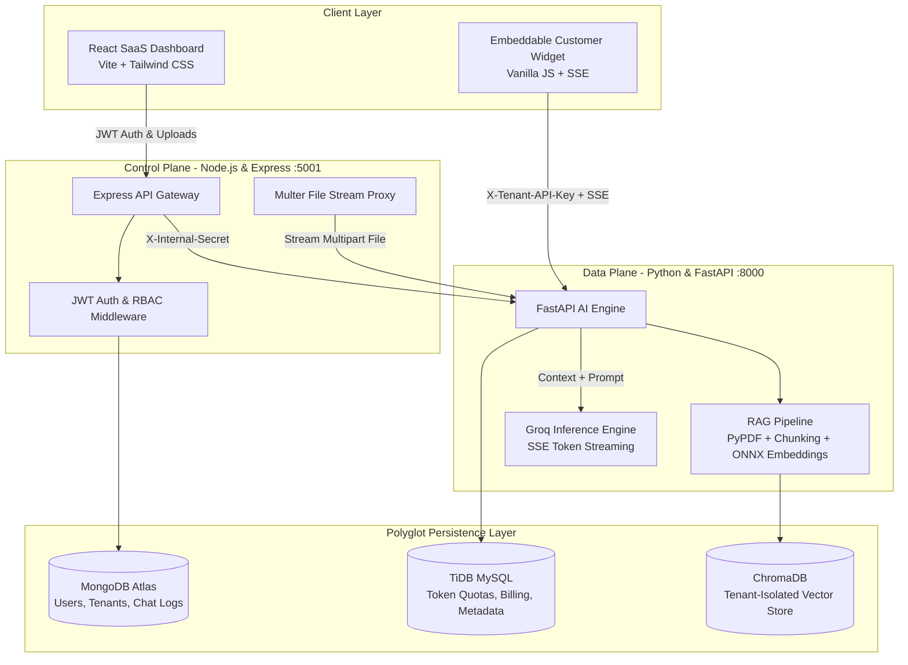
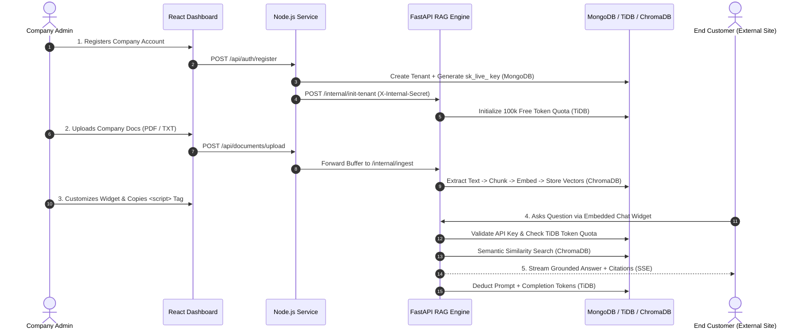

# 🧠 AskAI — Multi-Tenant AI Knowledge Base & Support Copilot SaaS

A production-grade, multi-tenant **Retrieval-Augmented Generation (RAG)** SaaS platform that allows businesses to upload internal documents (PDF/TXT), index them into isolated vector namespaces, and embed a real-time streaming AI customer support copilot onto any website via a single `<script>` tag.

---

## 🏗️ System Architecture & Polyglot Persistence

This project implements a **Microservice Architecture** separating user/tenant control-plane operations from compute-heavy AI/RAG data-plane workflows, utilizing **Polyglot Persistence** across three specialized databases:

1. **MongoDB Atlas (Document Store):** Manages unstructured & relational control-plane data—Users, Tenant configurations, widget themes, public API keys (`sk_live_...`), and chat session histories.
2. **TiDB Cloud / MySQL (Distributed SQL):** Handles strict ACID-compliant SaaS billing quotas (`TenantQuota`), document ingestion states (`DocumentRecord`), and per-request token metering (`UsageLog`).
3. **ChromaDB (Vector Database):** Stores 384-dimensional dense embeddings (`all-MiniLM-L6-v2`) strictly partitioned by `tenant_id` metadata filters to prevent cross-tenant data leakage.



---

## 🔄 End-to-End B2B Onboarding & Chatbot Flow

How an external company uses **AskAI** to deploy a custom AI support agent in under 2 minutes:



---

## ✨ Key Engineering Highlights

* **Zero-Leakage Multi-Tenancy:** Every ChromaDB similarity query enforces metadata-level isolation (`where={"tenant_id": tenant_id}`), ensuring Tenant A can never retrieve Tenant B's proprietary documents.
* **Real-Time Server-Sent Events (SSE):** Custom streaming pipeline from Groq LLM → FastAPI `StreamingResponse` → Browser `ReadableStream` for sub-second time-to-first-token (TTFT).
* **Service-to-Service Security:** Internal routes (`/internal/*`) on FastAPI are locked behind a shared cryptographic `X-Internal-Secret` header, while public chat endpoints authenticate via tenant-scoped `X-Tenant-API-Key` headers.
* **Real-Time Quota Metering:** Tracks prompt and completion tokens per inference call in TiDB MySQL and blocks requests cleanly once a tenant reaches their plan limit.
* **Zero-Dependency Embeddable Widget:** Lightweight `widget.js` script that dynamically injects a customizable chat bubble into any third-party HTML site without CSS collisions.

---

## 🛠️ Tech Stack

| Layer | Technologies |
| :--- | :--- |
| **Frontend** | React 18, Vite, Tailwind CSS, Lucide Icons, Axios |
| **Control Plane API** | Node.js, Express.js, Mongoose, JWT, Bcrypt, Multer |
| **AI & Data Plane API** | Python 3.13, FastAPI, Uvicorn, SQLAlchemy, PyMySQL, Pydantic |
| **AI / RAG Stack** | Groq SDK, ChromaDB, ONNX Runtime (`all-MiniLM-L6-v2`), PyPDF |
| **Databases** | MongoDB Atlas, TiDB Cloud (MySQL-compatible), ChromaDB |

---

## 🚀 Local Setup & Installation

### 1. Clone the Repository
```bash
git clone [https://github.com/yourusername/ai-knowledge-base-saas.git](https://github.com/yourusername/ai-knowledge-base-saas.git)
cd ai-knowledge-base-saas
```

### 2. Configure Environment Variables
Create `.env` files inside `server-node/`, `server-python/`, and `client/`:

**`server-node/.env`**
```env
PORT=5001
MONGO_URI=mongodb+srv://<user>:<password>@<cluster>.mongodb.net/ai_knowledge_base
JWT_SECRET=your_super_secret_jwt_key
FASTAPI_URL=http://localhost:8000
INTERNAL_API_SECRET=shared_internal_secret_key
CLIENT_ORIGIN=http://localhost:5173
```

**`server-python/.env`**
```env
PORT=8000
DATABASE_URL=mysql+pymysql://<user>:<password>@<host>:4000/saas_db
GROQ_API_KEY=gsk_your_groq_api_key
GROQ_MODEL=qwen/qwen3.8-27b
INTERNAL_API_SECRET=shared_internal_secret_key
NODE_URL=http://localhost:5001
CHROMA_PATH=./chroma_db
ANONYMIZED_TELEMETRY=False
TOKENIZERS_PARALLELISM=false
```

**`client/.env`**
```env
VITE_NODE_API_URL=http://localhost:5001
VITE_PYTHON_API_URL=http://localhost:8000
```

### 3. Run the Microservices

**Terminal 1 — Node.js Gateway (`:5001`)**
```bash
cd server-node
npm install
npm run dev
```

**Terminal 2 — FastAPI RAG Engine (`:8000`)**
```bash
cd server-python
python3 -m venv .venv
source .venv/bin/activate
pip install -r requirements.txt
uvicorn main:app --host 0.0.0.0 --port 8000 --reload
```

**Terminal 3 — React Dashboard (`:5173`)**
```bash
cd client
npm install
npm run dev
```

---

## 🧩 Embedding the Chatbot on Any Website

Navigate to **Widget Settings** in the dashboard, customize your brand color and greeting, and paste the generated snippet before the closing `</body>` tag of any website:

```html
<script 
  src="http://localhost:5173/widget.js" 
  data-api-key="sk_live_your_tenant_api_key"
  data-api-url="http://localhost:8000"
  defer>
</script>
```