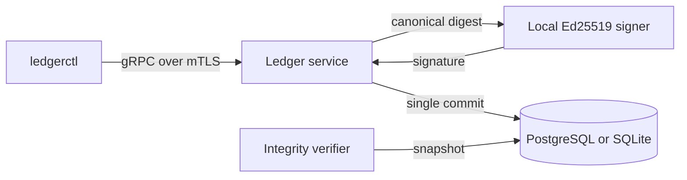

# cryptoledger

[](https://github.com/q133ss/cryptoledger/actions/workflows/ci.yml) · [Русский](README.ru.md) · [MIT](LICENSE)

A double-entry ledger in Go for retrying a transfer after losing the server's reply. The client supplies an idempotency key. PostgreSQL commits both postings, the balance updates, the Ed25519 signature and the audit event together. A retry returns the original transaction and its balances at commit time.

## Try a lost reply

With Docker Compose v2, run these commands from the repository root. The first build downloads Go modules and images.

```sh
docker compose up -d --build --wait
docker compose exec ledger ledgerctl demo
```

On a fresh database the demo transfers **1 USDT**, discards the first reply and sends the request again over mutually authenticated TLS. Look for `deduplicated=true`, one transaction, two entries and one audit event. Rerunning the command uses the same key. Restarting the server preserves its demo signing seed and the journal.


[Terminal recording in asciicast format](docs/assets/retry.cast)

```sh
docker compose exec ledger ledgerctl account get acc_player_1_main
docker compose exec ledger ledgerctl audit tail -n 3
docker compose exec ledger ledgerctl verify
docker compose down
```

With Go 1.26, `go run ./cmd/demo` runs a self-contained SQLite walkthrough. It creates temporary accounts, certificates and a signing key. Compose stores its database and identity in named volumes.

## Guarantees you can check

| Observation | Mechanism | Evidence |
|---|---|---|
| Ten competing clients record one transfer | Transaction-scoped key lock, unique idempotency key and payload comparison | [PostgreSQL concurrency test](internal/ledger/postgres_test.go) |
| Every transaction balances in one currency and scale | Validated postings and deferred PostgreSQL sum check at commit | [Schema](deploy/postgres/schema.sql) |
| A player's balance stays nonnegative | Account balance locks acquired in sorted order and a database trigger | [Posting path](internal/ledger/service.go) |
| Each cached balance equals that account's journal sum | Reconciliation in one read snapshot | [Property test](internal/ledger/property_test.go) |
| History is append-only for the runtime role | Grants, mutation triggers, linked audit hashes and signed transaction digests | [Verifier](internal/ledger/verify.go) |
| Audit records identify the calling client | The server derives the actor from a verified mTLS certificate | [Identity interceptor](internal/mtls/identity.go) |

## Architecture



This reference implementation covers the Ledger component of the [platform diagram](docs/assets/platform-context.png). It uses a software signing key and one audit chain. The surrounding wallet, payout service, key custody and blockchain integrations belong to the platform context. [Architecture and design decisions](docs/architecture.md) · [Threat model](docs/threat-model.md)

## Operations and performance

The gRPC interface exposes posting, account lookup, entry history and verification. `ledgerctl account create` and `audit tail` are local operator commands using database access. In Compose the HTTP listener is bound to localhost on port 8081 and serves `/healthz`, `/readyz` and `/metrics`. The gRPC listener is bound to localhost on port 50051. Set LEDGER_PORT and LEDGER_HTTP_PORT to change the host ports.

[Measured throughput and latency](docs/benchmarks.md) · [API contract](proto/ledger/v1/ledger.proto) · [Contributing and integration tests](CONTRIBUTING.md) · [Open work](https://github.com/q133ss/cryptoledger/issues)
