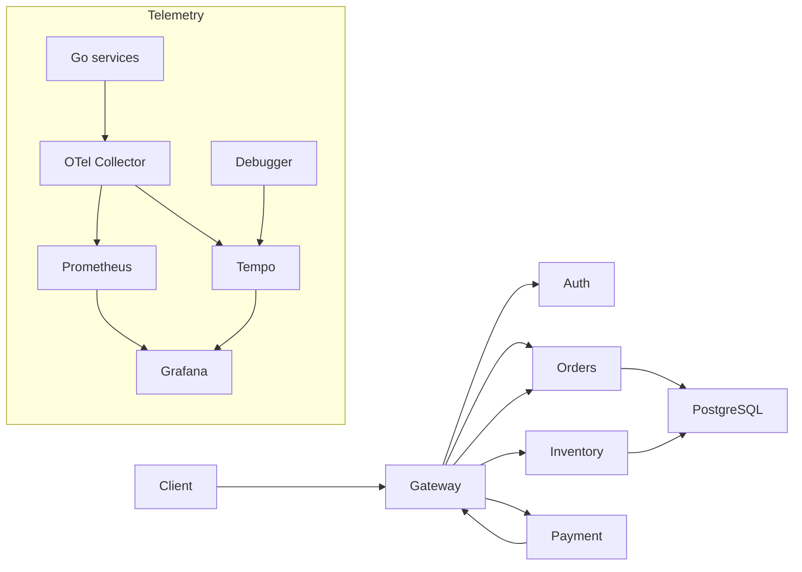

# Distributed Request Debugger

Find out why a request is slow across multiple backend services.

This Go reference application demonstrates distributed tracing, real PostgreSQL lock contention, and evidence-backed latency analysis with OpenTelemetry, Tempo, Prometheus, and Grafana. The identity and payment services are deterministic demos, not production implementations.

## What it does

A checkout passes through gateway, auth, orders, inventory, payment, and orders finalization. The debugger searches Tempo, normalizes the returned trace, calculates timings, and reports measured findings. The lock scenario acquires a real PostgreSQL row lock and waits until the inventory query is observed blocked before starting its configured hold interval. Checkout handlers do not add artificial lock-scenario sleeps.

## Quick start

Requires Docker Compose. Go is needed for local development and tests.

```sh
make up
make smoke
open http://localhost:8081
```

The debugger page lists real Tempo traces and, when `DEMO_MODE=true`, exposes allowlisted local scenarios. Select `inventory-db-lock` to run the contention demo. `make demo-healthy`, `make demo-lock`, and `make demo-payment` run the same scenarios from a terminal. Use `make demo-all` for the available set. Grafana is at <http://localhost:3000>; Prometheus is at <http://localhost:9090>. PostgreSQL and OTLP are internal to the Compose network by default.

To submit a checkout directly:

```sh
curl -sS http://localhost:8080/api/checkout \
  -H 'content-type: application/json' \
  -d '{"customer_id":"customer-demo","sku":"SKU-001","quantity":1,"idempotency_key":"local-001"}'
```

The JSON result and `X-Trace-ID` header contain the server-generated trace ID. Client-provided trace IDs are not trusted.

## Architecture



Orders and inventory own separate schemas and non-superuser roles in one PostgreSQL instance. The workflow uses HTTP between services; it is not an atomic transaction across services. Inventory reservation is idempotent and has a release operation, while this sample does not emulate a durable production payment saga.

## Understanding diagnosis

The analysis uses typed spans, parent relationships, timestamps, and safe span attributes. It computes exclusive time by subtracting the union of child intervals clipped to the parent. A slow SQL span without wait evidence is labeled inferred; only PostgreSQL `Lock` observations associated with the operation produce a confirmed lock finding. Client span duration includes remote work and transport, so it does not prove network latency. Findings include supporting span IDs and suggested next steps.

The wait observer uses a separate PostgreSQL pool connection to inspect `pg_stat_activity` and `pg_blocking_pids()`. Samples are approximate, lower-bound evidence; they are not millisecond-exact wait durations. The observer is enabled for this controlled local demonstration and is not intended as a high-frequency production poller.

## Scenarios and comparison

- `healthy`: ordinary checkout.
- `inventory-db-lock`: genuine row contention with observed PostgreSQL wait evidence.
- `slow-payment`: delayed simulator response.
- `upstream-timeout`: payment exceeds the gateway deadline.
- `missing-propagation`: intentionally omits context on one demo-only client call so the trace appears incomplete.

Compare two trace IDs through `GET /api/comparisons?before=…&after=…` or `debugger compare --before … --after …`. The result uses service and operation names to summarize measured duration changes. It does not claim a code optimization from a healthy/slow scenario comparison.

## Interfaces

Debugger endpoints include `/api/health`, `/api/traces`, `/api/traces/{id}`, `/api/traces/{id}/diagnosis`, `/api/comparisons`, `/api/demo/scenarios`, and `/api/demo/run`. `debugger serve`, `debugger diagnose --trace-id ID`, `debugger compare --before ID --after ID`, and `debugger demo run SCENARIO` are available in the debugger binary. Diagnosis output is JSON with a schema version; trace detail pages include a relative-time waterfall and Grafana Explore link.

## Metrics and tracing

Services export batched OTLP traces and periodic OTLP metrics through the Collector. HTTP server/client spans use OpenTelemetry instrumentation and W3C Trace Context. Resource attributes include service name, namespace, version, and local deployment environment. The local sampler keeps all traces for reproducible investigation; production sampling should account for traffic, incident capture, cost, and privacy. Metrics use bounded service/route/status labels and contain no trace, customer, or order IDs.

Run the small handler instrumentation benchmark with:

```sh
go test ./internal/telemetry -run '^$' -bench BenchmarkHTTPHandlerInstrumentation -benchmem
```

It measures an in-process handler with and without `otelhttp`; it excludes exporter I/O, networking, database work, and production load, so its results are not a deployment performance claim.

## Development and tests

```sh
make fmt
make test
make test-integration
make lint
make build
```

Integration tests require a running Compose stack and `DDR_INTEGRATION=1`; `make test-integration` sets it. They cover propagation, real lock evidence, slow payment, timeout, comparison, Tempo outage independence, and the debugger's non-superuser database role. Unit tests and golden traces run without Docker.

## Limitations and production considerations

This is an educational local deployment. The demo identity accepts only seeded input, and payment is simulated. Do not expose the stack publicly: it has no user authentication or TLS. A production deployment would need access control, secret management, telemetry redaction, retention policy, and deliberate sampling. Incomplete traces can result from sampling or propagation gaps; the analyzer reports uncertainty rather than reconstructing missing evidence. p95/p99 metrics are unstable with small sample counts. No screenshot is included because screenshots should come from a running stack.

See [ARCHITECTURE.md](ARCHITECTURE.md), [tracing](docs/tracing.md), [diagnosis](docs/diagnosis.md), [demo scenarios](docs/demo-scenarios.md), [troubleshooting](docs/troubleshooting.md), and [CONTRIBUTING.md](CONTRIBUTING.md).
