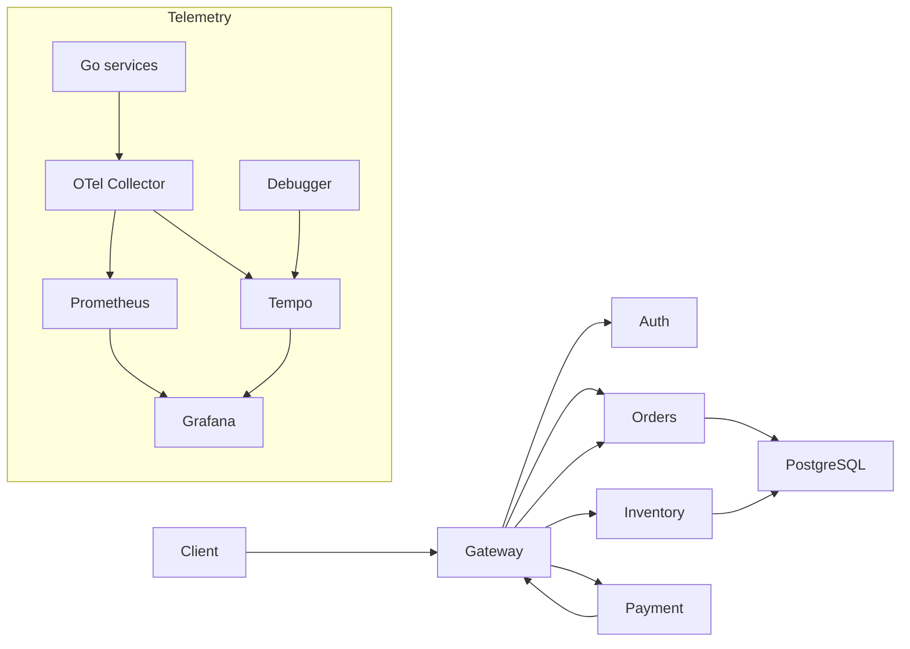

# Distributed Request Debugger

Find out why a request is slow across multiple backend services.

This Go reference application demonstrates distributed tracing, real PostgreSQL lock contention, and evidence-backed latency analysis with OpenTelemetry, Tempo, Prometheus, and Grafana. The identity and payment services are deterministic demos, not production implementations.


## What it does

A checkout passes through gateway, auth, orders, inventory, payment, and orders finalization. The debugger searches Tempo, normalizes the returned trace, calculates timings, and reports measured findings:

- **Confirmed Database Lock Contention**: Acquires a real PostgreSQL row lock and waits until the inventory query is observed blocked in `pg_stat_activity` with `pg_blocking_pids()` before starting its configured hold interval. Handlers add zero artificial lock-scenario sleeps.
- **Downstream Dependency Latency**: Detects slow upstream and external HTTP service calls (e.g. payment simulators) and distinguishes transport/service time from local SQL waits.
- **Timeout and Deadline Propagation**: Identifies context deadline expirations across microservice boundaries.
- **Missing Propagation Detection**: Flags broken context propagation and incomplete traces when spans or services are missing.
- **Differential Trace Comparison**: Measures span duration deltas between baseline and incident traces to pinpoint the exact operations driving latency increases.

## Showcase Gallery

| View                                                                                                            | Description                                                                                                                                                                                                                                                                      |
| --------------------------------------------------------------------------------------------------------------- | -------------------------------------------------------------------------------------------------------------------------------------------------------------------------------------------------------------------------------------------------------------------------------- |
| **Trace Diagnosis Waterfall**<br>        | **Confirmed Lock Diagnosis**: Identifies real PostgreSQL row contention during `inventory.db.reserve_stock`, displaying `pg_blocking_pids`, sampled wait estimate (~7520 ms), lock-wait sample counts, and recommended remediation next steps alongside a visual span waterfall. |
| **External Dependency Latency**<br> | **Downstream Latency**: Pinpoints slow client calls to simulated external payment services without misattributing them to database contention.                                                                                                                                   |
| **Trace Comparison**<br>                              | **Differential Comparison**: Compares baseline healthy checkouts against degraded checkouts, highlighting the exact operations contributing to latency deltas.                                                                                                                   |
| **Grafana Metrics Dashboard**<br>          | **Observability Stack**: Pre-configured Prometheus metrics and Grafana dashboards tracking request rates, p95 durations, and error rates across all services.                                                                                                                    |
| **CLI Verification & Diagnostics**<br>                                | **Terminal Tooling**: Execute scenarios, diagnose traces, and compare traces directly from the command line using `./debugger`.                                                                                                                                                  |

## Quick start

Requires Docker Compose. Go is needed for local development and tests.

```sh
make up
make smoke
open http://localhost:8081
```

The debugger page at <http://localhost:8081> lists recent Tempo traces and, when `DEMO_MODE=true`, exposes allowlisted local scenarios. Select `inventory-db-lock` to run the contention demo.

Command-line scenario runners:

```sh
make demo-healthy     # Ordinary fast checkout
make demo-lock        # Genuine PostgreSQL row contention demo
make demo-payment     # Downstream payment delay simulator
make demo-timeout     # Gateway deadline exceeded (HTTP 504)
make demo-all         # Execute all scenarios sequentially
```

Telemetry dashboards:

- **Debugger UI**: <http://localhost:8081>
- **Grafana**: <http://localhost:3000> (default credentials: `admin` / `admin`)
- **Prometheus**: <http://localhost:9090>
- **Tempo API**: <http://localhost:3200>

To submit a checkout directly:

```sh
curl -sS http://localhost:8080/api/checkout \
  -H 'content-type: application/json' \
  -d '{"customer_id":"customer-demo","sku":"SKU-001","quantity":1,"idempotency_key":"local-001"}'
```

The JSON result and `X-Trace-ID` header contain the server-generated trace ID. Client-provided trace IDs are not trusted.

## Architecture



Orders and inventory own separate schemas and non-superuser roles in one PostgreSQL instance. The workflow uses HTTP between services; it is not an atomic transaction across services. Inventory reservation is idempotent and has a release operation, while this sample does not emulate a durable production payment saga.

## Understanding diagnosis

The analysis uses typed spans, parent relationships, timestamps, and safe span attributes. It computes exclusive time by subtracting the union of child intervals clipped to the parent:

1. **Database Lock Contention (`confirmed`)**: Triggered when a database span exceeds 100 ms and PostgreSQL `Lock` wait observations (`db.wait.type = "Lock"`) are recorded by the observer with blocking PID evidence.
2. **Slow Database Operation (`inferred`)**: Labeled when a database operation occupies a significant interval without associated lock wait samples.
3. **Downstream Service / External Latency (`inferred`)**: Identified when an outbound HTTP client span represents the dominant duration in the request path.
4. **Incomplete Trace (`insufficient_evidence`)**: Raised when required checkout services are missing from the trace or span parentage contains cycles or gaps.

The wait observer uses a separate PostgreSQL pool connection to inspect `pg_stat_activity` and `pg_blocking_pids()`. Samples are approximate, lower-bound evidence; they are not millisecond-exact wait durations. The observer is enabled for this controlled local demonstration and is not intended as a high-frequency production poller.

## Scenarios and comparison

- `healthy`: ordinary checkout.
- `inventory-db-lock`: genuine row contention with observed PostgreSQL wait evidence.
- `slow-payment`: delayed simulator response.
- `upstream-timeout`: payment exceeds the gateway deadline.
- `missing-propagation`: intentionally omits context on one demo-only client call so the trace appears incomplete.

Compare two trace IDs through `GET /api/comparisons?before=…&after=…` or `debugger compare --before … --after …`. The result uses service and operation names to summarize measured duration changes. It does not claim a code optimization from a healthy/slow scenario comparison.

Direct comparison links can also be opened directly in the web UI:

```
http://localhost:8081/?before=<TRACE_ID_1>&after=<TRACE_ID_2>
```

## CLI Usage

The repository builds a standalone `debugger` CLI binary:

```sh
# Build binary
go build -o debugger ./cmd/debugger

# Run a demonstration scenario
./debugger demo run inventory-db-lock

# Diagnose a trace by ID (outputs JSON diagnosis with findings and evidence)
./debugger diagnose --trace-id <TRACE_ID> --json

# Compare two traces
./debugger compare --before <BASELINE_TRACE_ID> --after <INCIDENT_TRACE_ID>

# Start standalone debugger HTTP server
./debugger serve
```

## REST API Endpoints

| Endpoint                                 | Method | Description                                                                   |
| ---------------------------------------- | ------ | ----------------------------------------------------------------------------- |
| `/api/checkout` (port 8080)              | POST   | Submit checkout request (`customer_id`, `sku`, `quantity`, `idempotency_key`) |
| `/api/health` (port 8081)                | GET    | Debugger backend and Tempo healthcheck                                        |
| `/api/traces` (port 8081)                | GET    | List recent gateway traces in Tempo                                           |
| `/api/traces/{id}` (port 8081)           | GET    | Fetch raw normalized trace model                                              |
| `/api/traces/{id}/diagnosis` (port 8081) | GET    | Fetch structured diagnosis report (category, evidence, next steps)            |
| `/api/comparisons` (port 8081)           | GET    | Compare two traces (`?before=...&after=...`)                                  |
| `/api/demo/scenarios` (port 8081)        | GET    | List available demo scenarios                                                 |
| `/api/demo/run` (port 8081)              | POST   | Trigger scenario execution (`{"scenario":"inventory-db-lock"}`)               |

## Metrics and tracing

Services export batched OTLP traces and periodic OTLP metrics through the Collector. HTTP server/client spans use OpenTelemetry instrumentation and W3C Trace Context. Resource attributes include service name, namespace, version, and local deployment environment. The local sampler keeps all traces for reproducible investigation; production sampling should account for traffic, incident capture, cost, and privacy. Metrics use bounded service/route/status labels and contain no trace, customer, or order IDs.

Run the handler instrumentation benchmark:

```sh
go test ./internal/telemetry -run '^$' -bench BenchmarkHTTPHandlerInstrumentation -benchmem
```

It measures an in-process handler with and without `otelhttp`; it excludes exporter I/O, networking, database work, and production load, so its results are not a deployment performance claim.

## Development and tests

```sh
make fmt
make test
make test-integration
make lint
make build
```

Integration tests require a running Compose stack and `DDR_INTEGRATION=1`; `make test-integration` sets it. They cover propagation, real lock evidence, slow payment, timeout, comparison, Tempo outage independence, and the debugger's non-superuser database role. Unit tests and golden traces run without Docker.

## Limitations and production considerations

This is an educational local deployment. The demo identity accepts only seeded input, and payment is simulated. Do not expose the stack publicly: it has no user authentication or TLS. A production deployment would need access control, secret management, telemetry redaction, retention policy, and deliberate sampling. Incomplete traces can result from sampling or propagation gaps; the analyzer reports uncertainty rather than reconstructing missing evidence. p95/p99 metrics are unstable with small sample counts.

See [ARCHITECTURE.md](ARCHITECTURE.md), [tracing](docs/tracing.md), [diagnosis](docs/diagnosis.md), [demo scenarios](docs/demo-scenarios.md), [troubleshooting](docs/troubleshooting.md), and [CONTRIBUTING.md](CONTRIBUTING.md).
