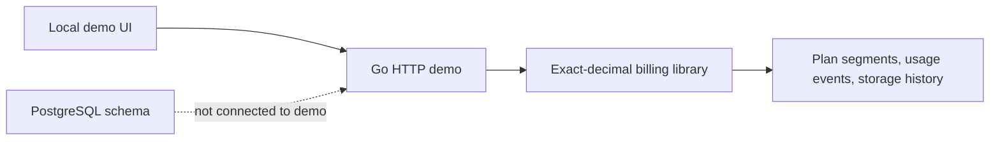

# usage-based-billing

Self-hosted usage metering and billing infrastructure for SaaS applications.

SaaS products need to measure usage, enforce plan allowances, calculate overages, and explain charges. This project provides an exact-decimal Go billing calculation library, a tenant-aware PostgreSQL schema, and a local demonstration application.

## What is included

- UTC calendar-month billing with half-open periods and prorated base fees.
- Segment-specific counter allowances and graduated overage rates.
- Time-weighted storage billing in decimal GB-months, with historical plan-segment rates.
- Decimal-string pricing, exact rational intermediates, half-up cent rounding, and per-segment usage explanations.
- A loopback-only demo with three example customers on Starter, Growth, and Scale plans.
- Stateless counter simulations and invoice previews using the same calculation package.
- PostgreSQL schema constraints, row-level security policies, and immutable-evidence triggers.

**Project status:** the current implementation is a calculation library and demonstration, not a complete production billing service. The demo has no authentication, persistence, or database connection. See [limitations](docs/limitations.md) and the [security policy](docs/security.md).

## Quick start

Requires Go 1.27 or newer. The current demo does not require PostgreSQL.

```sh
go test ./...
DEMO_MODE=1 go run ./cmd/server
```

Open <http://127.0.0.1:8080>, choose a customer, and preview the current-period calculation. The demo binds to loopback by default and does not store simulated usage. Do not expose it to an untrusted network or use real customer data.

The demo API provides:

- `GET /healthz` — local demo health.
- `GET /api/customers` — the three seeded examples.
- `GET /api/preview?customer_id=startup|growth|scale` — a point-in-time invoice preview.
- `POST /api/simulate` — recompute a preview with bounded counter usage; the added usage is discarded after the response.

See the [demo API specification](docs/openapi.yaml) and [curl example](examples/curl/demo.sh).

## Architecture



The calculation library is in `internal/billing`; the schema is in `db/migrations`. See [architecture](docs/architecture.md) for component boundaries and transaction requirements.

## Billing semantics

[Billing semantics](docs/billing-semantics.md) defines period boundaries, proration, allowance rounding, graduated tiers, storage integration, and invoice-preview behavior. Worked examples include counter overage, graduated pricing, storage accrual, and monetary rounding.

## Development

```sh
make fmt
go test ./...
go test -race ./...
go vet ./...
make build
```

The current tests cover counter and graduated pricing, storage accrual across plan changes, half-open boundaries, partial previews, validation, and demo handlers. PostgreSQL integration, browser end-to-end, and performance tests are not included in the current implementation.

## Integration

The package-level calculation entry point and supported integration boundary are described in the [integration guide](docs/integration-guide.md). The HTTP demo is not an ingestion or production API, and previews are not finalized invoices.

## Contributing

See the [contribution guide](CONTRIBUTING.md) and [Code of Conduct](CODE_OF_CONDUCT.md). Vulnerability reports should use the private process in the [security policy](.github/SECURITY.md).

## License

This project is licensed under the [MIT License](LICENSE).
