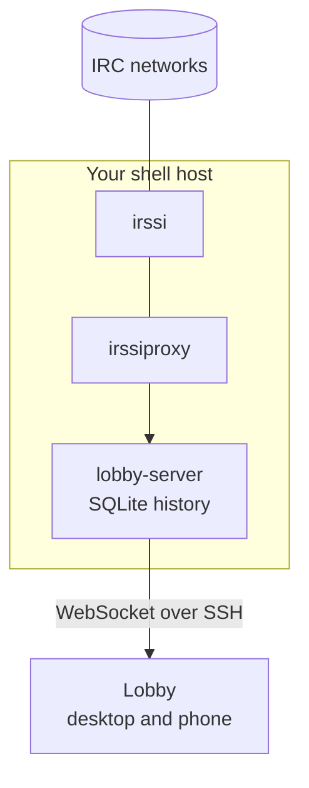
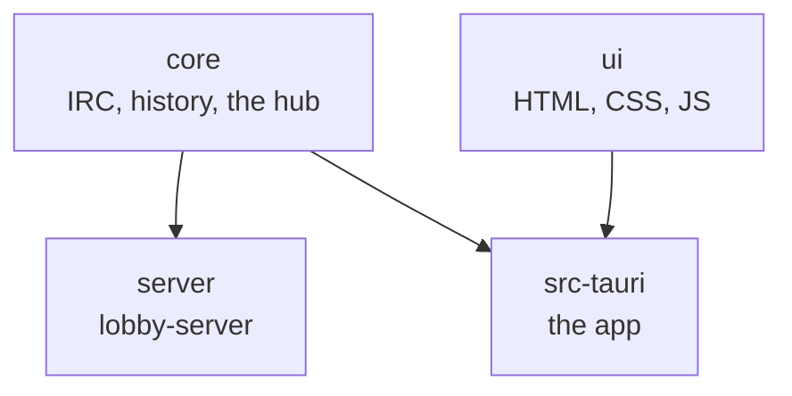

<p align="center">
  
</p>

<h1 align="center">Lobby</h1>

<p align="center">
  <a href="https://github.com/rollecode/lobby/actions/workflows/check.yml"></a>
  <a href="https://github.com/rollecode/lobby/releases/latest"></a>
  <a href="https://www.rust-lang.org"></a>
  <a href="https://tauri.app"></a>
  
  
</p>

<p align="center">
  A small, modern IRC client for people who keep irssi running.<br>
  One calm reading column, your whole history, and a window happy to live in the corner of your screen.
</p>

<p align="center">
  
</p>

## Features

### 🗂️ Full backlog

lobby-server runs next to irssi and keeps all lines, also while Lobby is closed. Scroll back as far as the history goes.

### 💬 Grouped chat

One face and name per person, their lines stacked under it. Links become cards; pictures, videos and audio play inline.

### 😂 Reactions and replies

Sent as plain IRC, `nick: 😂` and `nick: text`, and shown as reactions and quotes.

### 🧑 People

A photo, a colour and any number of nicks per person, matched by pattern or by ident and host.

### 👥 People list

The faces in the header open the channel's people, ops first, then by who spoke last. Keep it beside the chat, or pick several people to give op or voice at once.

### 📥 Highlights inbox

Lines that name you, from all channels, in one list. Mark them done, filter them, and jump to where each was said.

### 🔔 Highlight words

Your own words besides your nick. Only whole words count, so `kai` never lights up `kaikki`.

### 📣 Notifications your way

Per channel, every message or only highlights, for the app icon count and for notifications. Name people and words that always notify you without highlighting anything.

### 🗃️ Channel shelf

The links and pictures posted in a channel, each a jump back into the conversation.

### 📍 Unread

A New line where you left off, nothing read until you say so, and a jump to the first unread however far back.

### 📎 Attachments

Paste, drop or pick a file and its address goes into your message. Files go to your own file host, S3 or Cloudflare R2, SFTP, lobby-server or catbox.moe.

### 👑 Most active

Today's talkers by words, with a crown for the first and your day against your usual. Yesterday's top three where a new day starts.

### 🎵 Now playing

With a Last.fm username and API key, bars by the emoji button show what you play. One click sends `np. Artist - Song`.

### 📏 Message length

A count of what is left of the IRC line. Over it turns red, and nothing is sent until you shorten the message.

### 🛡️ Op tools

As an op, kick with a reason or ban by host from the people list or a message. Settings > Channel holds the topic, the channel modes and the ban list, and on QuakeNet the Q bans that last.

### 🙈 Hidden channels

Hide announcement channels from the list and the channel keys. A search still finds them.

### ⌨️ irssi commands and keys

`/wc`, `/whois`, `/names` and the rest, a `/` menu, numbered channels and jump keys.

### 🎹 Full keyboard support

Channels, highlights, the shelf, people, settings and replies all have keys, and the arrows move through lists and tabs. Keys can be changed in Settings.

### 📨 Notices, CTCP and DCC

Private messages, notices, CTCP requests and DCC offers all show up.

### ☁️ Synced

People, channel pictures, read positions and settings live on your server and follow you between devices.

### 🏠 Self-hosted, no bouncer

irssi stays in charge. Lobby reads through irssiproxy and reaches your server over SSH, so nothing new faces the internet.

### 📱 Platforms

Linux, macOS, Windows, Android and iPhone.

## Architecture

irssi already sees every message, but irssiproxy only hands over what happens after you connect. lobby-server fills that gap: it runs on the same machine as irssi, connects to irssiproxy like any client, and writes every line to SQLite. Lobby connects to lobby-server, loads the history, then follows the live chat.



Lobby can also connect straight to irssiproxy or any IRC server. That works without a server of your own, but only shows what arrived while Lobby was open.

| Mode | Lobby connects to | History |
|------|-------------------|---------|
| Server | lobby-server | Everything recorded, also while Lobby was closed |
| Direct | irssiproxy or an IRC server | Only what arrived while Lobby was running |

## Installation

### The app

Download the latest build from [Releases](https://github.com/rollecode/lobby/releases/latest):

| System | File |
|--------|------|
| Debian, Ubuntu | `.deb`, install with `sudo apt install ./Lobby_*.deb` |
| Arch, CachyOS, Manjaro | `.pkg.tar.zst`, install with `sudo pacman -U lobby-*.pkg.tar.zst` |
| Other Linux | `.AppImage`, make it executable and run it |
| macOS (Apple silicon) | `.dmg` |
| Windows | `-setup.exe` |
| Android | `.apk`, open it on the phone and allow installing from your browser |

The macOS build is not signed. After moving Lobby to Applications, run `xattr -dr com.apple.quarantine /Applications/Lobby.app` once, or macOS refuses to open it. The Windows installer is not signed either: on the SmartScreen warning, choose More info, then Run anyway.

<details>
<summary><strong>Building from source</strong></summary>

You need Rust from [rustup.rs](https://rustup.rs), plus:

| System | Command |
|--------|---------|
| Arch | `sudo pacman -S --needed base-devel webkit2gtk-4.1` |
| Debian, Ubuntu | `sudo apt install build-essential libwebkit2gtk-4.1-dev` |
| Fedora | `sudo dnf install webkit2gtk4.1-devel gcc` |
| macOS | `xcode-select --install` |

```sh
git clone https://github.com/rollecode/lobby
cd lobby
cargo build --release -p lobby
./target/release/lobby
```

To update: `git pull` and build again.

</details>

### iPhone

There is no App Store build yet. On a Mac with Xcode and an Apple developer account, with the iPhone connected over USB:

```sh
rustup target add aarch64-apple-ios
npm install
export APPLE_DEVELOPMENT_TEAM=YOUR_TEAM_ID
npm run tauri ios init
sh tools/ios-icons.sh
npm run tauri ios build -- --export-method debugging
xcrun devicectl device install app --device YOUR_IPHONE_UDID src-tauri/gen/apple/build/arm64/Lobby.ipa
```

`xcrun devicectl list devices` shows the UDID. On first start Lobby opens its connection setup; use Through SSH and add the key line it shows on your shell host. Notifications and the badge work while Lobby is open or recently in the background; the iPhone has no background connection yet.

### lobby-server

On the machine where irssi runs:

```sh
git clone https://github.com/rollecode/lobby
cd lobby
./server/install.sh
```

The installer builds lobby-server, writes a config and a random token, and sets up a systemd user service. [server/README.md](server/README.md) walks through turning on irssi's proxy, the config, starting the service, updating and removing it.

> [!IMPORTANT]
> lobby-server only listens on `127.0.0.1`. Lobby reaches it through SSH with your usual key, so nothing on the server is opened to the internet. For an address of its own, put a reverse proxy with TLS in front, as shown in the server README.

## Configuration

On first start Lobby opens its connection setup. You can come back to it any time from the gear, Set up the connection. The gear is in the channel list, which opens when you click the channel name in the header. The same three choices are on every device:

| Choice | What you fill in | History |
|--------|------------------|---------|
| Through SSH | `you@your-shell-host`, the SSH port if not 22, and the lobby-server token | Everything lobby-server recorded |
| Server address | `wss://lobby.example.org` and the token | Everything lobby-server recorded |
| Straight to IRC | Your nick and one row per IRC server or irssiproxy port | Only while Lobby is open |

The token is in `~/.config/lobby-server/token` on the server.

With lobby-server, the setup also lists the server's networks. Adding or removing one there changes lobby-server's own config and takes effect right away, without restarting anything.

**SSH.** Lobby has SSH built in, so it also works where no `ssh` program exists, like the iPhone. It signs in with a key of its own, and on a computer also with your usual keys in `~/.ssh` and your SSH agent. The setup shows Lobby's key as a line to add to `~/.ssh/authorized_keys` on the shell host:

```
restrict,port-forwarding,permitopen="127.0.0.1:7667" ssh-ed25519 AAAA… lobby
```

That key can reach lobby-server and nothing else: no shell, no other ports. The server's host key is checked against `~/.ssh/known_hosts`, or remembered on first connect.

The setup is saved in a plain file you can also edit by hand, and Lobby reconnects as soon as you save:

- Linux: `~/.config/lobby/config.toml`
- macOS: `~/Library/Application Support/lobby/config.toml`

```toml
[server]
ssh = "you@your-shell-host"
token_file = "~/.config/lobby/server.token"
```

## Using Lobby

| Keys | What they do |
|------|--------------|
| `Ctrl+K` (`Cmd+K` on a Mac), or click the channel name | Find and switch channels |
| `Alt+1` … `Alt+9`, `Cmd` on a Mac | Jump to a channel |
| `Alt+Left`, `Alt+Right`, `Cmd` on a Mac while the message box is empty | Previous and next channel |
| `Alt+A`, or the unread counter | Next channel with unread, mentions first |
| `Alt+U`, or the unread pill | Jump to the first unread message in this channel |
| `Alt+Enter` on Linux, `Ctrl+Enter` on Windows, `Cmd+Enter` on a Mac | Mark this channel read and go to the newest message |
| `Tab` | Complete a nick, or pick one from the list that opens as you type a name or `@` |
| `Up` in an empty input | Bring back the last message |
| `Ctrl+Shift+R` (`Cmd+Shift+R` on a Mac) | Reply to the last message |
| `Alt+Up`, `Alt+Down` on Linux, `Ctrl` on Windows, `Cmd` on a Mac | Scroll the chat up and down |
| `Ctrl+End` (`Cmd+End` on a Mac) | Back to the newest message |
| `PageUp`, `PageDown` | Scroll the chat a page at a time |
| `Ctrl+Shift+H` (`Cmd+Shift+H` on a Mac) | Open highlights. `Down` and `Up` move between them, `Enter` opens one, `Delete` marks it done |
| `Ctrl+Shift+S` (`Cmd+Shift+S` on a Mac) | Switch between the chat and the shelf |
| `Ctrl+Shift+P` (`Cmd+Shift+P` on a Mac) | People on this channel |
| `Ctrl+,` (`Cmd+,` on a Mac) | Settings. `Up` and `Down` move between its tabs |
| `Esc` | Close what is open |

Every shortcut can be changed under Settings, Keyboard shortcuts.

**Reactions and replies.** Point at a message for your favourite emojis, more emojis, reply and a menu. On a phone, hold a message instead: it lifts out of the chat with your favourite emojis, more emojis and reply above it. IRC has no reactions, so a reaction is sent as `nick: 😂`, and Lobby shows such lines from anyone as a reaction under that person's message. A reply goes out as `nick: text` and shows the message it answers.

**Unread.** A red New line marks where unread messages start. Nothing is marked read on its own: click the checkmark at the end of the New line, the Mark read button at the top, or press `Alt+Enter` (`Ctrl+Enter` on Windows, `Cmd+Enter` on a Mac).

**People.** Click a name or photo in the chat, or open the gear and People. `Kaisla` also covers `Kaisla_` and `Kaisla-`, `Kaisla*` covers any ending, and `kaisla@*.example.net` matches by ident and host. The colour follows the photo unless you pick one. Click the channel icon in the header to give a channel its own picture or colour, or to mute it. A muted channel adds nothing to unread counts or jumps, except when someone mentions you. `/mute` and `/unmute` work too, and so does the bell beside each channel in the channel list.

**Who is here.** The faces at the right of the header are the people talking now, in the last hour. Click them for everyone in the channel: ops first, then who is talking now, earlier today and away, fading the longer they stay quiet. Voiced people have a small mint mark. The button at the top of the list keeps it beside the chat instead, and the faces then show or hide it. Click anywhere on a row to pick it, the photo turns into a checkbox. With people picked, Give voice and Give op go out as one `MODE +vvv` line, or a few when the server takes fewer per line. Right-click a row for the same and to message or edit the person; with one person picked, the bar under the list has Message and Edit too. Mode changes show in the chat like joins and quits.

**Bot commands.** A line like `!seen milla` shows as a small card. Name your channel bots in Settings, Bots, and what they say right after a command shows inside its card as the answer.

**Topic.** The channel topic sits under the channel name in the header; point at it to read all of it.

**Commands.** Type `/` for the menu. `/me`, `/msg`, `/query`, `/join`, `/part`, `/wc`, `/topic`, `/names`, `/whois`, `/nick`, `/away`, `/notice`, `/invite`, `/kick`, `/op`, `/deop`, `/voice`, `/devoice`, `/clear`, `/say` and `/quote` work as in irssi. Anything else is sent as is. `/quit` is off, because through irssiproxy it would disconnect irssi from the network.

**Emoji.** `:D`, `:)`, `<3` and friends turn into emoji as you type. A colon at the start of a word opens the emoji picker, and `:joy` or a Finnish word like `:nauru` lists matching emoji, most used first. Both can be turned off in Settings.

**Attachments.** Paste an image into the message box, drop files on the window, or use the paperclip. The file is uploaded and its address is put into your message, so everyone on IRC can open it. Settings, Files, File storage picks where files go:

| Choice | Where the file goes | Setup |
|--------|---------------------|-------|
| Automatic | Your lobby-server, then your own file host, then catbox.moe, whichever works first | None |
| Your lobby-server | Where lobby-server's config says: an S3 bucket or a folder its web server serves | `[upload]` in lobby-server's config, see the [server README](server/README.md). The keys stay on the server |
| Your own file host | A host that takes the file as a POST, like `upload.php` below, soju or Halloy hosts | Its address |
| S3 storage | Your Cloudflare R2 or other S3 bucket, straight from the app | S3 address, bucket, key and the bucket's public address |
| Your server over SFTP | A folder on your server that a web server serves | `you@host`, folder, its web address, and your SSH key, Lobby's own key or a password |
| catbox.moe | [catbox.moe](https://catbox.moe), free | None. Files are public and kept until unseen for 2 years |

A bucket, folder or SFTP server of your own only gets pictures, PDFs and plain text, so nothing a browser would run is served from your domain. Each file goes in a folder of its own with a random name. Settings are saved on your lobby-server when you use one, so every device uses the same choice. Files can be up to 20 MB.

<details>
<summary><strong>Running a file host for attachments</strong></summary>

Lobby uploads the way Halloy and soju-style hosts expect, so one host serves all of them:

- `POST` the file as the raw request body to the host's address
- `Content-Type` is the file's type, `Content-Disposition` carries its name (`attachment; filename*=UTF-8''name.png`)
- The host answers `201 Created` with the file's address in `Location`

[tools/filehost/upload.php](tools/filehost/upload.php) is a complete host in one PHP file. It keeps only images, PDFs and plain text, and needs a secret key in the address. Put it on any web server with PHP, set `KEY`, `BASE_URL` and `STORE` at the top, and allow uploads of 20 MB. With nginx:

```nginx
server {
    server_name files.example.org;
    root /var/www/files;
    client_max_body_size 20m;

    location = /upload.php {
        include snippets/fastcgi-php.conf;
        fastcgi_pass unix:/run/php/php-fpm.sock;
    }

    location ^~ /u/ {
        add_header X-Content-Type-Options nosniff;
    }
}
```

Then set `https://files.example.org/upload.php?k=YOUR_KEY` in Lobby's Settings. The address is stored on your lobby-server like other settings, so every device uses it.

</details>

<details>
<summary><strong>Importing a folder of photos</strong></summary>

If you already have photos named after nicks (`kaisla.png`, `Kaisla_.png`), import them all at once. Files with the same picture, or nicks that differ only by `_`, `-` or `` ` ``, become one person. Nicks you have already set up are left alone. Round avatars are squared to fill the frame.

```sh
pip install Pillow websocket-client
ssh -N -L 17667:127.0.0.1:7667 you@your-shell-host &
python3 tools/import_photos.py ~/Pictures/irc ws://127.0.0.1:17667 ~/.config/lobby/server.token --dry-run
```

Drop `--dry-run` to import. Add `--skip file.png …` at the end to leave files out.

</details>

## Development



- `core` keeps IRC connections running, turns lines into events and stores them. The app in direct mode and lobby-server both use it.
- `server` is lobby-server: the hub behind a WebSocket.
- `src-tauri` is the desktop app. In server mode it talks to lobby-server, in direct mode it runs the hub itself.
- `ui` is the window. It does not know which mode is in use.

```sh
npm ci
npm test         # JS and Rust unit tests
npm run check    # Biome, rustfmt and clippy, as CI runs them
npm run format   # Biome and rustfmt rewrite the code
```

Every push runs the same checks on GitHub Actions, plus the macOS app build, the iPhone lint and the core tests on the iPhone simulator.

Changes waiting for a release collect under `[Unreleased]` in `CHANGELOG.md`. Releases are automatic: when that heading becomes a version heading on `main`, GitHub Actions tags it, publishes the release notes and attaches the Linux and macOS builds.

<details>
<summary><strong>The app and lobby-server protocol</strong></summary>

JSON over a WebSocket. The app sends `hello` with the token first, the server answers `welcome` with the current state and then streams events. Requests carry an `id` that the reply repeats. The types live in `core/src/protocol.rs`.

```
app    {"type":"hello","token":"..."}
server {"type":"welcome","snapshot":{"networks":[...],"channels":[...],"people":[...],"settings":{...}}}
server {"type":"event","event":{"type":"line","net":"IRCnet","buffer":"#rust","nick":"kaisla","text":"hei",...}}
app    {"type":"history","id":1,"net":"IRCnet","buffer":"#rust","before":null}
server {"type":"reply","id":1,"data":[...],"error":null}
app    {"type":"send","id":2,"net":"IRCnet","buffer":"#rust","text":"moi"}
app    {"type":"save_person","id":3,"person":{"id":0,"name":"Kaisla","nicks":["kaisla"],...}}
app    {"type":"set_setting","id":4,"key":"read","value":"{...}"}
app    {"type":"upload","id":5,"name":"photo.png","mime":"image/png","data":"<base64>"}
server {"type":"reply","id":5,"data":"https://files.example.org/3f2a.../photo.png","error":null}
```

</details>
