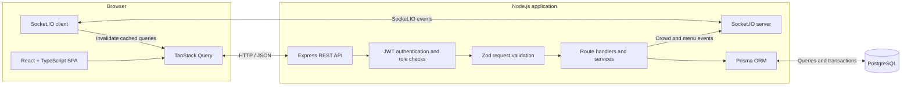

 <!--
  MessMate README
  Product documentation is intentionally limited to behavior verified in this repository.
-->

<div align="center">
  <table width="100%">
    <tr>
      <td align="center" bgcolor="#173F32">
        <br />
        <h1><font color="#F5F0E4">MessMate</font></h1>
        <p><font color="#F5F0E4"><strong>Find good food. Skip the guesswork.</strong></font></p>
        <p><font color="#F5F0E4">A practical way for college students to discover nearby messes, check today's menu and make a better lunch decision.</font></p>
        <br />
      </td> 
    </tr>
  </table>
  <p>
    <a href="#features">Features</a> &nbsp;·&nbsp;
    <a href="#architecture">Architecture</a> &nbsp;·&nbsp;
    <a href="#getting-started">Get started</a> &nbsp;·&nbsp;
    <a href="#roadmap">Roadmap</a>
  </p>
  <p>
    
    
    
    
    
    <a href="LICENSE"></a>
  </p>
  <p><sub>Built around the everyday food-discovery problem near DY Patil College, Akurdi, Pune.</sub></p>
</div>

---

## Contents

- [The problem](#the-problem)
- [Features](#features)
- [Screenshots](#screenshots)
- [Technology](#technology)
- [Architecture](#architecture)
- [How it works](#how-it-works)
- [Getting started](#getting-started)
- [Engineering notes](#engineering-notes)
- [Roadmap](#roadmap)
- [Contributing](#contributing)
- [Demo data disclosure](#demo-data-disclosure)
- [License](#license)

## The problem

Choosing where to eat between classes should be simple. In practice, students often have to walk to a mess or ask around just to find out whether it is open, what is being served, what a meal costs or how crowded it is.

MessMate brings those details into one place. Students can discover messes and dishes, compare menus and prices, and check a clearly labelled crowd estimate before heading out. Mess owners can maintain their listing and publish menu and rush updates; administrators review listings and moderate the platform.

The initial focus is the college-mess discovery experience around the DY Patil campus in Akurdi.

## Features

The statuses below describe what is present in the current repository, not a promise about future releases.

| Area | Capability | Status |
|---|---|---|
| Student experience | Search messes and dishes; filter by budget, food type, crowd level and open status; sort by distance, rating, price or crowd | **Implemented** |
| Student experience | Browse results as cards or on a map; use device location or the configured campus centre for distance | **Implemented** |
| Daily menus and dish discovery | View today's menu, dish categories, availability, prices and dish photographs when provided | **Implemented** |
| Reviews and ratings | Submit mess reviews with food, hygiene and value ratings; rate individual dishes | **Implemented** |
| Real-time crowd updates | View an estimate from student reports, owner updates and location-verified check-ins; receive Socket.IO updates | **Implemented** |
| QR check-ins | Scan a mess QR code; check-ins contribute to crowd estimates only when location verification succeeds | **Implemented** |
| Favourites | Save messes and return to a dedicated saved-messes view | **Implemented** |
| Mess owner dashboard | Create and edit a mess listing, manage dishes and photos, publish dated menus, mark dishes unavailable and issue a QR code | **Implemented** |
| Owner crowd updates | Submit a current crowd-level update for a verified mess | **Implemented** |
| Admin dashboard | Approve, reject, suspend and reinstate mess listings; review verification history | **Implemented** |
| Admin dashboard | Deactivate or reactivate non-admin accounts and hide or restore reviews | **Implemented** |

### A note about crowd estimates

Crowd levels are estimates, not live occupancy counts. The estimator combines recent student reports, owner updates and distinct location-verified QR check-ins. Signals lose weight over time and expire; when there is not enough recent evidence, MessMate displays **“No recent reports”** rather than inventing a level. Read the [crowd estimation notes](docs/CROWD_ALGORITHM.md) for the implementation details.

## Screenshots

There are currently no application screenshots in the repository. The gallery below is a capture checklist, not a set of fabricated product images. Add real screenshots at these paths when they are available.

| Screen | Screenshot |
|---|---|
| Student home and nearby mess summary | Screenshot placeholder: Student Home — `docs/screenshots/student-home.png` |
| Search, filters and map/list results | Screenshot placeholder: Discovery — `docs/screenshots/discovery-map.png` |
| Mess detail, today's menu and crowd estimate | Screenshot placeholder: Mess Detail — `docs/screenshots/mess-detail.png` |
| Student QR check-in result | Screenshot placeholder: QR Check-in — `docs/screenshots/qr-checkin.png` |
| Owner dashboard and listing status | Screenshot placeholder: Owner Dashboard — `docs/screenshots/owner-dashboard.png` |
| Owner dish library and daily menu editor | Screenshot placeholder: Menu Editor — `docs/screenshots/menu-editor.png` |
| Admin verification and moderation views | Screenshot placeholder: Admin Dashboard — `docs/screenshots/admin-dashboard.png` |

Capture the actual running application at a readable desktop or mobile viewport. Use real application data, and keep sample listings visibly identified as samples. Do not add stock food photography or mockups as product screenshots.

## Technology

| Technology | Role in MessMate |
|---|---|
| **React 18 + TypeScript** | Component-based single-page interface with typed application models. |
| **Vite** | Frontend development server and production build. |
| **Tailwind CSS** | Utility-based styling for the responsive interface. |
| **TanStack Query** | Server-state fetching, caching, polling and invalidation after updates. |
| **React Router** | Student, owner and admin page routing with role-gated views. |
| **Leaflet + React Leaflet + OpenStreetMap** | Map view for discovering mess locations. |
| **Node.js + Express + TypeScript** | Modular HTTP API and application server. |
| **PostgreSQL + Prisma** | Relational persistence, schema management, migrations and typed database access. |
| **Socket.IO** | Server-pushed crowd and menu change events. |
| **JWT + bcryptjs** | Bearer-token sessions and password hashing. |
| **Zod** | Runtime validation for request bodies, query parameters and route parameters. |

## Architecture

MessMate is a single React application backed by one modular Express API. The API and Socket.IO server share the same Node HTTP server; Prisma is the database access layer for PostgreSQL.



The API is organized by domain under `server/src/routes`: authentication, messes, dishes, check-ins, favourites, owner operations and admin operations. Shared business logic lives in services and libraries rather than being split into separate services.

## How it works

### Student

1. Browse nearby messes or search for a dish or mess by name.
2. Narrow the results by budget, food type, open status or recent crowd level; sort or switch between list and map views.
3. Open a mess to see its details, today's published menu, dish ratings, reviews and the freshness of its crowd estimate.
4. Save a favourite, rate a dish or submit a review and a crowd report.
5. At the counter, scan the mess QR code and sign in to check in. The check-in is marked geo-verified only when the submitted device location is within the configured radius.

### Mess owner

1. Register an owner account and create a mess listing.
2. Add listing details, location, opening hours, meal price and food type; submit the listing for admin review.
3. Manage the dish library and upload supported images.
4. Publish a dated menu, set item availability and apply price overrides.
5. Once the listing is verified, share its QR code and submit crowd updates.

### Administrator

1. Review pending mess listings and their submitted details.
2. Approve or reject a submission, or suspend and reinstate an existing listing.
3. Review the verification log, manage non-admin account activation and moderate user reviews.

## Getting started

### Prerequisites

- Node.js 20 or later.
- npm (included with Node.js).
- PostgreSQL 14 or later, or Docker with Docker Compose.

### 1. Clone and install

```bash
git clone https://github.com/samihan45/Mess-Mate-.git
cd Mess-Mate-
npm install
```

### 2. Start PostgreSQL

To use the repository's local PostgreSQL 16 container:

```bash
docker compose up -d db
```

If you already have a PostgreSQL instance, you can use that instead and skip the Docker command.

### 3. Configure environment variables

Create the server environment file from the checked-in example:

```bash
cp .env.example server/.env
```

Set at least a valid database connection string and a private JWT secret in `server/.env`. The JWT secret must be at least 32 characters. Generate one locally with:

```bash
node -e "console.log(require('crypto').randomBytes(48).toString('base64url'))"
```

The main server variables are:

| Variable | Purpose |
|---|---|
| `DATABASE_URL` | PostgreSQL connection string. |
| `JWT_SECRET` | Secret used to sign and verify JWTs; use a private value of 32+ characters. |
| `JWT_EXPIRES_IN` | Token lifetime; defaults to `7d`. |
| `CLIENT_URL` | Comma-separated browser origins allowed by the API. |
| `PUBLIC_APP_URL` | Base URL embedded in check-in QR links; defaults to the first client origin. |
| `UPLOAD_DIR` | Local image-upload directory; defaults to `uploads`. |
| `CHECKIN_MAX_DISTANCE_M` | Geofence radius for a verified check-in; defaults to `300`. |
| `PORT` | API port; defaults to `4000`. |

The optional seed-only variables are `ADMIN_EMAIL`, `ADMIN_PASSWORD` and `SEED_DEMO_PASSWORD`. If seed passwords are left blank, the seed script generates them and prints them once. Save those credentials securely; do not commit them.

The client can use its optional environment file:

```bash
cp client/.env.example client/.env
```

The client example documents `VITE_CAMPUS_LAT` and `VITE_CAMPUS_LNG` for the map and distance origin. `VITE_API_URL` can override the API base URL; for local development, Vite proxies API, uploads and Socket.IO traffic to port 4000 by default.

### 4. Generate Prisma Client and apply migrations

```bash
npm run db:generate
npm run db:deploy
```

### 5. Load sample data (optional)

```bash
npm run db:seed
```

The seed creates clearly labelled sample mess listings and menus, plus admin and sample-owner accounts. It does not create reviews, ratings, check-ins or crowd reports. Credentials for newly created seed accounts are printed once by the script.

### 6. Run the application

```bash
npm run dev
```

The root development script starts the API on **http://localhost:4000** and the Vite client on **http://localhost:5173**.

### Useful commands

```bash
npm test       # server node:test suite, then client Vitest suite
npm run build  # TypeScript build and Vite production build
```

For API endpoint details, see [docs/API.md](docs/API.md).

## Engineering notes

### Authentication and authorization

- Passwords are hashed with bcryptjs using a cost factor of 12.
- The API issues signed JWTs with a configurable expiry and resolves the active user from the token subject.
- Protected routes use authentication middleware and explicit `STUDENT`, `OWNER` or `ADMIN` role checks.
- Public registration accepts student and owner roles; it does not permit self-registration as an administrator.
- Owner operations verify that the requested mess or menu item belongs to the signed-in owner.

### Validation and request handling

- Zod schemas validate incoming request bodies, query strings and route parameters.
- A shared error handler maps validation, known Prisma, upload and malformed-JSON errors to API responses.
- JSON request bodies are limited to 100 KB.

### Security controls present in the code

- Helmet security headers and a configured CORS origin allow-list.
- Rate limits on authentication attempts and write operations.
- Image uploads are restricted to JPEG, PNG and WebP, with a 3 MB file-size limit.
- The Express `x-powered-by` header is disabled.
- Environment configuration is validated at startup; real environment files should remain out of version control.

These controls are the measures currently visible in the repository; they are not a substitute for a production security review.

### Database design

Prisma models users, mess listings, reusable menu items, dated menus and menu-item availability, reviews, dish ratings, crowd reports, check-ins, favourites and verification logs. The schema uses relational foreign keys, compound uniqueness constraints and indexes for common lookups.

### Real-time communication

The API emits Socket.IO events when crowd or menu information changes. The client listens for those events and invalidates its TanStack Query caches so affected views can refetch. A background sweeper periodically recomputes active crowd levels and removes old crowd-report and check-in records.

### Crowd estimation

The crowd estimator is implemented as a separate, unit-tested module. Student reports expire after 45 minutes; owner updates expire after 90 minutes; location-verified check-ins contribute within a 30-minute window. The estimator applies time decay and reports confidence and contributing signal counts alongside its estimate.

### Tests

The repository includes server tests using Node's built-in test runner and Supertest, plus client tests using Vitest and Testing Library. Current tests cover the crowd estimator, geo/date helpers, API health and error behavior, authentication gates, request validation, and selected client helpers/components. The server API tests require a generated Prisma Client but are written to exercise routes that reject before a database query; they do not require a running database for those cases.

Run the complete test command with `npm test`.

## Roadmap

The following are potential next steps, not claims about existing functionality:

- [ ] Add end-to-end tests for complete student, owner and admin journeys.
- [ ] Add pagination and more granular query controls for larger listings and moderation queues.
- [ ] Move uploaded images from local disk to managed object storage before running multiple API instances.
- [ ] Add operational monitoring, structured logs and documented backup/restore procedures.
- [ ] Improve automated accessibility checks and document supported browser behavior.
- [ ] Capture and maintain a small set of current, real application screenshots.

## Contributing

Contributions and focused improvements are welcome.

1. Fork the repository.
2. Create a branch from the current default branch: `git switch -c feature/your-change`.
3. Install dependencies with `npm install`.
4. Make a focused change and add or update tests where appropriate.
5. Run `npm test` and `npm run build`.
6. Commit with a descriptive message: `git commit -m "feat: describe your change"`.
7. Push your branch and open a pull request with a clear summary and verification notes.

Please avoid committing real environment files, credentials, private user data or generated uploads.

## Demo data disclosure

Seeded candidate mess listings, estimated menus and listed prices are illustrative demo data, not verified business information. Any representative food photographs shown in a demo context are illustrative as well; they should not be treated as proof of a real business, current menu or actual dish availability. Sample listings are marked in the application, and the seed script intentionally does not fabricate ratings, reviews, check-ins or crowd reports.

## License

This project is licensed under the [MIT License](LICENSE).
