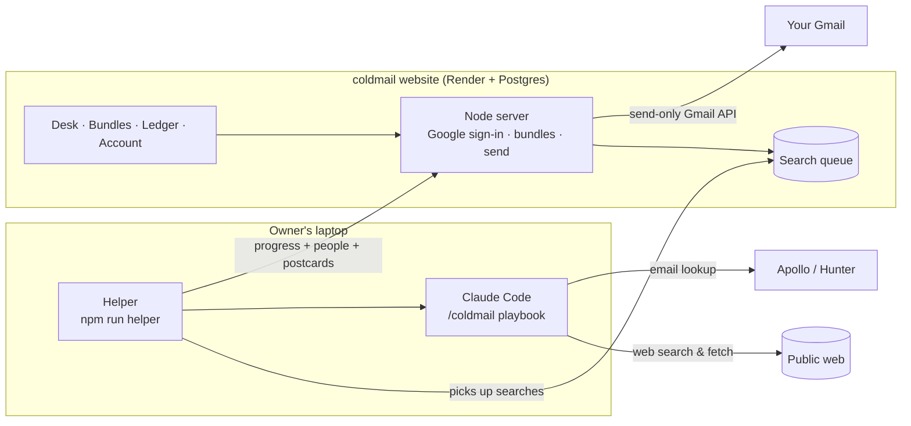

<div align="center">

# coldmail <sup>डाक</sup>

**Personal cold emails, hand-delivered.**
Upload your resume, name the role you want. coldmail finds the right people, writes each one a personal email that features the parts of your resume that match their work, and sends it from your own Gmail after you review it.

**[▶ Try the live demo](https://coldmail-cpw0.onrender.com/?demo)** · [Website](https://coldmail-cpw0.onrender.com) · [How it works](#how-it-works) · [Run it yourself](#run-it-yourself)


</div>

## Why I built it

Looking for a product-management internship, I hit the same wall every time. Finding the right people to email took hours, writing a genuinely personal email to each took longer, and then came copying, pasting and re-attaching my resume, one email at a time. Most "AI cold email" tools solve this by blasting generic messages. I wanted the opposite: fewer, better emails, each one about the person reading it, with me approving every word before it goes out.

I use coldmail for my own outreach.

## What it does

1. **Reads your resume** into a structured profile: projects, experience and skills, each tagged by topic (security, fintech, ML, drones…).
2. **Researches people** for the role you describe. It searches the web for hiring managers, team leads and founders, confirms they currently hold the role, and records **sources** and specific **hooks** for each (something they built, wrote or said).
3. **Finds their email** in order of trust: written publicly on a page → Apollo → Hunter (verified) → name-pattern guess, each labelled so you know how sure it is.
4. **Writes each email** around that person: it opens with their hook and features the 1–2 resume items closest to their work (your security project for the security lead, your growth result for the growth PM).
5. **You review** every postcard on the desk: edit, approve or set aside.
6. **Sends from your Gmail** with your resume attached and your signature added, and logs it so you never email the same person twice.

Need more people for the same role? **+ add people** grows the bundle without touching anything you've already edited.

## Screenshots

| | |
|---|---|
|  |  |
| **Landing**: an Indian air-mail poster | **Tracker**: each search moves along a Speed Post route |
|  |  |
| **Bundles**: one stack of postcards per role | **Ledger (बही)**: everything you've sent |
|  |  |
| **Account**: every setting is a little postcard | **On a phone** |

The design borrows from Indian picture postcards and stamps: air-mail stripes, "पोस्ट कार्ड" headers, perforated "भारत INDIA" stamps with folk motifs (rangoli, lotus, peacock feather, paisley, Warli), ink postmarks that land when you approve, and a book-style index to flip through people.

## How it works



- **The research is an AI agent.** Claude follows a written playbook: confirm each person from a real page, collect hooks and sources, never invent people, facts or emails. A validation script checks its output before anything reaches you.
- **Searches run on the owner's laptop, and the website stays online.** Hosting the AI on a server costs money per search, so the website queues searches and a small helper on the laptop runs them with Claude Code, streaming progress back. Reviewing and sending work from anywhere, laptop on or off.
- **Every bundle edit happens under a database row lock,** so a search adding people never overwrites a card you're editing.
- **Gmail access is send-only,** requested only when you connect it, with the token encrypted at rest. Nothing is sent until you approve a postcard and confirm.
- **Visitors get a demo** of made-up people that runs entirely in the browser. Real use is invite-only.

More detail: [ARCHITECTURE.md](ARCHITECTURE.md) (laptop edition) and [ARCHITECTURE.md on `product`](https://github.com/shataksha45-shiiii/Cold-Mail/blob/product/ARCHITECTURE.md) (website).

## Design decisions

| Problem | Decision |
|---|---|
| Fully automatic cold email is spam | A person reviews every email; daily send cap of 50; it's personalised or it isn't sent |
| AI-guessed emails bounce | Trust order with labels: public (with source) → verified → likely → guessed |
| AI can make things up | Every person and hook carries a source URL you can open; the output is schema-checked |
| Paying per search for AI isn't sustainable for a student | Hybrid: the hosted website plus a laptop worker on an existing Claude plan, so hosting is $0 |
| A search and the user edit the same bundle | Row-locked merges; new people only ever appended; approved cards never touched |
| Gmail permissions are sensitive | Send-only scope, incremental consent, encrypted tokens, one-click disconnect and account deletion |

## Tech stack

- **AI:** Claude (Claude Code headless on the laptop; Claude API agent with web search/fetch and tool use as an alternative on the server)
- **Backend:** Node.js (no framework), PostgreSQL ([Neon](https://neon.tech)), [PGlite](https://pglite.dev) for local development
- **Integrations:** Google OAuth 2.0 + Gmail API, Hunter, Apollo
- **Frontend:** vanilla HTML, CSS and JavaScript; View Transitions; hand-drawn SVG motifs
- **Hosting:** Render (free tier)

## Two editions

| Branch | What it is |
|---|---|
| **`main`** (this one) | **Laptop edition.** Runs locally with Claude Code; approved emails go to Gmail **Drafts**. Also contains the **helper** that runs searches for the website. Setup: [docs/laptop-setup.md](docs/laptop-setup.md) |
| **[`product`](https://github.com/shataksha45-shiiii/Cold-Mail/tree/product)** | **Website edition** (live at [coldmail-cpw0.onrender.com](https://coldmail-cpw0.onrender.com)). Multi-user: Google sign-in, Postgres, sends from your Gmail, demo mode. Deploy guide: [DEPLOY.md](https://github.com/shataksha45-shiiii/Cold-Mail/blob/product/DEPLOY.md) |

## Run it yourself

**Laptop edition** (needs Node 22.9+ and Claude Code):

```bash
git clone https://github.com/shataksha45-shiiii/Cold-Mail.git
cd Cold-Mail
npm run review
```

Then follow [docs/laptop-setup.md](docs/laptop-setup.md) to connect Gmail and, optionally, Hunter and Apollo.

**Website edition:** check out the `product` branch and follow [DEPLOY.md](https://github.com/shataksha45-shiiii/Cold-Mail/blob/product/DEPLOY.md). It runs entirely on free tiers (Render + Neon + Google OAuth in testing mode).

## Project structure (this branch)

```
.claude/commands/coldmail.md   the research-and-writing playbook Claude follows
lib/        emailFinder (Apollo → Hunter → pattern), mime (emails + attachments),
            google (OAuth + drafts), runs (headless Claude Code), store (data files)
scripts/    status, check, find-emails, merge, drafts, auth, helper
server/     local review app: review.js + public/ (the postcard UI)
data/       your resume, profile, bundles and history (gitignored)
docs/       setup guide and screenshots
```

## Privacy

Laptop edition: everything stays on your machine, in `data/`. Website: your data is scoped to your account, Gmail is send-only, and you can delete your account and all its data at any time. See the [privacy policy](https://coldmail-cpw0.onrender.com/privacy).

## Roadmap

- [ ] Google verification for the Gmail permission, so anyone can sign up (needs a custom domain)
- [ ] Reply tracking and follow-up reminders in the ledger
- [ ] Per-bundle stats: reply rate by role and company type

## Acknowledgements

Built with [Claude Code](https://claude.com/claude-code) as a pair-programmer. The product decisions, design direction and day-to-day use are mine.

## License

[MIT](LICENSE)
