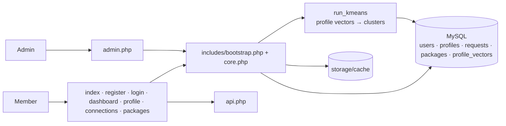

<div align="center">


# 💍 Wedlock Matrimony

### PHP-first matrimonial platform with K-means smart matching, moderation and membership plans

      

[](LICENSE)    

[](https://codespaces.new/shiroonigami23-ui/Wedlock?quickstart=1) [](https://github.com/shiroonigami23-ui/Wedlock/archive/refs/heads/main.zip)

[**🚀 Live Demo**](https://sobran.lovestoblog.com) · [**Overview**](#-overview) · [**Features**](#-features) · [**Architecture**](#-architecture) · [**Getting Started**](#-getting-started) · [**Roadmap**](#-roadmap)

</div>

---

## 📖 Overview

**Wedlock** is a matrimonial platform built to run on free shared hosting such as **InfinityFree**. Members register,
build an editable profile and bio, and receive **smart match suggestions** computed with **unsupervised K-means clustering**
over profile vectors. Admins moderate every profile before it goes live, manage membership packages and site imagery,
and members exchange **connection requests**. Heavy match queries are accelerated with a file cache, and a GitHub Actions
workflow packages **APK and EXE** wrappers.

### ✨ Highlights

- **K-means matching** — profiles vectorised and clustered (`run_kmeans`) to suggest compatible members
- **Admin moderation** — approve / reject profiles before they're visible
- **Membership packages** with payment-confirmation flow
- **Fast on free hosting** — file-cache acceleration + skeleton loaders

## 🧩 Features

| Feature | What it does |
|---|---|
| **Accounts** | Register, login, logout |
| **Profile** | Editable profile, about and bio (`profile.php`) |
| **Smart matching** | K-means style clustering of profile vectors stored in `profile_vectors` |
| **Connections** | Send / accept / decline requests (`connections.php`) |
| **Packages** | Plans and subscription activation (`packages.php`) |
| **Admin panel** | Moderation, plans and site settings incl. template images (`admin.php`) |
| **Support** | Direct owner contact via WhatsApp (`contact.php`) |
| **Performance** | File cache in `storage/cache`, skeleton/loading animations |
| **Apps** | Desktop (Electron) wrapper + release workflow for APK/EXE |

## 🛠 Tech Stack

| Layer | Technology |
|---|---|
| Backend | PHP 8+ (`includes/core.php`, `bootstrap.php`) |
| Database | MySQL / MariaDB |
| Front-end | Vanilla JS + CSS |
| Packaging | Electron desktop wrapper, GitHub Actions release |
| Hosting | InfinityFree |

## 🏗 Architecture

Page scripts share a bootstrap/core layer; matching runs as a clustering job over profile vectors.



➡️ Full design notes, data flow and design decisions: **[docs/ARCHITECTURE.md](docs/ARCHITECTURE.md)**

## 📁 Project Structure

```text
Wedlock/
├── index.php · register.php · login.php · logout.php
├── dashboard.php · profile.php · connections.php · packages.php · contact.php
├── admin.php · api.php
├── includes/       # bootstrap.php, core.php, layout.php, config.local.sample.php
├── assets/         # app.js, style.css
├── database/schema.sql
├── storage/cache/
└── desktop/        # Electron wrapper
```

## 🚀 Getting Started

### Prerequisites

- PHP 8+ and MySQL/MariaDB

### 1. Get the code

Pick whichever method suits you:

| Method | Command |
|---|---|
| **HTTPS** | `git clone https://github.com/shiroonigami23-ui/Wedlock.git` |
| **SSH** | `git clone git@github.com:shiroonigami23-ui/Wedlock.git` |
| **GitHub CLI** | `gh repo clone shiroonigami23-ui/Wedlock` |
| **ZIP** | [Download](https://github.com/shiroonigami23-ui/Wedlock/archive/refs/heads/main.zip) and extract |
| **Codespaces** | [Open in browser](https://codespaces.new/shiroonigami23-ui/Wedlock?quickstart=1) — zero local setup, dev container preconfigured |

> 🔑 **Using SSH for the first time?** Generate a key with `ssh-keygen -t ed25519 -C "you@example.com"`, add the `.pub` contents at **GitHub → Settings → SSH and GPG keys**, then test with `ssh -T git@github.com`.

### 2. Install & set up

```bash
cd Wedlock
cp includes/config.local.sample.php includes/config.local.php   # DB credentials
# import database/schema.sql
```

### 3. Run

```bash
php -S localhost:8000      # open http://localhost:8000
```

## 🎮 Usage

1. Register and complete your profile and bio.
2. Wait for admin approval — then your profile becomes discoverable.
3. Open the dashboard to see suggested matches from your cluster.
4. Send connection requests; accept or decline incoming ones.
5. Upgrade via **Packages** for premium features.

## 🗺 Roadmap

**v1 — Platform (done)**

- [x] Accounts, profiles, moderation
- [x] K-means matching and connection requests
- [x] Packages, admin settings, caching
- [x] Live deployment + APK/EXE packaging

**v1.1 — Trust & safety**

- [ ] Photo verification and ID-check workflow
- [ ] Report / block users and rate-limit messages
- [ ] CSRF tokens and audit log on admin actions

**v1.2 — Better matching**

- [ ] Preference weights (location, community, education, lifestyle)
- [ ] Explainable match score ("why we matched you")
- [ ] In-app chat after mutual acceptance

**v2.0 — Growth**

- [ ] Online payments, multilingual UI (Hindi/English), notification emails

➡️ Detailed plan, milestones and long-term vision: **[docs/ROADMAP.md](docs/ROADMAP.md)**

## 🤝 Contributing

Contributions, issues and feature requests are welcome!

1. Fork the repository
2. Create a feature branch: `git checkout -b feature/amazing-feature`
3. Commit your changes: `git commit -m "feat: add amazing feature"`
4. Push the branch: `git push origin feature/amazing-feature`
5. Open a Pull Request against `main`

Check the [issues page](https://github.com/shiroonigami23-ui/Wedlock/issues) and the [roadmap](docs/ROADMAP.md) for ideas on where to help.

## 📜 Changelog

See [CHANGELOG.md](CHANGELOG.md) for the release history.

## 📄 License

Distributed under the **MIT** license. See [LICENSE](LICENSE) for details.

## 👤 Author

**Aryan Singh Chandel** (Shiro)

[](https://github.com/shiroonigami23-ui)

<div align="center">

⭐ **If you find this project useful, consider giving it a star!** ⭐

</div>
