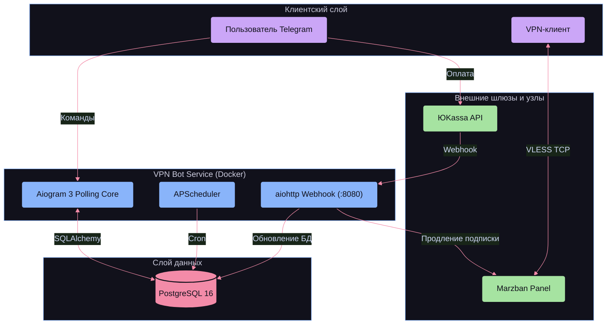

# VPN Bot & Infrastructure Gateway

> Полнофункциональный сервис автоматизации продажи и управления персональными VPN-подписками на базе протокола **VLESS TCP Reality (Xray-core)** через панель **Marzban** с приемом платежей через **ЮKassa** и веб-порталом клиента.

---

## Дисклеймер проекта (AI-Assisted Product)

> [!NOTE]
> Данный проект разработан в формате **AI-Assisted Infrastructure Product** (быстрое прототипирование и запуск MVP с использованием современных AI-инструментов).
> 
> * **Основной фокус:** Проектирование системной архитектуры, построение отказоустойчивых интеграций между разрозненными сервисами (Telegram Bot, YooKassa API, Marzban REST API, PostgreSQL, Docker), реализация DevSecOps-практик и сквозной автоматизации бизнес-процессов.
> * **Генерация кода:** Кодовая база на Python/Aiogram и сопутствующие шаблоны сформированы с привлечением AI под строгим контролем архитектурных паттернов, типизации и требований безопасности.

---

## Что умеет платформа

* **Автоматический онбординг:** Мгновенная регистрация пользователя в Telegram, автоматическое создание конфигурации в узле Marzban и выдача бесплатного ознакомительного триал-периода.
* **Платежный шлюз (ЮKassa):**
  * Генерация динамических счетов на оплату через официальный API ЮKassa.
  * Асинхронный HTTP Webhook-сервер на базе `aiohttp`.
  * **Защита от подмены (Anti-Spoofing):** Проверка криптографической подписи HMAC SHA-256 + обязательный контрольный запрос актуального статуса платежа напрямую к API ЮKassa перед активацией.
  * **Идемпотентность:** Защита от дублирования транзакций и повторной выдачи услуг на уровне схемы базы данных.
* **Оркестрация VPN-узлов (Marzban API):**
  * Создание пользователей с протоколом `VLESS TCP REALITY`.
  * Динамическое управление сроком действия ключей (time-to-live) и лимитами трафика (автопродление квоты 500 ГБ).
  * Автоматическая генерация универсальных ссылок подписки (`subscription_url`).
* **Фоновый мониторинг (APScheduler):** Ежедневный автоматический скоринг базы данных на предмет истекающих подписок (за 3 дня, 1 день и в день окончания) с отправкой персонализированных напоминаний в чат.
* **Административный модуль:**
  * Защита роутов через кастомные `AdminMiddleware` по белому списку `ADMIN_IDS`.
  * Интерактивный конструктор рассылок с поддержкой Markdown-разметки, загрузкой/заменой медиафайлов и предпросмотром перед отправкой всей аудитории.
* **Кастомный Web-портал подписки ([`MarzbanTemplate`](./MarzbanTemplate)):**
  * Cyberpunk/Dark-mode адаптивный веб-интерфейс на базе Jinja2, Bootstrap 5 и Vanilla JS для отображения актуального баланса трафика и срока подписки.
  * Генерация динамического QR-кода прямо в браузере.
  * Готовые One-Click Deep Links для мобильных и десктопных клиентов (Happ, Incy, Streisand, v2rayNG, Sing-box, FoXray).

---

## Стек технологий

| Слой / Домен | Технология | Назначение |
| :--- | :--- | :--- |
| **Backend Framework** | [Python 3.11](https://www.python.org/) + [Aiogram 3.x](https://github.com/aiogram/aiogram) | Асинхронный фреймворк Telegram-бота, FSM, диспетчеризация событий |
| **HTTP Server** | [aiohttp 3.x](https://docs.aiohttp.org/) | Асинхронный обработчик входящих Webhook-уведомлений ЮKassa (порт 8080) |
| **Database & ORM** | [PostgreSQL 16](https://www.postgresql.org/) + [SQLAlchemy 2.0](https://www.sqlalchemy.org/) (`asyncpg`) | Реляционная база данных, асинхронный пул сессий, типизированные модели |
| **Data Validation** | [Pydantic v2](https://docs.pydantic.dev/) + `pydantic-settings` | Строгая валидация конфигурации окружения и маскирование секретов (`SecretStr`) |
| **Task Scheduling** | [APScheduler](https://github.com/agronholm/apscheduler) (`AsyncIOScheduler`) | Планировщик периодических фоновых задач проверки подписок |
| **Payment Gateway** | [YooKassa API](https://yookassa.ru/developers/api) (`yookassa` SDK) | Эквайринг (Банковские карты, СБП, SberPay) |
| **VPN Core & Node** | [Marzban REST API](https://github.com/Gozargah/Marzban) (Xray-core) | Управление VLESS/Shadowsocks пирами, генерация ключей и учет трафика |
| **Client Portal** | HTML5 / Bootstrap 5 / Jinja2 / Vanilla JS | Динамический веб-шаблон клиентской страницы подписки Marzban |
| **Containerization** | Docker, Docker Compose (Alpine images) | Изолированное развертывание сервиса от non-root пользователя |

---

## Архитектура системы



---

## Переменные окружения (`.env`)

Все параметры конфигурации вынесены в переменные окружения и типизированы через Pydantic Settings.

| Переменная | Обязательная | Описание | Пример значения |
| :--- | :---: | :--- | :--- |
| `BOT_TOKEN` | **Да** | Токен Telegram-бота от `@BotFather` | `1234567890:ABCdef...` |
| `MARZBAN_BASE_URL` | **Да** | Базовый URL панели Marzban | `https://vpn.example.com:8443` |
| `MARZBAN_USERNAME` | **Да** | Логин администратора панели Marzban | `admin` |
| `MARZBAN_PASSWORD` | **Да** | Пароль администратора Marzban | `StrongSecretPassword` |
| `MARZBAN_VLESS_INBOUND_TAG`| Нет | Тег входящего VLESS-подключения | `VLESS TCP REALITY` *(дефолт)* |
| `DATABASE_URL` | **Да** | DSN подключения к базе данных PostgreSQL | `postgresql+asyncpg://vpn_user:password@db:5432/vpn_bot` |
| `YOOKASSA_SHOP_ID` | **Да** | Идентификатор магазина ЮKassa | `123456` |
| `YOOKASSA_SECRET_KEY` | **Да** | Секретный ключ API (Test или Live) | `test_...` / `live_...` |
| `YOOKASSA_RETURN_URL` | Нет | Ссылка на возврат пользователя после оплаты | `https://t.me/your_vpn_bot` |
| `ADMIN_IDS` | Нет | Список Telegram ID администраторов через запятую | `123456789,123456789` |
| `PROXY_URL` | Нет | Прокси для обращения к API Telegram (SOCKS5/HTTP) | `socks5://127.0.0.1:10808` |
| `PARTNER_IDS` | Нет | Telegram ID партнеров с повышенной комиссией | `123456789` |
| `REFERRAL_MIN_WITHDRAWAL` | Нет | Минимальный порог вывода средств (руб.) | `500` |

Шаблон для создания файла доступен в [`.env.example`](./.env.example).

---

## Быстрый старт

### Требования
* Docker & Docker Compose (v2+)
* Установленная и настроенная панель [Marzban](https://github.com/Gozargah/Marzban) с входящим протоколом VLESS
* Токен Telegram-бота и магазин в ЮKassa

### 1. Клонирование и настройка окружения
```bash
git clone https://github.com/<your-username>/VPN_BOT.git
cd VPN_BOT

# Создание конфигурационного файла на основе шаблона
cp .env.example .env
nano .env  # Укажите реальные токены и реквизиты
```

### 2. Запуск через Docker Compose (Рекомендуемый способ)
```bash
# Сборка и фоновый запуск контейнеров бота и базы данных
docker compose up -d --build

# Просмотр логов работы сервиса
docker compose logs -f bot
```

### 3. Настройка Nginx для Webhook ЮKassa
Для безопасного приема вебхуков от ЮKassa настройте reverse-proxy на порт `8080`:

```nginx
server {
    server_name vpn-api.example.com;

    location /webhook/yookassa {
        proxy_pass http://127.0.0.1:8080/webhook/yookassa;
        proxy_set_header Host $host;
        proxy_set_header X-Real-IP $remote_addr;
        proxy_set_header X-Forwarded-For $proxy_add_x_forwarded_for;
    }
}
```

---

## Локальная разработка и миграции

### Запуск в виртуальном окружении
```bash
python3.11 -m venv .venv
source .venv/bin/activate
pip install -r requirements.txt

# Запуск сервиса
python -m bot.main
```

### Бесшовная миграция данных (SQLite ➡️ PostgreSQL)
Если первоначальный прототип работал на локальной базе SQLite (`vpn_bot.db`), в репозиторий включен автоматический скрипт переноса пользователей и связей:

```bash
python migrate_db.py
```

---

## Безопасность (DevSecOps Practices)

1. **Непривилегированный пользователь:** Контейнер Docker запускается от изолированного системного пользователя `botuser` (UID 1000) без прав root.
2. **Защита секретов в памяти:** Все критические токены обернуты в `pydantic.SecretStr`, исключающий случайный вывод секретов в логи, трассировки стека или дампы.
3. **Строгая валидация Webhook:** Вебхук ЮKassa защищен двойной проверкой:
   - Проверка криптографической контрольной суммы заголовка запроса по алгоритму `HMAC-SHA256`.
   - Прямой запрос `GET /v3/payments/{payment_id}` к серверам ЮKassa для подтверждения оригинальности статуса `succeeded` перед начислением подписки.
4. **Изоляция сети:** Порты PostgreSQL и Webhook забиндены исключительно на локальный интерфейс (`127.0.0.1`), доступ извне осуществляется только через обратный прокси с SSL/TLS.
