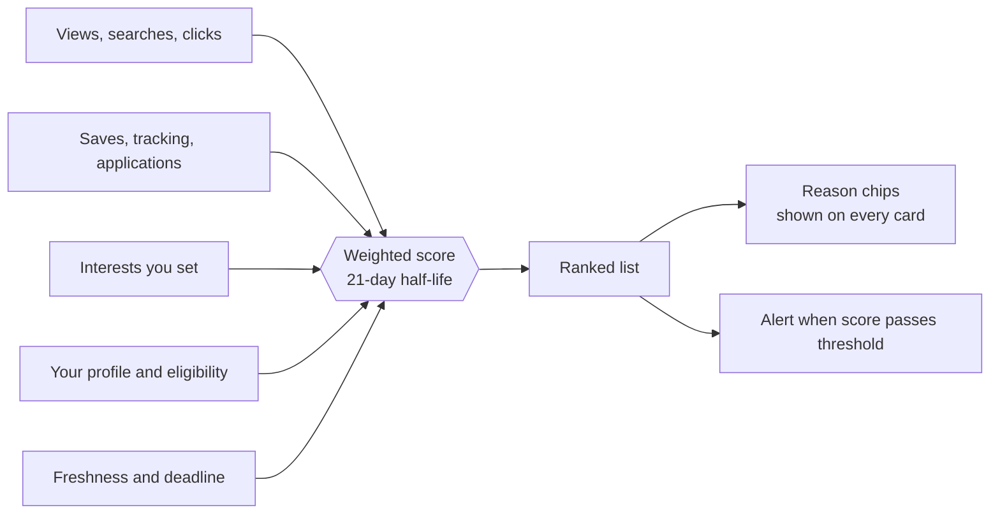
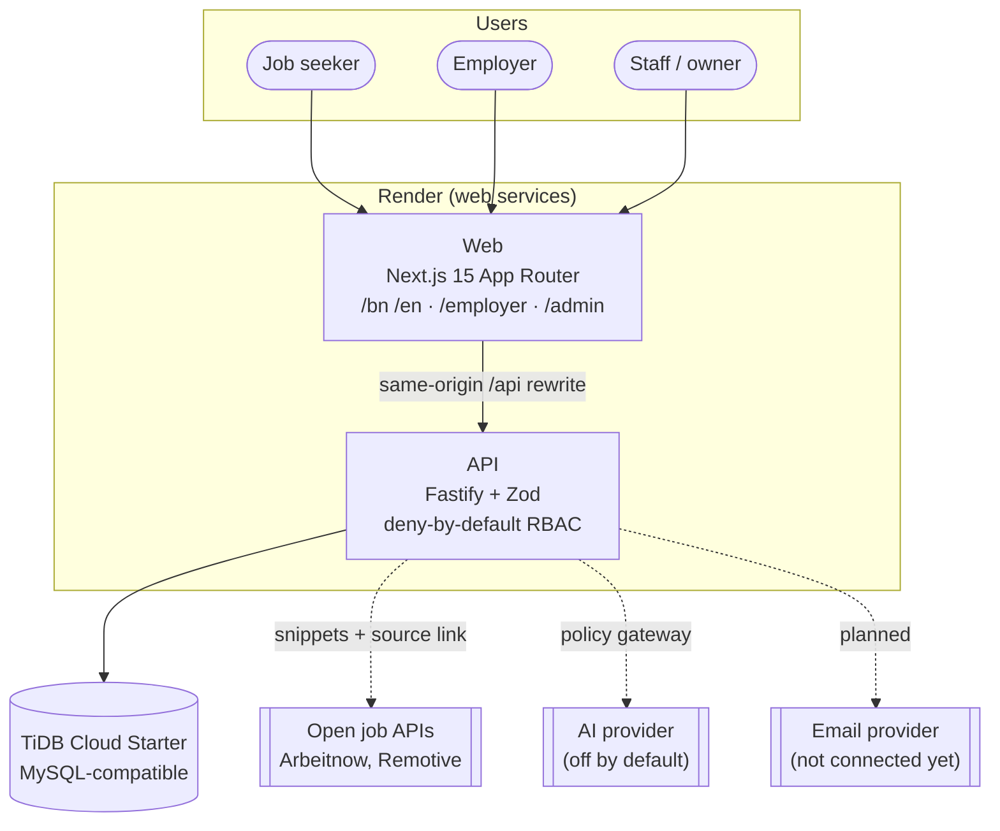
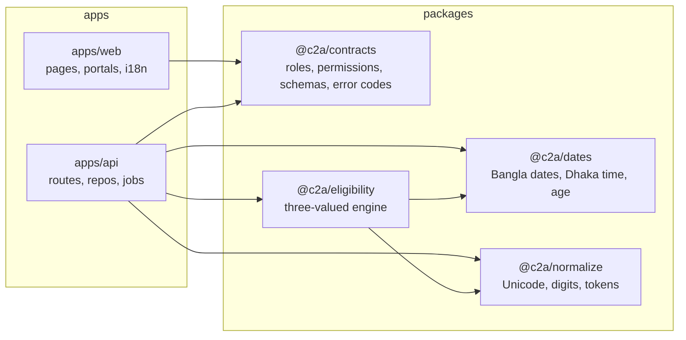
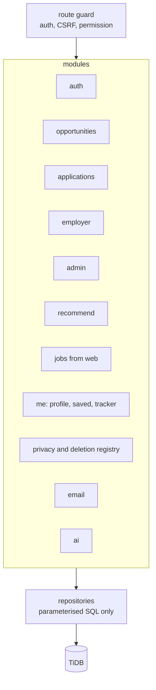
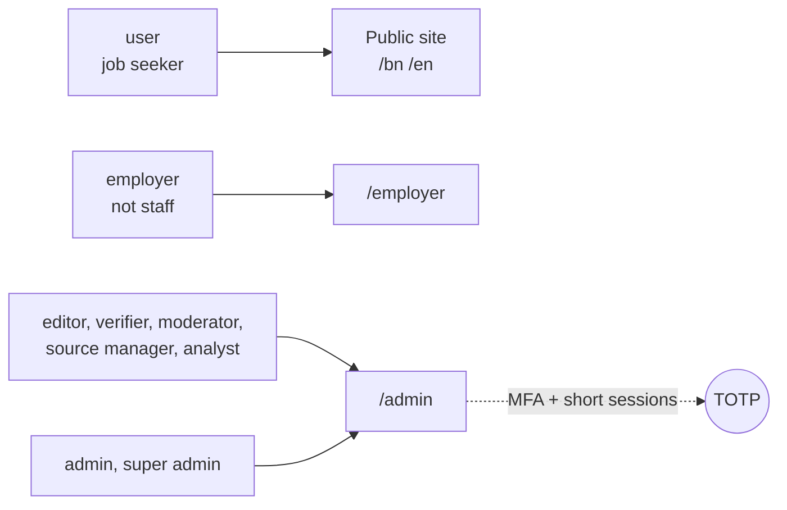
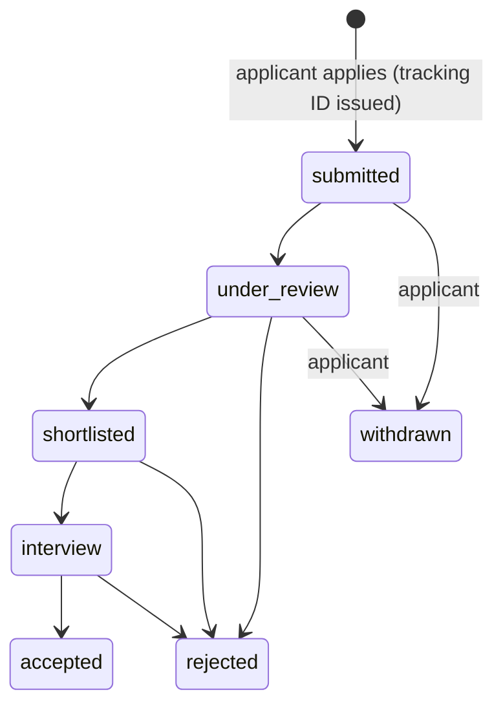
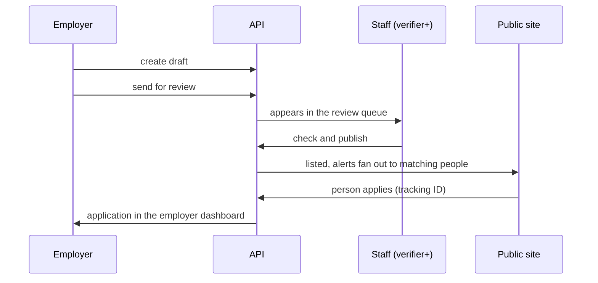

<div align="center">

# Circular2Action AI

**Verified circulars, explainable eligibility and application tracking for jobs, internships and scholarships in Bangladesh.**

[](https://github.com/souravsahapartho/Circular2Action-AI/actions/workflows/ci.yml)
[](https://github.com/souravsahapartho/Circular2Action-AI/actions/workflows/security.yml)


[Features](#features) · [Architecture](#architecture) · [Quick start](#quick-start) · [Security](#security-and-privacy) · [Testing](#testing) · [Deployment](#deployment) · [Docs](#documentation)

</div>

---

## Built by

[**Vantyr**](https://vantyr.sourav.com.bd/), a software company in Dhaka, Bangladesh. Software that leads the way.

## Why this exists

Government and private circulars in Bangladesh are scattered across PDFs, newspaper scans and agency sites. People miss
deadlines, cannot tell whether they qualify, and have no single place to apply and follow up.
Circular2Action puts a **verified** circular, a **deterministic eligibility check that shows its working**, and a
**tracked application** in one bilingual product.

## Features

| For                   | What you get                                                                                                                                                                                                                                                                                   |
| --------------------- | ---------------------------------------------------------------------------------------------------------------------------------------------------------------------------------------------------------------------------------------------------------------------------------------------- |
| **Job seekers**       | Bangla and English search with filters, **eligibility check that names every missing or failing requirement**, apply on the site and get a **tracking ID**, public Track page, tracker, saved items, deadline and match **alerts**, interests, **personalised "For you" ranking with reasons** |
| **Employers**         | Own portal at `/employer`: post jobs, internships and circulars, send them for staff review, **promote a post as Sponsored (demo plan)**, receive and handle applications, notifications (in the app and as phone push), company profile                                                       |
| **Staff / owner**     | Own portal at `/admin` with two-factor sign-in: verify and publish opportunities, handle applications (bulk status, CSV export), manage the web-jobs feed, suspend accounts, announcements, analytics dashboard, full audit log                                                                |
| **Everyone**          | Responsive on phones (drawer menu, card tables), accessible forms, Bangla digits and dates understood, no tracking of activity unless allowed                                                                                                                                                  |
| **Jobs from the web** | Listings from many open job feeds and company career pages (Jobicy, Remote OK, Himalayas, Greenhouse, Lever and more), shown as snippets with a clear **source label** and a link to the original, kept apart from verified circulars                                                          |

### How suggestions work (no black box)



Activity weights are view 1, search 1, click 1, save 3, track 4, apply 5. People can switch activity recording off or clear it, and it is deleted with
the account. See [ADR](docs/adr/README.md) for why this is a transparent score rather than a trained model.

## Architecture

### System context



### Containers and code layout



| Path                  | Purpose                                                                                                                                   |
| --------------------- | ----------------------------------------------------------------------------------------------------------------------------------------- |
| `apps/web`            | Next.js site: public pages in `/bn` and `/en`, English-only `/admin` and `/employer` portals, responsive CSS, drawer and card layouts     |
| `apps/api`            | Fastify API: auth, opportunities, applications, employer, admin, recommendations, jobs-from-web, privacy, notifications, queue, scheduler |
| `apps/api/migrations` | Ordered SQL migrations (`0001` to `0005`) applied by a small runner                                                                       |
| `packages/*`          | Shared, framework-free libraries with their own tests                                                                                     |
| `docs/`               | Status, plan addenda, decision records (ADR), spikes                                                                                      |
| `scripts/`            | Migration builder and checker, link crawler                                                                                               |

### API modules



### Roles and portals



### Application lifecycle



Every change notifies the applicant and is visible on the public **Track** page (which returns no personal data).

### Opportunity publishing



Employers can never publish directly. Staff publish after checking the post against its official source.

## Quick start

**Prerequisites:** Node.js 22+, pnpm 9 (`corepack pnpm@9.15.0 ...` needs no global install), Docker for the local database.

```bash
git clone https://github.com/souravsahapartho/Circular2Action-AI.git
cd Circular2Action-AI
corepack pnpm@9.15.0 install
docker compose up -d                      # local TiDB on 127.0.0.1:4100
cp .env.example .env.local                # then fill in local values
```

Apply migrations and run both apps (two terminals):

```bash
cd apps/api && corepack pnpm@9.15.0 migrate && corepack pnpm@9.15.0 seed && corepack pnpm@9.15.0 dev
```

```bash
cd apps/web && API_ORIGIN=http://127.0.0.1:4000 corepack pnpm@9.15.0 dev
```

Create the owner account (choose your own strong password, 12+ characters, set in `.env.local` as `ADMIN_EMAIL` and `ADMIN_PASSWORD`; it is never printed):

```bash
cd apps/api && corepack pnpm@9.15.0 create-admin
```

| URL                                    | What                                    |
| -------------------------------------- | --------------------------------------- |
| `http://localhost:3000/en`             | Public site (English); `/bn` for Bangla |
| `http://localhost:3000/employer/login` | Employer portal                         |
| `http://localhost:3000/admin/login`    | Staff portal (needs authenticator app)  |

## Security and privacy

- **Authentication:** Argon2id passwords (min 8 with lower, upper and special character; admins 12+), opaque cookie sessions, staff **TOTP two-factor** and short staff sessions.
- **Requests:** signed double-submit **CSRF** token plus Origin check, strict Zod validation, parameterised SQL only, rate limits on sign-in, track lookup, applications and employer posts.
- **Authorisation:** every route is registered through a deny-by-default guard that names its required permission; employers see only their own posts and applications.
- **Privacy:** activity recording can be switched off or cleared; a **deletion registry test** scans every migration so no table holding personal data can be forgotten when an account is deleted; no personal data on the public Track page.
- **Supply chain and secrets:** secrets live only in platform environment settings; `.env*` is git-ignored; gitleaks and dependency audit run in CI.
- **Reporting a vulnerability:** see [SECURITY.md](SECURITY.md).

## Testing

```bash
corepack pnpm@9.15.0 -r typecheck
corepack pnpm@9.15.0 -r test                              # unit tests
cd apps/api && corepack pnpm@9.15.0 test:db               # integration tests on a real TiDB
corepack pnpm@9.15.0 exec eslint . && corepack pnpm@9.15.0 exec prettier --check .
node scripts/crawl-links.mjs http://localhost:3000        # follow every internal link, report errors
```

| Suite                            | Count (last run) |
| -------------------------------- | ---------------- |
| API unit                         | 187              |
| Eligibility engine               | 73               |
| Dates, normalize, contracts, web | 57               |
| TiDB integration (`test:db`)     | 88               |

Integration tests run against TiDB (never plain MySQL) because the product depends on TiDB behaviour such as `AUTO_RANDOM` ids and case-sensitive `LIKE`.

## Deployment

| Piece     | Where                            | Notes                                                                         |
| --------- | -------------------------------- | ----------------------------------------------------------------------------- |
| Web + API | Render (auto-deploy from `main`) | Free tier sleeps when idle; first request can take a minute                   |
| Database  | TiDB Cloud Starter               | Migrations are applied manually: `pnpm migrate` with `DATABASE_MIGRATION_URL` |
| CI        | GitHub Actions                   | `ci` (lint, types, unit, DB) and `security` (secret and dependency scans)     |

## Tech stack

TypeScript everywhere · Next.js 15 (App Router) · Fastify · Zod · mysql2 · TiDB · Argon2 · Vitest · ESLint + Prettier · pnpm workspaces · GitHub Actions · Render.

## Documentation

| Document                                                                   | What                                   |
| -------------------------------------------------------------------------- | -------------------------------------- |
| [docs/STATUS.md](docs/STATUS.md)                                           | What is built, verified, and not done  |
| [docs/PLAN_v1.2_PORTAL.md](docs/PLAN_v1.2_PORTAL.md)                       | Portal, applications and web-jobs plan |
| [docs/adr/README.md](docs/adr/README.md)                                   | Decision records                       |
| [CIRCULAR2ACTION_MASTER_PLAN_v1.1.md](CIRCULAR2ACTION_MASTER_PLAN_v1.1.md) | Master plan (source of truth)          |
| [Readiness report](CIRCULAR2ACTION_IMPLEMENTATION_READINESS_REPORT.md)     | Audit that produced v1.1               |

## Known limits

No email provider yet (verification and digests are off), no scheduler on the free tier, no file uploads, AI features disabled, company verification has no staff screen yet.
See [docs/STATUS.md](docs/STATUS.md) for the honest, current list.

## Contributing

Small commits, tests with every change, lint and format must pass, never commit secrets. Open an issue before large changes.

## License

No license has been chosen yet, so all rights are reserved by the author until one is added.
