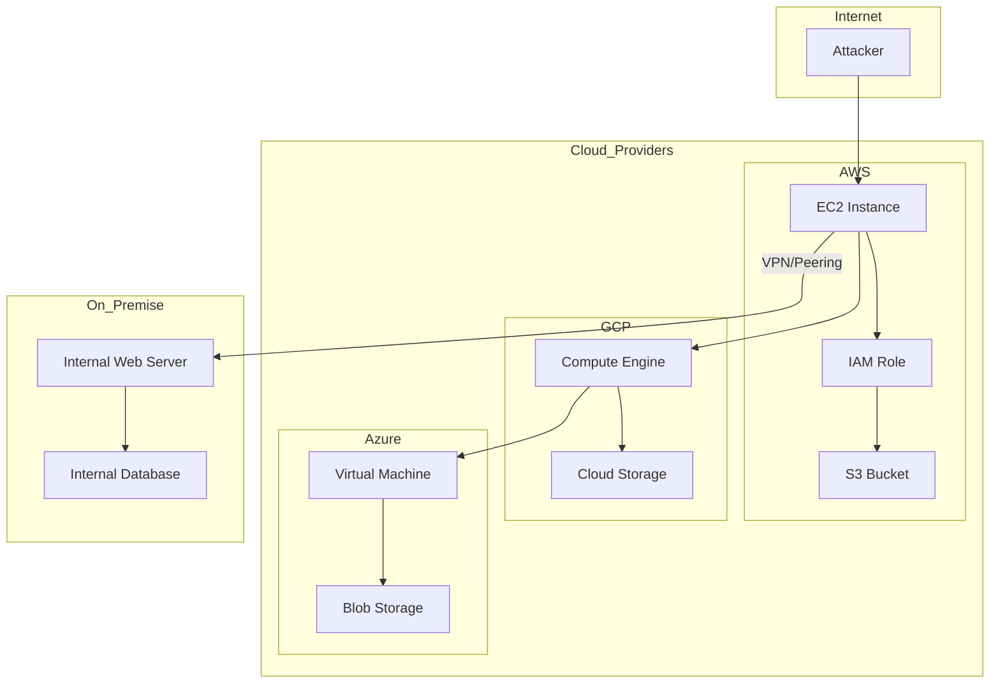
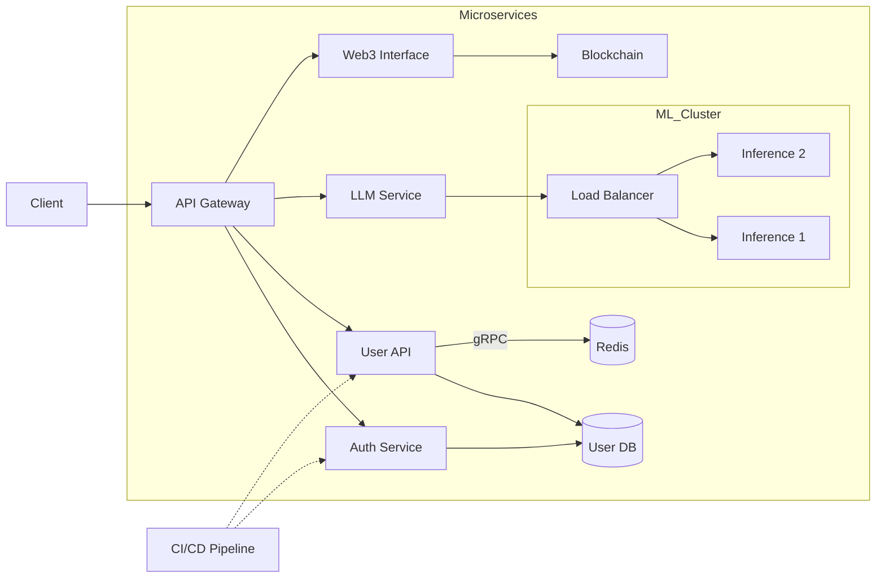

# 🚀 secMONSTER - Advanced Security Assessment & Exploitation Framework
# under development 
<p align="center">
  
</p>

<p align="center">
  
  
  
  
  
  
</p>

---

📖 What secMONSTER Actually Provides

secMONSTER is a comprehensive, working penetration testing framework that provides:

🔍 Vulnerability Discovery & Assessment

Feature What It Does Real-World Application
150+ Attack Vectors Scans for security vulnerabilities across web apps, APIs, cloud, containers, and emerging tech Find XSS, SQLi, RCE, SSRF, LFI, command injection, SSTI, XXE, NoSQL injection, and more
WAF/CDN Detection Identifies security layers (Cloudflare, AWS WAF, ModSecurity, Fastly, Akamai) Adapt testing strategy to bypass security controls
Technology Fingerprinting Detects server-side (PHP, ASP.NET, Java, Node.js) and client-side (React, Angular, Vue) technologies Tailor payloads based on detected tech stack
Security Headers Analysis Checks for missing security headers (HSTS, X-Frame-Options, CSP, etc.) Identify misconfigurations that lead to clickjacking, MIME sniffing, or SSL stripping
CSP (Content Security Policy) Testing Evaluates CSP implementation for weaknesses Find unsafe-inline/unsafe-eval usage that allows XSS

📊 Detailed Vulnerability Reports

Feature What It Provides Format
CVE Mapping Associates findings with known CVE identifiers Database references
CWE Classification Maps vulnerabilities to Common Weakness Enumeration Standardized classification
OWASP Top 10 Categorizes findings by OWASP categories Compliance reporting
CVSS Scoring Calculates CVSS severity scores Risk prioritization
Risk Level Classification Critical/High/Medium/Low/Info Actionable prioritization
Confidence Scoring Percentage confidence in detection (70-100%) False positive reduction
Timestamps & Metadata When and how vulnerabilities were found Audit trail

🛠️ Exploitation Capabilities

Feature What It Does Output
Exploitation Guides Step-by-step exploitation instructions with commands Detailed walkthrough for each vulnerability
Attack Chain Visualization Shows progression from initial foothold to full compromise Visual diagrams (XSS→Session Hijacking→RCE)
Tool Recommendations Specific tools for each vulnerability type Nmap, SQLMap, Metasploit, Burp Suite, etc.
Reverse Shell Payloads Pre-built reverse shell commands (Python, Bash, Netcat, PHP, Perl, Ruby) Ready-to-use commands
Privilege Escalation Windows/Linux privilege escalation techniques LinPEAS, WinPEAS, kernel exploits
Persistence Methods Cron jobs, systemd, registry keys, SSH keys Persistence establishment
Lateral Movement Techniques to move within networks CrackMapExec, PsExec, WMI
Data Exfiltration Methods to extract data DNS, HTTPS, SCP, AWS CLI
Cover Tracks Log wiping, history clearing Stealth techniques

☁️ Cloud & Infrastructure Testing

Feature What It Tests Real-World Attack
AWS Metadata SSRF Tests for http://169.254.169.254/latest/meta-data/ access AWS credential theft
GCP Metadata SSRF Tests for http://metadata.google.internal/ access GCP service account compromise
Azure Metadata SSRF Tests for http://169.254.169.254/metadata/instance access Azure MSI token theft
Kubernetes API Exposure Tests /api/v1/pods, /api/v1/secrets endpoints K8s cluster compromise
Container Escape Tests /host/, /proc/1/root paths Host system compromise
AWS S3 Bucket Enumeration Tests S3 bucket access Data breach
AWS IAM Credential Theft Extracts IAM credentials from metadata Full AWS account compromise
Cloud Service Detection Identifies cloud provider Tailored exploitation

🔐 Authentication & JWT Testing

Feature What It Tests Attack Type
JWT None Algorithm Tests for alg:none vulnerability Authentication bypass
JWT Algorithm Confusion Tests RS256→HS256 confusion Session hijacking
JWT KID Path Traversal Tests kid:../../../../etc/passwd File read
JWT Claim Injection Tests admin:true claim Privilege escalation
OAuth CSRF Tests state parameter validation Session fixation
OAuth Redirect Bypass Tests redirect_uri validation Open redirect
Auth Bypass Methods Tests X-Forwarded-For, X-Original-URL, X-Rewrite-URL Admin bypass
Basic Auth Testing Tests username/password combinations Credential validation

🌐 Network & Protocol Testing

Feature What It Tests Protocol
HTTP/2 Exploitation Header injection, settings, priority, window, stream attacks HTTP/2
WebSocket Security Origin bypass, XSS, SQLi, CMDi injection WebSocket
DNS Rebinding DNS rebinding attacks DNS
DNS Cache Poisoning DNS cache injection DNS
WebRTC IP Leak Tests WebRTC for IP disclosure WebRTC
QUIC Protocol Testing QUIC downgrade and header attacks QUIC
WebTransport Security Header and stream abuse WebTransport
Slowloris DoS Tests Slowloris vulnerability HTTP

🤖 AI & Emerging Tech Testing

Feature What It Tests Impact
LLM Prompt Injection Tests "Ignore previous instructions" attacks AI system compromise
LLM Chain of Thought Extracts reasoning and training data Information disclosure
LLM Memory Poison Injects malicious memory into LLM sessions Persistent manipulation
AI Model Extraction Extracts model architecture and training data IP theft
AI Training Data Poison Tests training data manipulation Model corruption
Web3 Smart Contracts Tests contract exposure and ABI access Smart contract exploit
Web3 Wallet Security Tests wallet connection vulnerabilities Cryptocurrency theft
DeFi Flash Loan Tests DeFi manipulation Financial loss

📡 OOB (Out-of-Band) Detection

Feature What It Does Purpose
Callback Server Runs HTTP server on configurable port (default: 8888) Receive blind injection callbacks
Unique Callback IDs Generates unique IDs for each test Track vulnerability verification
Timeout Detection Waits for callback with configurable timeout (default: 60s) Validate blind vulnerabilities
Callback Logging Logs all received callbacks with metadata Audit and verification
OOB Payload Generation Creates payloads that call back SSRF, SQLi, XXE, CMDi verification

🛡️ Defense & Mitigation Guides

Feature What It Provides Target
Web Application Defense WAF, CSP, headers, input validation, output encoding Web apps
API Security OAuth2/OIDC, JWT best practices, rate limiting APIs
Container Security Minimal images, vulnerability scanning, runtime security Containers
Kubernetes Security RBAC, network policies, pod security, secrets encryption K8s
Zero Trust Architecture MFA, micro-segmentation, continuous validation Networks
Cloud Security IAM best practices, monitoring, encryption Cloud providers
Database Security Parameterized queries, least privilege, encryption Databases

📊 Reporting & Output Formats

Format What It Provides Use Case
JSON All data in structured format Automation, programmatic analysis
CSV Flat file with key metrics Spreadsheet analysis, metrics
HTML Interactive report with exploitation guides Stakeholder presentation
SQLite Database Persistence for all findings Querying, trend analysis
Console Output Real-time progress and findings Live monitoring

🚀 Performance & Scalability

Feature Specification Benefit
Multi-threading Configurable workers (default: 10) Parallel scanning
Rate Limiting Configurable requests/sec (default: 50) Avoid detection
Connection Pooling Configurable connection limits Resource optimization
Cache System 10,000 items TTL 600s Performance improvement
Queue System 100,000 task queue Large-scale scanning
Proxy Rotation Support for proxy lists Bypass IP restrictions
Timeout Control Configurable timeouts Adapt to slow responses

📦 Built-in Tools Database

Category Tools Included Purpose
Information Gathering Nmap, Recon-ng, Gobuster, Sublist3r, theHarvester, Shodan, Censys, Amass, Masscan, WhatWeb Reconnaissance
Web Application Burp Suite, OWASP ZAP, SQLMap, XSStrike, Nuclei, Nikto, WPScan, JoomScan, Wfuzz, FFUF Web testing
Exploitation Metasploit, Searchsploit, BeEF, Nishang, Empire, Cobalt Strike Exploitation
Privilege Escalation LinPEAS, WinPEAS, Linux Exploit Suggester, Mimikatz, GTFOBins Privesc
Post-Exploitation PowerSploit, BloodHound, Rubeus, Responder, Netcat Post-exploit
Cloud Pacu, CloudEnum, ScoutSuite, AWS CLI, GCP CLI, Azure CLI Cloud testing
Mobile Frida, MobSF, Drozer, Objection, APKTool, Jadx Mobile testing
Wireless Aircrack-ng, Kismet, Wifite, Hashcat, BetterCap, Ettercap Wireless testing
Stealth & Evasion Veil, Shellter, Packers, ProxyChains, Tor Evasion
Persistence Cron jobs, Systemd, Registry, Scheduled Tasks, SSH Keys, Windows Services Persistence

<p align="center">
  
</p>

---

🔬 What secMONSTER Does NOT Do

· Does NOT automatically exploit vulnerabilities (it provides guides)
· Does NOT install malicious software on target systems
· Does NOT perform unauthorized attacks
· Does NOT steal or modify data
· Does NOT provide legal advice
· Does NOT include illegal or unethical hacking tools
· Does NOT bypass authentication without proper authorization
· Does NOT guarantee 100% detection rate (no tool does)

---

📋 Real-World Use Cases

1. Penetration Testing

```bash
# Full web app assessment
sudo python3 secmonster.py -u https://corporate-app.com --all -o pentest_report.html
```

Provides:

· Complete vulnerability scan
· Exploitation guides for each finding
· Risk scoring and prioritization
· Remediation recommendations

2. Bug Bounty Hunting

```bash
# Focused XSS and SQLi testing
python3 secmonster.py -u https://target.com --xss --sqli --xss-reflected --xss-stored
```

Provides:

· Fast detection of common vulnerabilities
· POC payloads for each finding
· Confidence scoring to reduce false positives

3. Cloud Security Assessment

```bash
# AWS/GCP/Azure security audit
sudo python3 secmonster.py -u https://cloud-app.com --aws-metadata --gcp-metadata --azure-metadata
```

Provides:

· Metadata endpoint exposure detection
· IAM credential theft vectors
· Cloud misconfiguration identification

4. API Security Testing

```bash
# Full API security assessment
python3 secmonster.py -u https://api.company.com --api --graphql-introspection --api-broken-auth
```

Provides:

· GraphQL introspection detection
· Broken object level authorization testing
· Mass assignment vulnerability detection
· API key exposure scanning

5. Container & Kubernetes Security

```bash
# K8s security audit
sudo python3 secmonster.py -u https://k8s-cluster.com --container --kubernetes --container-escape
```

Provides:

· Container escape vectors
· Kubernetes API exposure detection
· Secret and RBAC security assessment

6. AI/LLM Security Assessment

```bash
# LLM security testing
python3 secmonster.py -u https://ai-service.com --ai-prompt --llm-cot --llm-memory
```

Provides:

· Prompt injection detection
· Chain-of-thought extraction
· Memory poisoning vectors

7. Zero Trust Architecture Validation

```bash
# Zero Trust bypass testing
sudo python3 secmonster.py -u https://secure-app.com --zero-trust --auth --jwt-none
```

Provides:

· Authentication bypass detection
· JWT security assessment
· Authorization validation

--- 
🏛️ Network & Cloud Architecture Simulator

Models modern multi-cloud and hybrid network architectures for realistic attack simulation:



Key Features:

· Multi-cloud integration (AWS, GCP, Azure)
· Hybrid network topology modeling
· Traffic routing simulation
· Security control emulation
· Comprehensive API mocking
· Persistent data sessions

🔧 Application & Service Architecture Simulator

Models microservice architectures to identify injection points and logic flaws:



Key Features:

· API lifecycle management
· Microservices modeling with service mesh
· Dynamic dependency injection
· Modern backend models (Web3, AI/LLM, CI/CD)
· Service mesh security (mTLS, Istio, Envoy)


🚀 Installation & Quick Start

Prerequisites

· Python 3.11+
· pip3
· sudo/Administrator privileges (for full functionality)

Installation

```bash
# Clone repository
git clone https://github.com/sylhetyhackvenger/secMONSTER
cd secMONSTER

# Install dependencies
pip install -r requirements.txt
```

Quick Start

```bash
# Basic scan
sudo python3 secmonster.py -u https://target.com --all

# Generate HTML report
sudo python3 secmonster.py -u https://target.com --all -o report.html

# Scan multiple targets from file
sudo python3 secmonster.py -f targets.txt --all --workers 20
```

---

📜 License & Disclaimer

GNU General Public License v3.0

secMONSTER is free software: You can redistribute it and/or modify it under the terms of the GNU General Public License as published by the Free Software Foundation, either version 3 of the License, or (at your option) any later version.

This program is distributed in the hope that it will be useful, but WITHOUT ANY WARRANTY; without even the implied warranty of MERCHANTABILITY or FITNESS FOR A PARTICULAR PURPOSE. See the GNU General Public License for more details.

Legal Disclaimer

⚠️ IMPORTANT NOTICE:

1. Authorization Required: You must obtain explicit written permission from the system owner before using secMONSTER. Unauthorized testing is illegal.
2. Lawful Use Only: This tool is for legitimate security testing, vulnerability assessment, and educational purposes only.
3. No Liability: The authors and contributors are not responsible for any misuse, damage, or legal consequences.
4. Compliance: Users must comply with all applicable laws, regulations, and organizational policies.
5. Responsible Disclosure: Vulnerabilities must be disclosed responsibly to affected parties.

---

🏷️ Tags

Penetration Testing Vulnerability Scanner Security Assessment XSS SQL Injection RCE SSRF LFI SSTI XXE JWT Cloud Security Kubernetes Container Security API Security AI Security LLM Security Web3 DeFi OWASP CWE CVE CVSS Ethical Hacking Cyber Security Red Teaming Blue Teaming GPLv3 Open Source Python

---

Version: 3.0.0 | Status: ✅ Active & Working | License: GPLv3 | Requires: Sudo for Full Features | Platform: Linux/macOS/Windows

Last Updated: August 2026
