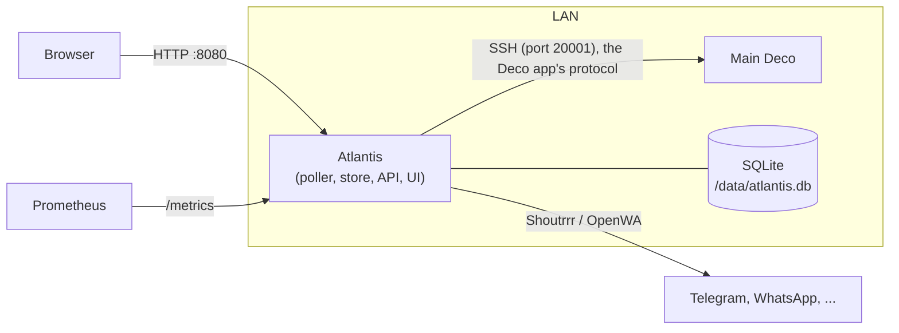

# Atlantis

[](https://github.com/t0mer/Atlantis/actions/workflows/ci.yml)
[](https://github.com/t0mer/Atlantis/actions/workflows/security.yml)
[](LICENSE)

Atlantis is a self-hosted web app that monitors and manages a TP-Link Deco mesh from your own network, without the Deco mobile app. It shows which Decos and devices are online, how they connect, and who came and went. It keeps that history, sends notifications, and exports Prometheus metrics.

It is a single Go binary with the web UI built in. It runs on a Raspberry Pi, a NAS or any Docker host on the same LAN as your main Deco.

> Atlantis is an independent project. It is not affiliated with, endorsed by or supported by TP-Link.


## Contents

- [Features](#features)
- [Screenshots](#screenshots)
- [How it works](#how-it-works)
- [Requirements](#requirements)
- [Installation](#installation)
- [Configuration](#configuration)
- [Using Atlantis](#using-atlantis)
- [Notifications](#notifications)
- [Prometheus metrics](#prometheus-metrics)
- [REST API](#rest-api)
- [Command line](#command-line)
- [Security](#security)
- [Troubleshooting](#troubleshooting)
- [Development](#development)
- [License](#license)

## Features

- **Mesh at a glance.** See whether the internet is up and how many Decos and devices are online. The mesh is drawn as a tree that shows how each satellite connects back (wired or wireless, with signal bars).
- **24-hour presence strips** for every Deco and device. They show when each one was online, with changes marked.
- **Clients.** Search and filter by online state, Deco, band, network (main, guest, IoT) and watched. Each device shows its current speed, a 24-hour strip and a detail page with presence, throughput and connection history over 24 hours, 7 days or 30 days.
- **Rename devices everywhere.** Give a device a name and it is renamed on the Deco too, so the Deco app shows it (Hebrew names work). Tick "Only in Atlantis" to keep a name to Atlantis. Tags and a "watch" flag are stored in Atlantis.
- **Decos.** Model, firmware (with a notice when an update is available), IP and MAC, role, backhaul, and the devices connected to each one.
- **Connect from the browser.** Atlantis starts without a Deco. Add the main Deco's address and your TP-Link ID on the first page, and change or remove it later in Settings. Atlantis signs in to check the details before it saves them.
- **Wi-Fi.** Every band and network with its name, security and state. Turn the guest and IoT networks on or off and change their name and password (and the guest network's security). Change the main network's name and password on all bands, after typing `CHANGE` to confirm. Only changes that have been tested on a real Deco are offered (see [Wi-Fi changes](#wi-fi-changes)).
- **Configured in the browser.** No configuration file or environment variables are needed: start the container or binary, then set everything in Settings. The key that encrypts stored passwords is created on first start.
- **Refresh times you set.** Choose how often devices and the mesh are checked in Settings; the change applies at once.
- **Events.** A timeline of devices joining, coming and going, Decos going offline, internet outages, public IP changes, firmware updates and a new Deco SSH key.
- **Notifications** through [Shoutrrr](https://containrrr.dev/shoutrrr/) (Telegram, Discord, Slack, ntfy, email and more) or WhatsApp through [OpenWA](https://github.com/open-wa/wa-automate-nodejs). Each channel picks which events it sends and can be limited to watched devices. Messages use templates, and there are quiet hours.
- **Prometheus metrics** for Decos, clients, the internet connection and Atlantis's own polling.
- **History in SQLite**, with raw samples rolled up hourly. You choose how long both are kept.
- **Shares the Deco politely.** The Deco allows one admin session at a time. Atlantis can release it for a few minutes so you can use the Deco app.
- Live updates, light and dark mode, a phone layout, and correct display of Hebrew and other right-to-left names.

## Screenshots

### Connect your Deco


### Clients


### Client detail


### Decos


### Deco detail


### Wi-Fi


Each network has its own panel. The guest network can be turned on or off and edited:


Changing the main network asks for a typed confirmation:


### Events


### Settings and notifications


### Dark mode


### Phone

<p>
  
  
</p>

The screenshots use a pretend mesh that ships with the source (see [Development](#development)), not a real network.

## How it works



Atlantis talks to the **main Deco** (the one in router mode). The default `ssh` transport uses the same local protocol as the Deco app: TP-Link's TMP over SSH on port 20001. It signs in with your TP-Link ID. A second transport, `luci`, uses the Deco's local web API and its local management password.

Atlantis polls the Deco on two loops:

- **Fast loop** (default every 30 seconds): clients and their speeds.
- **Slow loop** (default every 5 minutes): Decos, the internet connection, Wi-Fi and firmware.

Both can be changed in **Settings → Refresh** while Atlantis runs.

Each result is stored and compared with the previous one. The changes become events, which go to the event log, to notifications and to every open browser over a live stream.

**One admin at a time.** A Deco accepts one admin session. While Atlantis is signed in, the Deco app may be signed out, and the reverse. When that happens, Atlantis backs off and shows the state at the top of every page. **Release for the app** signs Atlantis out for 10 minutes (or an hour from Settings) and then signs back in by itself.

## Requirements

- A TP-Link Deco mesh whose main unit is reachable from the machine running Atlantis. Atlantis has been tested with a Deco M5 on firmware 1.9.1. See [Supported Decos](#supported-decos).
- For the `ssh` transport (the default): the **TP-Link ID** (email and password) that owns the Deco network in the Deco app.
- Docker, or a Linux machine (amd64, arm64 or armv7) for the binary.

### Supported Decos

Atlantis speaks the Deco app's local protocol over SSH. It works with any Deco model and firmware that still accepts that connection, whatever its bands: bands and networks are read from the Deco, not from a model list. The Deco says which connections it accepts when Atlantis asks it on the LAN (TDP discovery).

Newer models and firmware may accept only TP-Link's newer encrypted connection (TLS with SPAKE2+ or device certificates). Atlantis does not support that yet. When you add such a Deco, it says so instead of retrying. Support is planned.

**Finding the Deco's address.** It is your network's default gateway: in the Deco app, open the main Deco and look at its IP address, or run `ip route | grep default` on a Linux machine. Many networks use `192.168.68.1`.

## Installation

Atlantis needs no configuration file and no environment variables: everything is set in the browser. It keeps its database, `atlantis.db`, and the key that encrypts the stored passwords, `secret.key`, in its data directory (`/data` in the image, the working directory for the binary). The key file is created on first start. Back up the two together: without the key, the stored passwords can't be read.

### Docker

```sh
docker run -d --name atlantis -p 8080:8080 -v atlantis-data:/data --restart unless-stopped techblog/atlantis
```

### Docker Compose

Save [`docker-compose.yml`](docker-compose.yml) and run:

```sh
docker compose up -d
```

### Binary

Download the archive for your platform from [Releases](https://github.com/t0mer/Atlantis/releases). Then:

```sh
tar xzf atlantis_*_linux_arm64.tar.gz
./atlantis serve
```

It creates `atlantis.db` and `secret.key` in the current directory.

Then open `http://<host>:8080`, create the admin account (for Atlantis itself, not your TP-Link ID), and connect the main Deco.

The image (`linux/amd64`, `linux/arm64`, `linux/arm/v7`) is built from scratch: no shell, a non-root user (UID 65532), the data on the `/data` volume, and a health check that runs `atlantis healthcheck`.

### From source

Requires Go (the version in `go.mod`) and Node.js 24.

```sh
git clone https://github.com/t0mer/Atlantis.git && cd Atlantis
make web build        # builds the UI, then bin/atlantis with the UI built in
```

## Configuration

Everything is set in **Settings**, and saved in the database:

| Settings panel | What it sets |
|---|---|
| Deco | The main Deco's address, account and password |
| Refresh | How often devices and the mesh are checked; when a device counts as offline |
| Notifications | Channels (Shoutrrr, or WhatsApp through OpenWA with its own address and chat) and their events |
| Notification timing | Time zone (default UTC) and quiet hours |
| History | How long detailed samples (default 7 days) and hourly history (default 90 days) are kept |
| Prometheus metrics | On or off (default on, at `/metrics`), per-device series (default watched devices), bearer token |
| Advanced | Public address (secure cookies behind an HTTPS proxy), log level and format, trusting a new Deco SSH key automatically (on by default), debug endpoint |

Changes apply at once; nothing needs a restart. Secrets (the Deco password, the metrics token, channel credentials) are encrypted and never shown again.

### Set at startup

There is no configuration file. Only two things are chosen before the web UI runs, and both are optional. Settings shows them read-only under **Advanced**.

| Flag | Environment variable | Default | Description |
|---|---|---|---|
| `--server-listen` | `ATLANTIS_SERVER_LISTEN` | `:8080` | Address and port to listen on. |
| `--store-path` | `ATLANTIS_STORE_PATH` | `atlantis.db` | The database file, relative to the working directory (`/data` in the image). The key file is kept next to it. If there is no `atlantis.db` in the working directory but `/data/atlantis.db` exists (the old default), that one is used. |

A flag wins over its environment variable. The image's health check (`atlantis healthcheck`) reads only `ATLANTIS_SERVER_LISTEN`, so in Docker change the port with that variable rather than the flag.

`ATLANTIS_SECRET_KEY` (base64 of 32 bytes, from `atlantis keygen`) is for keeping the encryption key outside the data directory; when it is set, it is used instead of `secret.key`. Atlantis refuses to start with a key that doesn't open the passwords already stored.

Earlier versions read a YAML file, more `ATLANTIS_*` variables and more flags (`--config`, `--deco-*`, `--log-level`). Those are no longer read: the flags are still accepted, Atlantis logs a warning naming any of them that are still set, and the settings are made in the UI. The one exception is the old OpenWA defaults: on the first start, Atlantis copies those saved in Settings or set in `ATLANTIS_OPENWA_*` into any WhatsApp channel that left those fields empty. Defaults kept only in the old YAML file are not read; enter them on the channel.

## Using Atlantis

- **First run:** create the admin account (the password needs at least 6 characters). Then enter the main Deco's IP address, your TP-Link ID email and its password, and choose **Connect**. Atlantis signs in and reads the Decos before it saves anything. A wrong password is not retried, so the account isn't locked; after five rejected passwords in 15 minutes, Atlantis waits before it tries again. The first time, Atlantis trusts the Deco's SSH key and remembers it.
- **Settings → Deco** shows the connected Deco and its security key. **Change connection** updates the address, account or password and keeps the history. **Remove** (type `REMOVE` to confirm) signs out and deletes the Deco's devices, history and events; notification channels and your account stay.
- **Settings → Refresh** sets how often devices and the mesh are checked, and after how many missed checks a device counts as offline.
- **The status line** at the top of every page shows the connection to the Deco and its action:
  - **Release for the app:** sign Atlantis out for 10 minutes so you can use the Deco app.
  - **Resume now:** sign back in early, after a release, a pause, or another admin taking the session.
  - **Trust the new key:** shown when the Deco presents a different key than before and **Settings → Advanced → Trust a new Deco SSH key automatically** is off. That is expected after a firmware update or reset; otherwise, don't trust it. With the switch on (the default), Atlantis trusts the new key by itself, logs a warning and records a **The Deco's SSH key changed** event (with the old and new fingerprints) that channels can send.
- **Settings** also has the same session controls, plus **Release for an hour** and **Pause polling**, the notification channels, and every other setting (see [Configuration](#configuration)).
- **Renaming a device** (on its detail page, **Name and tags**) renames it on the Deco first, then in Atlantis. If the Deco refuses, for example because it doesn't list a device that has been away for a while, nothing is saved and the page says why. Clearing the name clears it in Atlantis only; the Deco keeps its name.
- **Watching a device** (on its detail page) can limit notifications to the devices you care about. With per-device metrics set to watched devices, they also get their own metrics.
- **Not available yet:** restarting Decos. The button appears in the UI but is disabled until it is verified on real hardware. Use the Deco app for that.

### Wi-Fi changes

Atlantis only offers a Wi-Fi change after it has been tested on a real Deco: the change was made, read back, and undone again. These are tested on a Deco M5:

| Network | Changes |
|---|---|
| Main | Name and password, on every band |
| Guest | On or off; name, password and security (open or WPA2) |
| IoT | On or off; name and password |
| Multi-link | Shown, not changed yet |

Renaming a device on the Deco is tested the same way (with an ASCII and a Hebrew name).

Each change keeps the network's other settings as the Deco reports them, is read back to confirm, and disconnects the devices on that network until they join again. The main network cannot be turned off. Everything else answers "not available yet". Developers can test more with `atlantis ssh wifi-probe` (see [Command line](#command-line)).

## Notifications

Add channels under **Settings → Notifications**. Each channel has:

- **A service.**
  - **Shoutrrr:** one URL, such as `telegram://token@telegram?chats=@channel`, `discord://token@id`, `ntfy://ntfy.sh/topic` or `smtp://...`. See the [Shoutrrr services](https://containrrr.dev/shoutrrr/latest/services/overview/).
  - **WhatsApp (OpenWA):** the OpenWA address and the chat to send to (both required), and the API key if your OpenWA server uses one.
- **The events to send:**
  - a new device joining for the first time;
  - a device coming online or going offline;
  - a Deco going offline or coming back;
  - the internet going down or coming back;
  - the public IP changing;
  - a Deco's firmware changing.
- **Only for watched devices**, which limits the device events to watched devices.
- **A message template** (Go `text/template`) with `.Type`, `.Subject`, `.Name`, `.Site`, `.Time` and `.Payload`. Leave it empty for the built-in message.
- **Send test**, which sends a real message with the values in the form before you save.

Channel credentials are encrypted in the database and are never sent back to the browser.

## Prometheus metrics

| Metric | Labels | Meaning |
|---|---|---|
| `deco_node_up` | `mac`, `name`, `model` | 1 when the Deco is connected to the mesh. |
| `deco_clients` | `node`, `band`, `interface` | Online clients per Deco, band and network. |
| `deco_client_up` | `mac`, `name` | 1 when the device is online. |
| `deco_client_rx_bytes_rate` | `mac`, `name` | Device download rate, bytes per second. |
| `deco_client_tx_bytes_rate` | `mac`, `name` | Device upload rate, bytes per second. |
| `deco_cpu_usage` | | Main Deco CPU load, 0–1, when the model reports it. |
| `deco_mem_usage` | | Main Deco memory use, 0–1, when the model reports it. |
| `deco_wan_up` | | 1 when the main Deco reports working internet. |
| `deco_poll_duration_seconds` | `loop` | Duration of each poll (histogram). |
| `deco_poll_errors_total` | `loop`, `reason` | Failed polls. |
| `deco_session_logins_total` | `result` | Sign-ins to the Deco. |

The per-device series follow **Per-device series** in Settings. Go runtime and process metrics are included too.

```yaml
scrape_configs:
  - job_name: atlantis
    authorization:
      credentials: change-me   # the bearer token from Settings
    static_configs:
      - targets: ["atlantis:8080"]
```

## REST API

The UI uses the REST API under `/api/v1`. The OpenAPI spec is at `/api/openapi.yaml`, and Swagger UI is at `/api/docs`.

- **No sign-in needed:**
  - `GET /health`;
  - the sign-in endpoints (`/api/v1/auth/status`, `/auth/setup`, `/auth/login`, `/auth/logout`).
- **Everything else** needs a signed-in session: the `atlantis_session` cookie (HttpOnly, SameSite=Strict, valid for 7 days). Every request that changes something must also send the `X-CSRF-Token` header returned by `/api/v1/auth/status`, with a `Content-Type: application/json` body.
- **Sign-in lockout:** after 5 failed attempts in 15 minutes, a username or address is locked out.

| Method | Path | Purpose |
|---|---|---|
| `GET` | `/api/v1/network` | Summary: internet, Decos, client counts, session state |
| `GET` | `/api/v1/nodes`, `/api/v1/nodes/{id}?range=24h\|7d\|30d` | Decos, and one Deco with its history |
| `GET` | `/api/v1/clients?q=&online=&node=&band=&network=` | Devices |
| `GET` / `PATCH` | `/api/v1/clients/{mac}` | One device with history; set `alias` (also renames it on the Deco unless `local_only`), `watch`, `tags` |
| `GET` / `PATCH` | `/api/v1/wifi` | Wi-Fi, with `editable` listing the changes allowed per network. `PATCH` changes one network, for example `{"network":"guest","enable":false}` or `{"network":"host","ssid":"...","password":"..."}` (`ssh` transport only). |
| `GET` / `POST` / `PUT` / `DELETE` | `/api/v1/deco` | The Deco connection: show it, add it (checked by signing in first), change it, or remove it with `{"confirm":"REMOVE"}`. The password is never returned. |
| `GET` | `/api/v1/firmware` | Available firmware updates |
| `GET` | `/api/v1/events?type=&since=&limit=` | The event log |
| `GET` | `/api/v1/settings` | The active configuration |
| `GET` / `POST` / `PUT` / `DELETE` | `/api/v1/channels[/{id}]` | Notification channels |
| `POST` | `/api/v1/channels/test`, `/api/v1/channels/{id}/test` | Send a test message |
| `GET` | `/api/v1/session` | The Deco session state |
| `POST` | `/api/v1/session/logout?minutes=10`, `/pause`, `/resume`, `/accept-host-key` | Release, pause, resume, trust a new key |
| `GET` | `/api/v1/stream` | Server-sent events: `snapshot`, `clients`, `event`, `session` |
| `GET` | `/api/v1/ready` | 503 until a recent mesh poll succeeded |
| `GET` | `/api/v1/audit` | The last 200 changes made through Atlantis |

`POST /api/v1/nodes/{id}/reboot`, `POST /api/v1/nodes/reboot-all` and `PUT /api/v1/settings` exist but answer `501` until they are verified on a Deco.

## Command line

| Command | Purpose |
|---|---|
| `atlantis serve [--server-listen ADDR] [--store-path FILE]` | Run the server. |
| `atlantis keygen` | Print a new secret key. |
| `atlantis healthcheck [--url URL]` | Exit 0 when the local server answers `/health` (used by the Docker health check). |
| `atlantis version` | Print the version. |
| `atlantis ssh probe --host IP --email EMAIL` | Sign in over SSH and print what the Deco reports. Read-only. The password comes from `ATLANTIS_CLOUD_PASSWORD`. |
| `atlantis ssh set-wifi --host IP --ssid NAME` | Change the main Wi-Fi name and password on every band. The new password comes from `ATLANTIS_WIFI_PASSWORD`. |
| `atlantis ssh client-rename-probe --host IP --mac MAC` | Test renaming a device on a Deco (an ASCII and a Hebrew name) and put its name back. Writes a sanitised record for the tests. |
| `atlantis ssh wifi-probe --host IP --network guest --field enable` | Test one Wi-Fi change on a Deco and undo it: `--field` is `enable`, `ssid`, `password`, `encryption` or `hidden`. It refuses changes that would cut off devices (turning off an IoT network that is on, or the main network). Writes a sanitised record for the tests. |
| `atlantis probe --host IP` | Sign in to the local web API (`luci`) and print what it reports. Read-only. |
| `atlantis cloud probe --email EMAIL` | List your sites through the TP-Link cloud. Read-only. |

Run any command with `--help` for all its flags.

## Security

- The Deco password, notification credentials and the metrics token are encrypted at rest with AES-256-GCM. The key is `secret.key` in the data directory (created on first start, readable only by Atlantis's user), or `ATLANTIS_SECRET_KEY` if set. Secrets are never returned by the API and never logged.
- With the key file, a copy of the data directory alone can decrypt the stored passwords. To keep them apart, set `ATLANTIS_SECRET_KEY` instead (from `atlantis keygen`, or the contents of `secret.key`) and keep it outside the volume.
- The Deco's SSH host key (or HTTPS certificate with `luci`) is pinned on first use. A different SSH key is trusted automatically and recorded as an event, because firmware updates change it; that also means a device on your LAN pretending to be the Deco would be trusted and get the TP-Link ID password. Turn off **Settings → Advanced → Trust a new Deco SSH key automatically** to have a different key stop Atlantis until you trust it from the UI. A different HTTPS certificate always stops it.
- Connecting a Deco signs in once to check the password and never retries a rejected one. After five rejected passwords in 15 minutes, Atlantis waits so the TP-Link ID isn't locked.
- Wi-Fi changes are limited to the ones tested on a real Deco, and every change and connection change is written to the audit log (without passwords).
- Atlantis's own account uses a bcrypt password, an HttpOnly SameSite=Strict session cookie, CSRF tokens on changes, and a lockout after repeated failed sign-ins.
- Expose Atlantis only on your LAN or behind a reverse proxy with HTTPS. Set the public address (**Settings → Advanced**) to the `https://` address: the sign-in cookie is then marked `Secure` for requests that arrive over HTTPS (directly, or with `X-Forwarded-Proto: https` from the proxy). Plain HTTP on the LAN keeps working.
- The database holds your network's history and the encrypted credentials. Back up the data directory (database and `secret.key`) as a whole.

## Troubleshooting

- **"The encryption key ... does not match the passwords stored in ...".** The key in use (`ATLANTIS_SECRET_KEY` or `secret.key`) is not the one the database was set up with, for example after restoring an older backup. Start Atlantis with the original key.
- **"... holds encrypted passwords, but there is no ATLANTIS_SECRET_KEY and no secret.key".** The database was created with a key that is not available now (for example, an older install that used `ATLANTIS_SECRET_KEY`, started without it). Set `ATLANTIS_SECRET_KEY` to that key. Atlantis never makes a new key for such a database, because the stored passwords could not be read with it.
- **"The Deco app or another admin is signed in; retrying shortly".** The Deco app (or a browser) holds the Deco's single admin session. Close the app, or wait: Atlantis backs off and tries again. Use **Release for the app** whenever you need the app.
- **"The Deco rejected the password".** Atlantis stops trying, to avoid locking the account. Enter the right TP-Link ID password in **Settings → Deco → Change connection** (or on the Reconnect page).
- **"This Deco only accepts TP-Link's newer encrypted (TLS) connection".** The Deco's model or firmware doesn't accept the SSH connection Atlantis uses. See [Supported Decos](#supported-decos).
- **"This is a satellite Deco".** Enter the address of the main Deco, the one connected to the modem.
- **"The Deco's security key changed".** Shown only when automatic trust is off (or for the HTTPS certificate with `luci`). This is expected after a firmware update or factory reset. If neither happened, don't trust the new key: something else may be answering at the Deco's address.
- **CPU and memory show "—".** Some models, such as the M5, don't report them.
- **Swagger UI is blank.** `/api/docs` loads Swagger UI from unpkg.com, so the browser needs internet access. The spec itself is at `/api/openapi.yaml`.

## Development

```sh
make dev       # the UI with hot reload against a pretend Deco mesh (http://localhost:5173)
make test      # Go tests (with -race) and the UI unit tests
make lint      # go vet, golangci-lint, TypeScript and ESLint
make e2e       # Playwright smoke tests: start with no Deco, connect the pretend mesh in the UI
make docker    # build the image for this machine
```

`cmd/atlantis-fake` is a pretend mesh for development and tests: an SSH server speaking the Deco app's protocol, with three Decos and fourteen devices, including Hebrew names. It never talks to real hardware. `SEED=1 make e2e` starts it with a day of history; `SCREENSHOTS=dir` saves the screenshots used in this README.

```
cmd/atlantis/        the binary: serve, probes, keygen, healthcheck
cmd/atlantis-fake/   the pretend mesh
internal/deco/       the Deco client interface; tmp/ and tmpclient/ (SSH), luci/ (web API), cloud/
internal/site/       the Deco connection: add, change and remove it at runtime
internal/poller/     the fast and slow loops
internal/events/     turns poll differences into events
internal/session/    the Deco session: sign-in, back-off, release, key trust
internal/store/      SQLite storage, migrations, retention
internal/notify/     Shoutrrr and OpenWA senders
internal/metrics/    Prometheus collectors
internal/api/        REST API, live stream, auth, OpenAPI spec
internal/web/        serves the built UI
web/                 the React + TypeScript UI (Vite, Tailwind)
```

Releases are cut by the **Release** workflow (GoReleaser, versions `YYYY.M.PATCH`). The **Docker** workflow then publishes `techblog/atlantis`.

## Contributing

Issues and pull requests are welcome. Before opening a pull request, run `make lint test e2e`. Never include real MAC addresses, IP addresses, network names or credentials in tests or fixtures.

## License

[Apache License 2.0](LICENSE)
