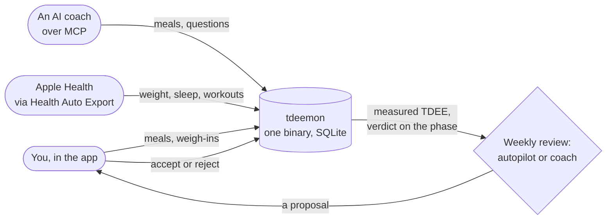

<h1 align="center">
  <br>
  tdeemon
</h1>
<p align="center">
  <b>A self-hosted nutrition tracker that measures your real TDEE,<br>
  and lets an AI coach change your plan only with your yes.</b>
</p>
<p align="center">
  <a href="docs/features.md">Features</a> ·
  <a href="#try-it">Try it</a> ·
  <a href="docs/self-hosting.md">Self-hosting</a> ·
  <a href="docs/ai-coach.md">AI coach</a> ·
  <a href="docs/methodology.md">How the numbers work</a> ·
  <a href="https://github.com/tdeemon/tdeemon/discussions">Discussions</a>
</p>
<p align="center">
  <a href="https://github.com/tdeemon/tdeemon/releases/latest">
    </a>
  <a href="https://github.com/tdeemon/tdeemon/actions/workflows/ci.yml">
    </a>
  <a href="LICENSE">
    </a>
</p>

<picture>
  <source media="(prefers-color-scheme: dark)" srcset="docs/screenshots/desktop-day-dark.png">
  
</picture>

<sub>The screenshots show `tdeemon user demo`: three months of made-up
data. More in [the tour](docs/features.md).</sub>

## Why

Calorie apps estimate what you burn from a formula, and leave you to
guess why the scale won't move. tdeemon **measures** your TDEE from what
you eat and how your trend weight moves, tells you whether your cut,
maintenance, bulk or recomp is on pace, and changes your targets **only
through proposals you accept**, within limits enforced in code.

It is made to work with an AI coach. Tell Claude, Codex or a local
model "I had 200 g of skyr and a banana", and tdeemon finds the foods,
logs them and does every sum. The model never does the arithmetic, and
it can't push your plan past your limits.

## How it works



1. **Log** meals in the app (search, barcode, a recipe's portion, an
   estimate), or just tell your AI coach.
2. **Measure.** After a few weeks tdeemon knows your real TDEE, ± its
   interval, and whether your phase is on pace.
3. **Adjust.** Each week the autopilot, or your coach, proposes a
   change within your limits. You accept or reject it, and can take it
   back.

## Highlights

### Logging that stays out of the way

- **Search and a tray:** your foods first, then the ones you eat at
  this meal; yesterday's meal again in one tap.
- **Barcodes** from the camera, with Open Food Facts for a product you
  don't have.
- **Recipes** weighed by the pot, logged as a portion or a share of the
  dish.

### Numbers you can trust

- **A measured TDEE** with its interval and a verdict on your phase,
  every number explained ([methodology](docs/methodology.md)).
- **A plan with limits:** phases, targets by type of day, and floors
  the code enforces ([limits](docs/limits.md)).
- **Autopilot:** a weekly review that steps your target, or asks
  first.

### An AI coach, your choice of model

- **An MCP server** with 23 tools, three coaching sessions and the
  methodology, for Claude, Codex, Hermes or a local model
  ([AI coach](docs/ai-coach.md)).
- **Proposals, not edits:** the AI suggests, you decide, and any change
  can be undone.

### Yours, on your server

- **One container, one SQLite file**; export everything as a ZIP of
  JSON and CSV.
- **Apple Health** through Health Auto Export, and a morning summary
  and alarms as **push notifications or on Telegram**.
- **Several users and households:** a shared kitchen, each person's
  plan their own.
- **An installable app** (PWA), light and dark, in English and
  Croatian, and quick with a keyboard on a desktop.

**[The full tour, with screenshots →](docs/features.md)**

## Is it for you?

tdeemon fits if you want to run it yourself, you weigh most of what you
eat, and you like the idea of an AI coach that can't fudge the math. It
is not for you (yet) if you need imperial units, an Android health
integration, a hosted service, or ChatGPT's or claude.ai's connectors,
which sign in with OAuth that tdeemon doesn't offer yet
([what it doesn't do](docs/features.md#what-tdeemon-doesnt-do-yet)).

## Try it

To look around with made-up data on your own machine, with Docker:

```sh
(umask 077 && printf 'TDEEMON_BASE_URL=http://localhost:8080\nTDEEMON_SECRET_KEY=%s\n' \
  "$(openssl rand -base64 32)" > try.env)
docker run -d --name tdeemon-try --env-file try.env -v tdeemon-try:/data \
  -p 127.0.0.1:8080:8080 ghcr.io/tdeemon/tdeemon:latest
until docker exec tdeemon-try /tdeemon healthcheck 2>/dev/null; do sleep 1; done
docker exec tdeemon-try /tdeemon user demo --email demo@example.com
```

Open <http://localhost:8080> and sign in as `demo@example.com` with the
password the last command printed. When you are done:
`docker rm -f tdeemon-try && docker volume rm tdeemon-try && rm try.env`.

## Run it

With Docker and Compose, on the machine that will run it:

```sh
mkdir tdeemon && cd tdeemon
base=https://raw.githubusercontent.com/tdeemon/tdeemon/main/deploy/compose
curl -fsSLO "$base/compose.yaml" -O "$base/compose.caddy.yaml" -O "$base/Caddyfile" -O "$base/.env.example"

# The address it will have, such as https://tdeemon.example.com;
# http://localhost:8080 to try it on this machine.
url=http://localhost:8080
# The settings, readable by you only, with a new secret key. Keep the key.
# set -C refuses to replace an existing .env, so running this again keeps it.
(umask 077 && set -C && sed -e "s|^TDEEMON_SECRET_KEY=\$|TDEEMON_SECRET_KEY=$(openssl rand -base64 32)|" \
  -e "s|^TDEEMON_BASE_URL=.*|TDEEMON_BASE_URL=$url|" .env.example > .env)

docker compose up -d --wait
docker compose exec tdeemon /tdeemon user create --admin --email you@example.com
```

The last command prints your password once. Open the base URL and sign
in; the first steps on the day take you to a plan.

tdeemon then listens on `127.0.0.1:8080`. For HTTPS, put your reverse
proxy in front of it, or let Caddy do it: uncomment `COMPOSE_FILE` in
`.env` and run `docker compose up -d --wait` again
([Docker Compose](docs/self-hosting.md#docker-compose)).

## Documentation

- [Features](docs/features.md): a tour of the app, with screenshots.
- [Self-hosting](docs/self-hosting.md): configuration, users, devices,
  backups and upgrades.
- [AI coach](docs/ai-coach.md): connecting an MCP client, the tools and
  the coaching sessions.
- [Methodology](docs/methodology.md): how the numbers come about.
- [Limits](docs/limits.md): the limits of a plan and their sources.
- [Design](docs/DESIGN.md): the design and why it is so.
- [Discussions](https://github.com/tdeemon/tdeemon/discussions):
  questions, ideas, and setups to show.
- [Contributing](CONTRIBUTING.md), and [security](SECURITY.md): report a
  vulnerability privately.

tdeemon is stable and runs every day for its author. Each release says
what changed in its notes, and a change that needs something of you
raises the major version.

## Disclaimer

tdeemon is not medical advice. Talk to a professional before making
significant changes to your diet or training.

## License

[AGPL-3.0-only](LICENSE). Contributions come under the same licence, with no
CLA to sign ([CONTRIBUTING.md](CONTRIBUTING.md)).
