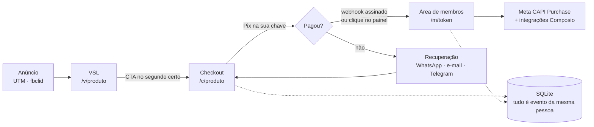

<p align="center">
  <picture>
    <source media="(prefers-color-scheme: dark)" srcset="docs/banner-escuro.svg">
    
  </picture>
</p>

<p align="center">
  <a href="https://github.com/thiagopatzdorf/funil-aberto/actions/workflows/ci.yml"></a>
  
  
  
  
  <a href="CONTRIBUTING.md"></a>
</p>

<p align="center">
  <a href="https://funil.genesisinnovation.com.br/v/metodo-demo"><b>Ver a demo no ar</b></a> ·
  <a href="https://funil.fabweb.io">Conceito</a> ·
  <a href="#rodar-em-1-minuto">Rodar</a> ·
  <a href="#o-que-faz">O que faz</a> ·
  <a href="AGENTS.md">AGENTS.md</a> ·
  <a href="CONTRIBUTING.md">Contribuir</a>
</p>

# funil-aberto

<!-- resumo: A operação de venda online (digital/DR) num processo só e de código aberto (MIT): tracker com atribuição por UTM e Meta CAPI, página de VSL com CTA no segundo certo, checkout com Pix direto na chave do vendedor (sem gateway), área de membros, recuperação de checkout abandonado por WhatsApp e e-mail, robô de mensagens por palavra-chave e biblioteca de anúncios; Python stdlib + SQLite. -->

> *"É possível fazer um open source que substitua todos os softwares que alguém usa numa operação de digital/DR/venda online?
> Tracker, VSL, Manychat, área de membros, spy, checkout, remarketing. Vejo todo mundo criando a própria; não faria mais sentido
> todos criarem uma só?"* — pergunta no X, 13/11/2026

Faz. Este repositório é essa uma só: **sem mensalidade, sem gateway, sem dependência**. Um `python3 app.py` e a operação está de pé,
do anúncio à aula.

<table>
  <tr>
    <td width="68%"><br><sub><b>VSL</b>: o botão de compra aparece no segundo que você escolher, e a retenção é medida por quartil.</sub></td>
    <td width="32%"><br><sub><b>Checkout</b> no celular, com cronômetro, garantia e order bump.</sub></td>
  </tr>
  <tr>
    <td><br><sub><b>Painel</b>: receita, conversão e qual campanha vendeu, do clique no anúncio ao Pix pago.</sub></td>
    <td><br><sub><b>Pix</b> direto na sua chave: QR, copia e cola, e a página muda sozinha quando o pagamento cai.</sub></td>
  </tr>
  <tr>
    <td colspan="2"><br><sub><b>Área de membros</b>, liberada no pagamento: módulos, aulas e progresso. Fotos da demo do Unsplash (créditos em <code>static/demo/CREDITOS.md</code>).</sub></td>
  </tr>
</table>

## Rodar em 1 minuto

    git clone https://github.com/thiagopatzdorf/funil-aberto && cd funil-aberto
    ADMIN_TOKEN=troque-isto WEBHOOK_SECRET=troque-isto python3 app.py
    # VSL:    http://localhost:8080/v/metodo-demo
    # Painel: http://localhost:8080/entrar  (entra com o ADMIN_TOKEN)

Nada para instalar além do Python 3.10+. Sem credencial nenhuma mensagem sai da máquina: tudo fica marcado como `simulado` até você
ligar os canais em `/painel/conexoes`.

## Como uma venda passa por ele



## Já existia? Em pedaços, sim. Junto, não.

Pesquisado em 13/11/2026 antes de escrever uma linha (regra da casa: consulte antes de assar).

| Peça | Open source que já existe | Por que não bastava |
|---|---|---|
| Tracker | Umami, Plausible, Matomo, PostHog | medem visita, não ligam o anúncio à venda nem mandam a compra para a Meta (CAPI) |
| VSL | Video.js, Plyr | player, não página de venda com CTA atrasado e eventos de retenção |
| Manychat | Typebot (hoje *fair source*, FSL), Chatwoot (MIT), Botpress | bons, mas são outro sistema, outro banco, outra conta |
| Área de membros | CourseLit, Moodle, Frappe LMS | LMS completos, sem saber quem comprou o quê no seu checkout |
| Checkout | Autonnel (Apache-2.0), Medusa, Hyperswitch | nenhum com Pix direto na chave do vendedor, sem gateway |
| Remarketing | Mautic, listmonk | e-mail; sem WhatsApp e sem o estado do pedido |
| Spy | Biblioteca de Anúncios da Meta (API oficial) | só busca; ninguém guarda o swipe file junto do funil |

O ganho de juntar não é economia de ferramenta: é que **tudo é evento sobre a mesma pessoa**. O anúncio que trouxe o visitante, o quanto ele
viu da VSL, o checkout que abandonou, a mensagem de recuperação e a compra moram no mesmo banco, e "qual campanha vendeu" vira uma consulta.

## O que faz

- **Tracker** (`/t.js`, uma linha no seu site): grava UTM, `fbclid`, `gclid`, `ttclid` no primeiro toque; eventos `visita`, `vsl_play`,
  `vsl_25..100`, `cta_visto`, `cta_clique`, `checkout`, `compra`. **Meta Conversions API** server-side: `InitiateCheckout` e `Purchase`
  com e-mail e telefone em sha256 e `fbc` montado do clique (não depende do pixel do navegador nem do bloqueador de anúncio).
- **VSL** em `/v/<produto>`: vídeo, botão que aparece no segundo configurado, retenção medida por quartil.
- **Checkout** em `/c/<produto>`: gera o **Pix copia e cola** (BR Code do Banco Central) com valor e identificador do pedido, direto na
  sua chave. Sem gateway, sem taxa. Confirmação por webhook assinado (HMAC) do seu banco/gateway, ou um clique no painel.
  Quer cartão? `link_pagamento` no produto manda para Stripe, Mercado Pago ou qualquer link de pagamento.
- **Área de membros** em `/m/<token>`: liberada no pagamento, link enviado por e-mail e WhatsApp; módulos, aulas e progresso.
- **Recuperação de checkout abandonado**: sequência em dados (ex.: WhatsApp em 15 min, e-mail em 4 h, WhatsApp em 24 h); para sozinha quando paga.
- **Robô de mensagens (estilo Manychat)**: palavra-chave abre um fluxo, cada resposta avança um passo. WhatsApp pela Evolution API ou
  pela Cloud API oficial; e-mail por SMTP.
- **Remarketing**: público de quem abandonou (ou comprou) em sha256, pronto para Custom Audience.
- **Spy**: busca na Biblioteca de Anúncios da Meta e swipe file salvo junto do funil.
- **Painel** em `/painel` (login em `/entrar`): funil por origem e campanha (visita → play → CTA → checkout → compra → receita), pedidos, mensagens.

Produto novo, sequência de recuperação nova e fluxo novo do robô são **dado** em `config.json`, nenhuma linha de código.

## Conexões (painel em `/painel/conexoes`)

O painel abre por login (`/entrar`, com o `ADMIN_TOKEN`; o cookie guarda um derivado do token, nunca o token).

- **WhatsApp pela Evolution API**, o mesmo caminho do `maus-conexoes`: o funil cria uma instância só dele, mostra o QR
  no painel e o dono lê com o celular. A chave da Evolution fica no servidor. Teto de 300 mensagens em 24 h
  (`FUNIL_TETO_WHATSAPP_DIA`) contra banimento do número. Sem Evolution, a API oficial da Meta (`WA_CLOUD_TOKEN`).
- **Telegram por bot oficial** (`TELEGRAM_BOT_TOKEN` e `TELEGRAM_BOT_USUARIO`, criados no @BotFather): a página do Pix
  mostra "Receber o acesso pelo Telegram", o `/start <pedido>` liga o chat ao pedido e o robô responde no bot. O webhook
  tem um segredo derivado do token no caminho. Não usa a conta pessoal do dono: aviso automático em volume por conta
  pessoal derruba a credencial de aplicativo.
- **Integrações pela Composio** (`COMPOSIO_API_KEY`): o dono conecta Gmail, Planilhas, HubSpot, Notion, Slack etc. pelo
  link da Composio, e o `config.json` diz o que rodar em cada evento:

```json
"integracoes": [
  {"evento": "compra", "ferramenta": "GOOGLESHEETS_SPREADSHEETS_VALUES_APPEND",
   "argumentos": {"spreadsheetId": "...", "range": "Vendas!A1", "values": [["{pedido}", "{nome}", "{email}", "{valor}"]]}}
]
```
  Eventos: `checkout` e `compra`. Campos: `{pedido}`, `{nome}`, `{email}`, `{telefone}`, `{produto}`, `{valor}`, `{status}`.
  Com `EMAIL_VIA=composio`, o e-mail de acesso sai do Gmail conectado.

A Genesis hospeda uma instância em https://funil.genesisinnovation.com.br (app + Evolution própria num compose, túnel de
um hostname): `apps/factory/deploy/factory01/instalar-funil-aberto.sh` no repositório da Genesis.

## Configuração

Docker: `docker build -t funil-aberto . && docker run -p 8080:8080 -v funil:/data -e ADMIN_TOKEN=... -e WEBHOOK_SECRET=... funil-aberto`.
Testes: `python3 -m pytest -q tests` (sobem o servidor de verdade e percorrem o funil inteiro).

| Variável | Para quê | Sem ela |
|---|---|---|
| `ADMIN_TOKEN` | login do painel e API admin (`Authorization: Bearer`) | painel fechado |
| `WEBHOOK_SECRET` | assinatura HMAC-SHA256 (`X-Assinatura`) do webhook de pagamento e da entrada do robô | webhook recusado |
| `META_PIXEL_ID`, `META_CAPI_TOKEN` (`META_TEST_EVENT_CODE`) | Conversions API | evento simulado |
| `EVOLUTION_URL`, `EVOLUTION_KEY`, `EVOLUTION_INSTANCIA` ou `WA_CLOUD_TOKEN`, `WA_PHONE_ID` | WhatsApp | mensagem simulada |
| `TELEGRAM_BOT_TOKEN`, `TELEGRAM_BOT_USUARIO` | Telegram | mensagem simulada |
| `COMPOSIO_API_KEY` (`EMAIL_VIA=composio`) | integrações e Gmail | integração simulada |
| `SMTP_HOST`, `SMTP_PORT`, `SMTP_USER`, `SMTP_PASS`, `SMTP_FROM` | e-mail | mensagem simulada |
| `META_AD_LIBRARY_TOKEN` | spy pela API | devolve o link da biblioteca pública |
| `BASE_URL` | links nas mensagens | `http://localhost:8080` |
| `PORT`, `BIND` | porta e endereço em que o servidor escuta (`BIND=127.0.0.1` atrás de proxy na mesma máquina) | `8080`, `0.0.0.0` |
| `DATA_DIR`, `FUNIL_CONFIG` | pasta do SQLite e caminho de outro `config.json` | `./data`, o `config.json` ao lado do app |
| `EMAIL_VIA` | `composio` manda o e-mail de acesso pelo Gmail conectado na Composio | SMTP |
| `COMPOSIO_USUARIO`, `COMPOSIO_URL` | dono das contas conectadas na Composio; outro endereço da API (testes) | derivado do `BASE_URL`; a API pública |
| `CONEXOES_URL`, `CONEXOES_SERVICO_TOKEN`, `CONEXOES_USUARIO` | WhatsApp por um serviço de conexões que já tem o número ligado (o `maus-conexoes` da Genesis): o funil não abre outro QR | Evolution própria ou Cloud API |
| `FUNIL_TETO_WHATSAPP_DIA` | teto de mensagens de WhatsApp em 24 h | `300` |
| `TELEGRAM_API` | outro endereço da Bot API (testes) | `https://api.telegram.org` |

Sem credencial nada sai da máquina e o painel mostra `simulado`: "simulado" nunca aparece como "enviado".

### API

- `POST /t` `{"vid","nome","produto",utm...}` → `{"vid"}`
- `POST /api/webhook/pagamento` `{"pedido","status":"pago"}` com `X-Assinatura: hex(hmac_sha256(WEBHOOK_SECRET, corpo))`. Idempotente.
- `POST /api/bot/entrada` `{"canal":"whatsapp","de":"55...","texto":"quero","enviar":true}` (mesma assinatura) → `{"respostas":[...]}`
- Com `Authorization: Bearer $ADMIN_TOKEN`: `GET /api/admin/funil`, `GET /api/admin/publico?status=pendente`,
  `POST /api/admin/pedido/<id>/pago`, `POST /api/admin/recuperacao`, `GET /api/admin/spy?q=...`, `GET|POST /api/admin/anuncios`.

## Limites declarados

- **Pix estático não avisa sozinho que foi pago.** O BR Code estático é um código de transferência; a confirmação vem do webhook do seu
  banco (Efí, Inter, Mercado Pago e outros têm Pix com webhook) ou do clique no painel. Pix dinâmico (cobrança com vencimento) é a próxima fatia.
- **A API da Biblioteca de Anúncios** só devolve anúncio comercial na UE e no Reino Unido; para o Brasil ela devolve o link da página pública e
  você salva o que achar no swipe file.
- **WhatsApp pela Cloud API oficial** só aceita texto livre até 24 h depois da última mensagem da pessoa; recuperação fora dessa janela precisa
  de template aprovado (pela Evolution API não há essa trava, mas o número corre risco de bloqueio se mandar em massa).
- Um processo e um SQLite: aguenta bem uma operação; várias réplicas exigem trocar o armazenamento (`nucleo.py` é o único arquivo com SQL).
- LGPD: guarda nome, e-mail e telefone de quem compra. A Meta recebe só hash. Nenhum dado em log.

## Contribuir

PRs são bem-vindos. Comece pelo [`AGENTS.md`](AGENTS.md): mapa do código, regras que os testes cobram, como fazer as mudanças comuns e a
lista do que ainda falta. O passo a passo curto está em [`CONTRIBUTING.md`](CONTRIBUTING.md).

Licença MIT.
