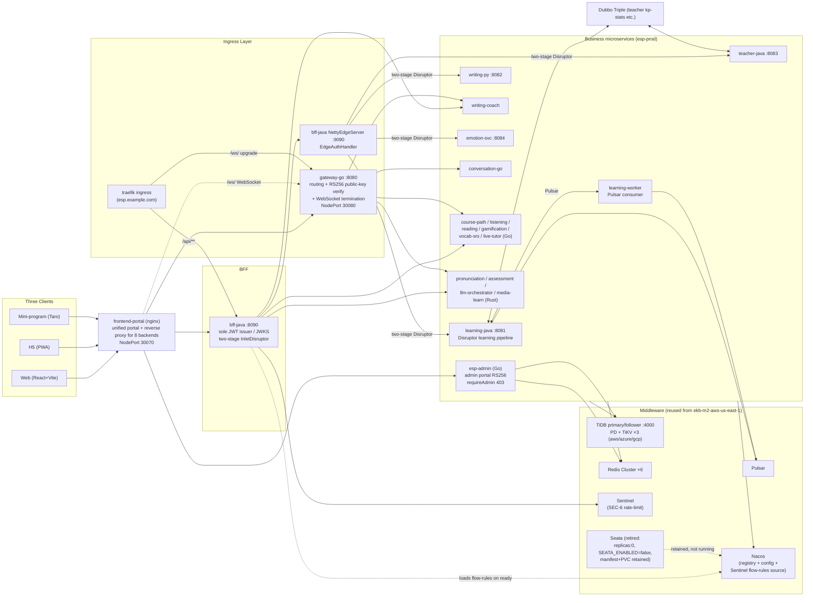
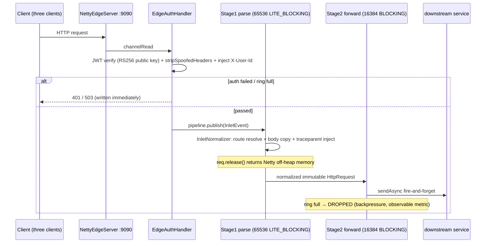
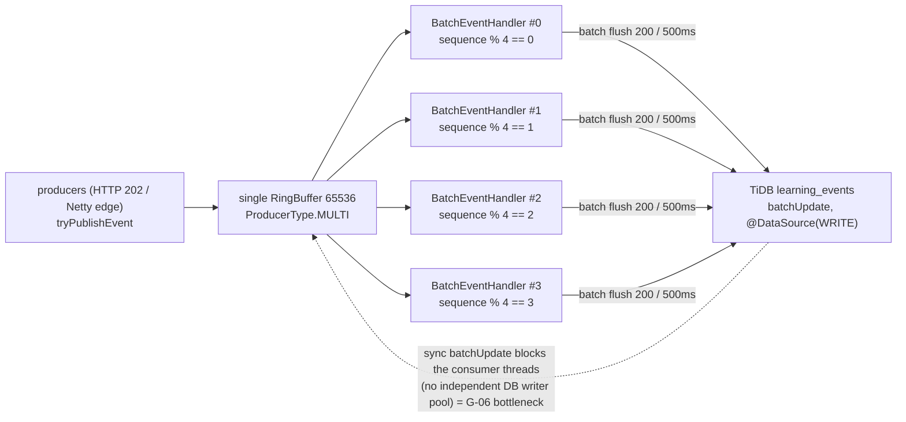
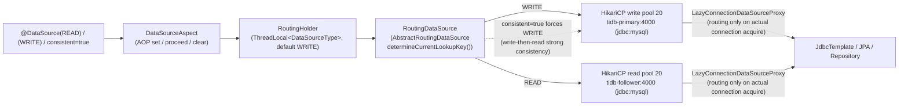
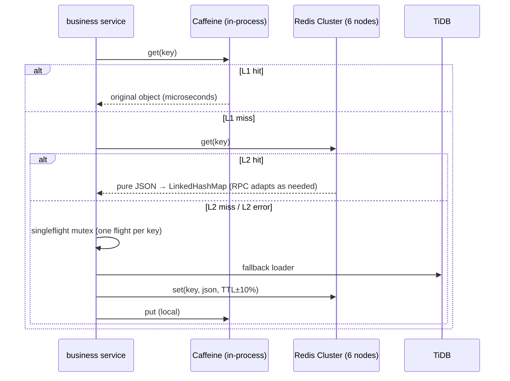
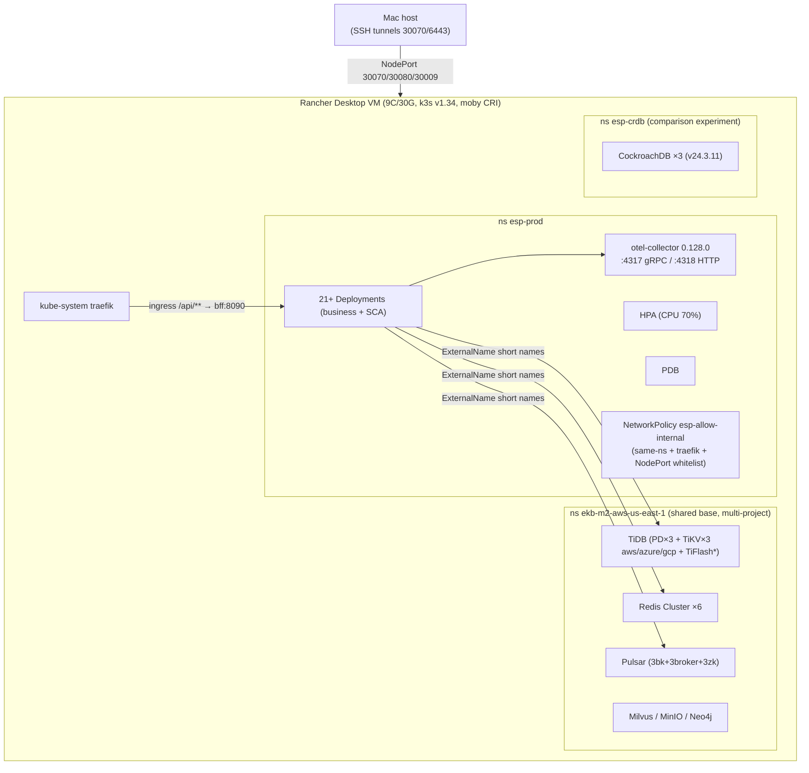
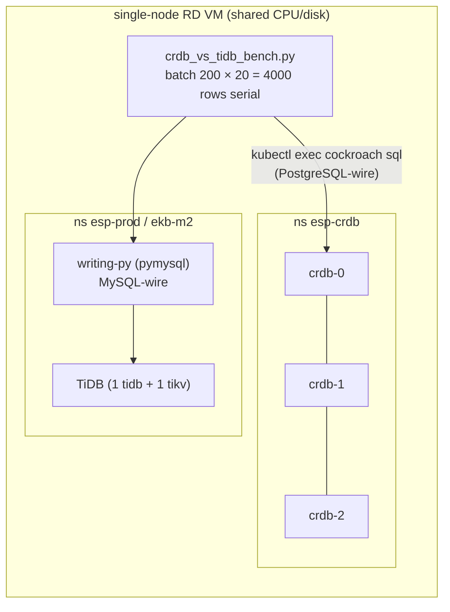
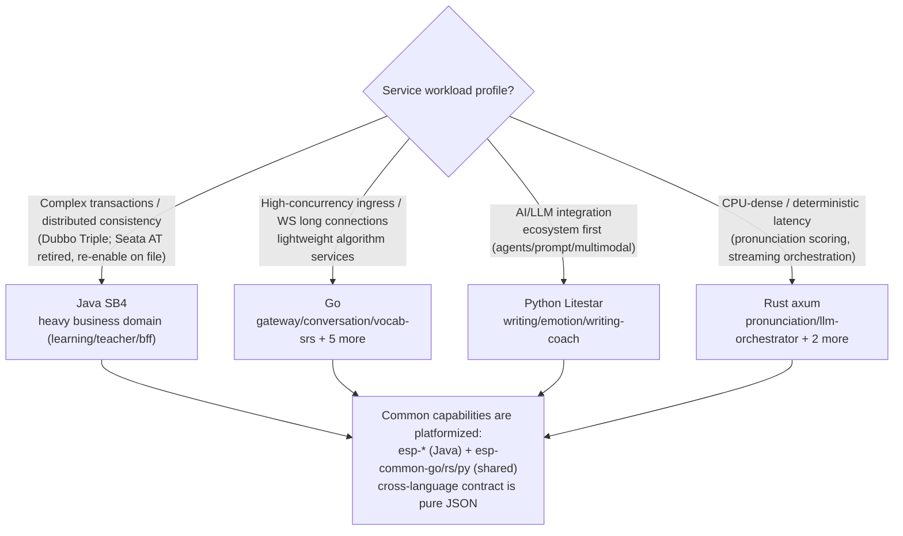
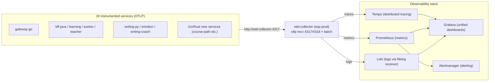
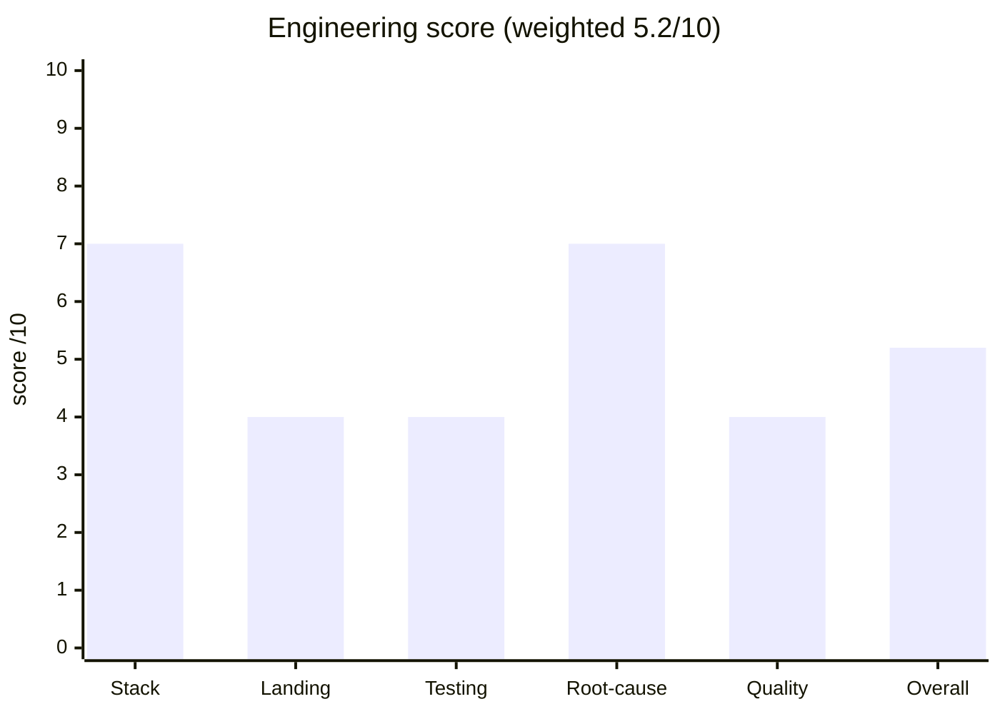

# ESP — English Study Platform · Verity (洁语)

[🇬🇧 English](README.md) | [🇨🇳 简体中文](README.zh-CN.md)


> **Truthful AI English education platform (Verity / 洁语 / ESP)** — a polyglot microservice platform built to professor-grade industrial standards:
> 19 business services (Go / Java / Python / Rust) + TiDB read-write splitting + Redis Cluster + Pulsar event bus + two-stage LMAX Disruptor pipelines + Netty edge ingress.
> Targets: **5000 CCU, three clients (Web / H5 / mini-program), 3 billion rows of test data**, fully manual-testable at every stage; topology validated on a single-node cluster and portable to multi-node as-is.

---

## Table of Contents

- [Core Features](#core-features)
- [System Architecture](#system-architecture)
- [Technology Choices](#technology-choices)
- [Repository Layout](#repository-layout)
- [Quick Start](#quick-start)
- [Core Design Deep Dives](#core-design-deep-dives)
- [CRDB vs TiDB: Benchmarked Comparison & Selection Decision](#crdb-vs-tidb-benchmarked-comparison--selection-decision)
- [Four-Language Showdown (Java/Go/Python/Rust)](#four-language-showdown-javagopythonrust)
- [Observability Architecture](#observability-architecture)
- [Test System](#test-system)
- [Measured Performance Data](#measured-performance-data)
- [Engineering Status Scorecard](#engineering-status-scorecard)
- [Roadmap](#roadmap)
- [Contribution Conventions](#contribution-conventions)

---

## Core Features

| Dimension | Highlights |
|---|---|
| **Polyglot service matrix** | 19 business services: Java Spring Boot 4 (learning/teacher/bff), Go (gateway/conversation + 6 more), Python Litestar (writing/emotion/writing-coach), Rust axum (pronunciation/assessment/llm-orchestrator/media-learn) |
| **High-performance ingress** | Netty edge server (:9090) + **two-stage LMAX Disruptor pipeline** (parse 65536 LITE_BLOCKING → forward 16384 BLOCKING), fire-and-forget with explicit backpressure (ring-full → fast 503) |
| **Event-driven** | Pulsar event bus (3 brokers + 3 bookies + 3 ZK) + Disruptor batched writes (batchUpdate); learning events async via HTTP 202 |
| **Storage** | TiDB v8.5 (PD/TiKV across aws/azure/gcp regions) + read-write splitting (`esp-rw-java` RoutingHolder / `@DataSource` AOP) + schema-per-service evolution |
| **Multi-level cache** | Caffeine L1 + Redis Cluster L2 (real 6-node cluster, hostname announce), TTL jitter ±10% (anti-avalanche) + singleflight (anti-breakdown), pure-JSON cross-language contract |
| **Security** | RS256 JWT (BFF is the sole issuer; sign/verify secrets split by key), JWKS endpoint, IDOR fixes, httpOnly cookie, register locks role, tightened NetworkPolicy, NodePort consolidation, **Sentinel rate-limiting (SEC-6: 3 QPS FlowRules in Nacos `bff-java-flow-rules`, 429 verified)**, **admin portal RS256 + requireAdmin middleware 403 (esp-admin)** |
| **Observability** | OTel Collector (0.128.0) with three pipelines (traces/metrics/logs) → Tempo / Prometheus / Grafana / Loki + Alertmanager |
| **Elasticity** | HPA (CPU 70%) + PDB + slow-start tolerance (JVM services ~90s); fully numbered Kustomize-style manifests |
| **Engineering** | GitHub Actions 9 jobs (java-commons/java-services/go-gateway/python-services/go-services/build-images/contract/e2e/frontend) + trivy security scanning + jacoco coverage gates; **G-8 fix: per-module `mvn` (platform/ has no aggregate parent pom) + `packageManager` as single source for pnpm version + `security.yml` trivy block mapping** |
| **DDD** | Rich domain aggregates (`UserMastery.applyEvent` / `Submission.grade`), domain packages split into aggregate/valueobject/domainevent/repository |

---

## New Features (Phase 1-3)

> 各阶段功能的**需求/架构/详细设计/测试用例**见 `docs/design/`;实测见 `docs/test/`。

| 阶段 | 功能 | 服务 | 前端 | 关键文档 |
|---|---|---|---|---|
| **Phase 1** | 内容库(课程/课时/练习题) | `content-go` (:8096) | Web/H5 内容页 | `docs/design/phase1-content-library-*.md` |
| **Phase 2** | 圈子社区(发帖/评论/点赞) | `community-go` | Web/H5 社区页 | `docs/design/phase2-community-*.md` |
| **Phase 3** | 排行榜(周/全网/地区 XP、前100快照、反作弊、退出) | `gamification-go` (:8092) | Web/H5 排行榜页 | `docs/design/phase3-rankings-design.md`、`docs/design/sdd/srs-gamification-go.md`;E2E `report/phase3-ranking-e2e-2026-08-17.log` |

排行榜要点(架构债已记录):XP 事件经 CRDB `esp_learning.learning_events` 由 gamification 轮询消费,Redis ZSET fan-out 双榜(周/全网)+ 地区子榜;反作弊(事件上限/每日额度);每日 top-100 落 `esp_gamif.leaderboard_snapshots`;用户可 opt-out。

---

## System Architecture



### Architecture at a Glance (measured numbers)

| Metric | Value |
|---|---|
| Business services | 19 (Java 3 / Go 8 / Python 3 / Rust 4 + integration-tests) |
| Deployments (esp-prod) | 21+ (business + SCA) |
| Disruptor in production | bff-java **2-stage** (`parse` 65536 → `forward` 16384); learning-java single ring 65536 with **4 sharded consumers**; teacher-java not wired |
| RW-split pools (learning-java) | HikariCP write 20 + read 20 + shared 10 |
| Cache | Caffeine L1 + Redis Cluster ×6; warm-up 23,000 keys in 1.5 s |
| Storage | TiDB primary/follower :4000 (MySQL wire); CockroachDB ×3 in `ns esp-crdb` (`crdb-public:26257`, PG wire) as measured benchmark alternative |
| Edge | NettyEdgeServer :9090 (SO_BACKLOG 8192) + gateway-go WS :8080 (NodePort 30080) |

> Infrastructure is reused cross-namespace via ExternalName short names (`tidb-primary`/`tidb-follower`/`redis-cluster`/`pulsar-broker`) — see `deploy/k8s/05-infra-reuse.yaml` and `deploy/k8s/05b-platform-infra-externalnames.yaml`.

---

## Technology Choices

| Component | Choice | Rationale |
|---|---|---|
| Gateway / BFF | Go gin (gateway-go) + Java Netty/Disruptor (bff-java) | WS long connections in Go (lightweight, high concurrency); auth issuance & orchestration in Java (mature ecosystem); unified Netty edge |
| Service languages | Java SB4 / Go / Python Litestar / Rust axum | Match language to workload: JVM for heavy business logic, Go for light concurrency, Python for LLM integration, Rust for CPU-dense work (pronunciation scoring / orchestration) — see the [four-language showdown](#four-language-showdown-javagopythonrust) |
| Database | TiDB v8.5 (MySQL wire, HTAP) | Horizontal scaling + MySQL ecosystem compatibility; PD/TiKV across three regions simulating multi-AZ; AUTO_RANDOM keys prevent hotspots; CockroachDB evaluated and rejected by measurement (see [dedicated chapter](#crdb-vs-tidb-benchmarked-comparison--selection-decision)) |
| Read-write splitting | In-house `esp-rw-java` (`@DataSource` AOP + RoutingHolder) | Explicit read/write intent; SQL hint `/*+MASTER*/` reserved for true multi-node follower routing |
| Cache | Caffeine (L1) + 6-node Redis Cluster (L2) | Microsecond local reads at L1; cross-service consistency at L2; pure-JSON serialization contract (Go/Python can `json.loads` directly) |
| Messaging | Pulsar (geo-replication plan on file) | Tiered storage, multi-tenancy, Bookie scaling path; load shedding for learning events |
| High-performance queue | LMAX Disruptor (two-stage pipeline) | Lock-free RingBuffer with explicit backpressure semantics (ring-full DROPPED → 503, protecting gateway latency) |
| RPC | Dubbo Triple + HTTP REST | Triple carries OTel trace context automatically (verified end-to-end); REST is friendly to the three clients |
| Transactions | Seata (AT mode) — **retired 2026-08-16** (`replicas: 0`, all 4 Java services `SEATA_ENABLED=false`; manifest + ExternalName + PVC retained for one-line re-enable); Saga evolution ADR on file | Cross-service eventual consistency was the design intent; retired to remove startup cost & Dubbo coupling during the move to shared `ekb-m2` ns; `adr-seata-at-to-saga.md` reserves the long-transaction path if re-enabled |
| Registry / config | Nacos | Service discovery + dynamic configuration |
| Observability | OTel Collector → Tempo/Prometheus/Grafana/Loki | Unified traces/metrics/logs pipelines; filelog receiver collects container logs |
| Deployment | K8s (k3s / Rancher Desktop single-node validation) | Fully numbered manifests, portable to multi-node as-is; HPA + PDB elasticity |
| Load testing | Locust (distributed) + k6 (custom Go static binary) | In-cluster ClusterIP direct hits bypass port-forward overhead — industrial-grade testing posture |

---

## Repository Layout

```text
English-Study-Platform/
├── backend/
│   ├── services/                  # 19 business services
│   │   ├── bff-java/              # BFF: Netty edge + two-stage Disruptor + JWT issuance
│   │   ├── learning-java/         # adaptive learning: Disruptor pipeline + RW splitting
│   │   ├── teacher-java/          # teacher side: rich DDD + Dubbo Triple
│   │   ├── gateway-go/            # routing + RS256 verify + WebSocket
│   │   ├── conversation-go/       # conversation logic (extracted from gateway)
│   │   ├── course-path-go/ listening-go/ reading-go/
│   │   ├── gamification-go/ vocab-srs-go/ live-tutor-go/
│   │   ├── writing-py/            # writing grading (Litestar/FastAPI + LLM)
│   │   ├── emotion-svc/           # affective multimodal service
│   │   ├── writing-coach/         # writing coach (Python)
│   │   ├── pronunciation-rs/ assessment-rs/
│   │   ├── llm-orchestrator-rs/ media-learn-rs/
│   │   └── integration-tests/     # contract / integration tests
│   └── shared/                    # esp-common-go / esp-common-rs / esp-cache-py / esp-db-py
├── platform/                      # Java platform foundation
│   ├── esp-api/                   # API contracts
│   ├── esp-cache/                 # multi-level cache (TTL jitter + singleflight + idempotency filter)
│   ├── esp-disruptor/             # multi-stage Disruptor pipeline abstraction
│   └── esp-rw-java/               # read-write splitting (@DataSource AOP + RoutingHolder)
├── apps/                          # frontend monorepo (pnpm + turbo)
│   ├── web/ h5/ miniprogram/      # @esp/web @esp/h5 @esp/miniprogram
├── packages/                      # types / api-client / ws-client / ui-tokens
├── frontend-portal/               # unified portal (nginx proxying 8 backends)
├── deploy/
│   ├── k8s/                       # production manifests (numbered, see below)
│   ├── docker/                    # docker-compose full local stack
│   ├── locust/                    # distributed load testing (README covers G-01/G-04/G-06)
│   └── crdb/                      # CockroachDB 3-node comparison experiment
├── e2e/                           # Playwright smoke E2E
├── docs/
│   ├── design/                    # SRS/SAD/SDD + 30+ ADRs/design docs
│   ├── test/                      # 00 overview ~ 09 manual test guide
│   ├── api/ product/ progress/
│   └── PROGRESS.md                # cross-session progress hot zone (iron rule: state must be persisted)
├── scripts/                       # db_query.sh / seed_3b.py / crdb_vs_tidb_bench.py / redis-warmup.py etc.
├── report/                        # measured load test / benchmark artifacts (csv/json/html)
└── .github/workflows/             # ci.yml (9 jobs) + security.yml (trivy)
```

Key `deploy/k8s/` manifests (real files):

| File | Contents |
|---|---|
| `00-namespace-secret.yaml` / `00b-rsa-jwt-secrets-split.yaml` | namespace + RS256 sign/verify key-split secrets |
| `05-infra-reuse.yaml` / `05b-platform-infra-externalnames.yaml` | cross-ns infrastructure ExternalName reuse |
| `06-sca-middleware.yaml` | Nacos + Sentinel + Seata (all three in `ekb-m2-aws-us-east-1`; nacos/seata PVC-backed; **Seata `replicas:0` retired**) |
| `07-tidb-tikv.yaml` | TiDB/TiKV/PD (across three regions) |
| `10-gateway-go.yaml` / `15-bff-java.yaml` / `20-learning-java.yaml` / `21-learning-worker.yaml` | core four |
| `30-other-services.yaml` / `31-new-services.yaml` / `32-batch2-services.yaml` / `33-orchestrator-vocab.yaml` | teacher/emotion/writing + Go/Rust new-service matrix |
| `15/16/17-frontend*.yaml` | web / h5 / portal |
| `40-ingress.yaml` / `40-networkpolicy.yaml` / `40b-traefik-ratelimit.yaml` | ingress + NetworkPolicy + traefik rate limiting |
| `41-pdb.yaml` / `50-hpa.yaml` | PDB + HPA |
| `95-otel-collector.yaml` | OTel Collector (traces/metrics/logs) |
| `esp-redis-warmup-job.yaml` / `16-seed-session-turns.yaml` | Redis warm-up / seed data Job |

---

## Quick Start

### Prerequisites

- K8s: Rancher Desktop (k3s v1.34+, VM ≥ 8C/30G; this project validated on 9C/30G)
- Infrastructure namespace `ekb-m2-aws-us-east-1`: TiDB (v8.5, root passwordless, DB `esp`), Redis Cluster (6 nodes), Pulsar, Milvus/Neo4j/MinIO (shared platform base)
- Tooling: kubectl, docker (build inside the RD VM), JDK 21+, Go 1.25 (note `env -u GOROOT GOTOOLCHAIN=local` to bypass the gvm GOROOT trap), Python 3.12/3.13, Rust 1.88, node/pnpm
- See `deploy/k8s/README-infra.md`

### Deployment Steps (apply order, field-validated)

```bash
NS=esp-prod

# 1) namespace + secrets (RSA private key held by BFF only; verify secret is public-key-only)
kubectl apply -f deploy/k8s/00-namespace-secret.yaml
kubectl apply -f deploy/k8s/00b-rsa-jwt-secrets-split.yaml   # caution: never apply empty placeholders over real PEM

# 2) infrastructure reuse + SCA middleware
kubectl apply -f deploy/k8s/05-infra-reuse.yaml
kubectl apply -f deploy/k8s/05b-platform-infra-externalnames.yaml
kubectl apply -f deploy/k8s/06-sca-middleware.yaml
kubectl apply -f deploy/k8s/07-tidb-tikv.yaml

# 3) business services (numbered order)
kubectl apply -f deploy/k8s/10-gateway-go.yaml
kubectl apply -f deploy/k8s/15-bff-java.yaml
kubectl apply -f deploy/k8s/15-frontend-react.yaml -f deploy/k8s/16-frontend-h5.yaml -f deploy/k8s/17-frontend-portal.yaml
kubectl apply -f deploy/k8s/20-learning-java.yaml -f deploy/k8s/21-learning-worker.yaml
kubectl apply -f deploy/k8s/30-other-services.yaml -f deploy/k8s/31-new-services.yaml
kubectl apply -f deploy/k8s/32-batch2-services.yaml -f deploy/k8s/33-orchestrator-vocab.yaml

# 4) boundaries & elasticity
kubectl apply -f deploy/k8s/40-ingress.yaml -f deploy/k8s/40-networkpolicy.yaml -f deploy/k8s/40b-traefik-ratelimit.yaml
kubectl apply -f deploy/k8s/41-pdb.yaml -f deploy/k8s/50-hpa.yaml
kubectl apply -f deploy/k8s/95-otel-collector.yaml

# 5) seeding + Redis warm-up
kubectl apply -f deploy/k8s/16-seed-session-turns.yaml        # seed Job (see deploy/seed-job.yaml)
kubectl apply -f deploy/k8s/esp-redis-warmup-job.yaml
```

> Java services start slowly (Nacos+Dubbo ~90s; Seata retired, no longer in the start path); readiness probes are already relaxed to 10s/10-failures — do not declare failure early.

### Access Endpoints

| Entry | Address |
|---|---|
| Unified Portal (Web/H5/mini-program preview + API proxy) | `http://localhost:30070` (single-node RD needs an SSH tunnel: `ssh -f -N -L 30070:localhost:30070 -F "$HOME/Library/Application Support/rancher-desktop/lima/0/ssh.config" lima-0`) |
| gateway-go (API/WS) | NodePort `30080` |
| bff-java | NodePort `30009` (MVC) / `30010` (edge) |

### Local Development

```bash
# frontend monorepo
pnpm install && pnpm turbo typecheck

# Java (install platform libs first)
cd platform && mvn -B install -DskipTests -pl esp-api,esp-cache,esp-rw-java,esp-disruptor
cd backend/services/learning-java && mvn test

# Go (workspace mode; mind the GOROOT trap)
env -u GOROOT GOTOOLCHAIN=local go test ./services/... ./shared/...

# Python
cd backend/services/writing-py && pip install -e ".[test]" && python -m pytest

# docker-compose full local stack
cd deploy/docker && docker compose up -d
```

### Host-Migrated Middleware Ops (moved out of K8s to macOS host)

Observability stack (Prometheus/Loki/Alertmanager/OTel Collector/Grafana) and Nacos now run natively on the macOS host (`~/observability/` + `~/nacos/`), bridged into K8s via ExternalName Services in the `esp-observability` namespace.

```bash
# Start all 6 host middleware (Nacos→Prometheus→Loki→Alertmanager→OTel→Grafana)
./scripts/start-host-middleware.sh

# Check status (process / port / health probe)
./scripts/status-host-middleware.sh

# Stop all
./scripts/stop-host-middleware.sh
```

| Component | Port | Config Path | Purpose |
|-----------|------|-------------|---------|
| Nacos | 8848 | `~/nacos/nacos/conf/` | Service registry / config center (standalone + Derby) |
| Prometheus | 9090 | `~/observability/prometheus.yml` | Metrics + 10 alert rules (7d retention) |
| Loki | 3100 | `~/observability/loki-fixed.yaml` | Log aggregation |
| Alertmanager | 9093 | `~/observability/alertmanager.yml` | Alert routing |
| OTel Collector | 4317/4318 | `~/observability/otel-gateway-config.yaml` | Telemetry gateway |
| Grafana | 3000 | `~/observability/grafana.ini` | Dashboards |

> Full ops manual: [`docs/ops/host-middleware-startup.md`](docs/ops/host-middleware-startup.md)
> Note: Tempo (distributed tracing) binary is corrupted and needs re-download; data stores in `/tmp/` — lost on macOS reboot.

---

## Core Design Deep Dives

### 1. Two-Stage Disruptor Pipeline (bff-java edge)

Stage1 `parse` (InletNormalizer, ring 65536 + LITE_BLOCKING): pure computation at microsecond scale — route resolution, body copy out of the Netty ByteBuf (`req.release()` immediately after, returning off-heap memory), hop-by-hop header whitelist, W3C traceparent inject.
Stage2 `forward` (DownstreamForwarder, ring 16384 + BLOCKING): pure IO dispatch (JDK HttpClient sendAsync, fire-and-forget); the small ring naturally caps total in-flight body copies to prevent memory amplification; ring-full `forward` returns DROPPED → fast 503 backpressure.

WaitStrategy rationale: Stage1 LITE_BLOCKING (spin first, then park — low latency under bursts without burning CPU when idle); Stage2 BLOCKING (IO-bound stages are insensitive to wakeup latency; lock semantics are the cheapest on CPU).



**Multi-level pipeline abstraction (arbitrary stage count).** `platform/esp-disruptor`'s `DisruptorPipeline` chains any number of levels: `DisruptorPipeline.named("flow").stage("s1", ...).stage("s2", ...).build()`. Each stage is an **independent RingBuffer + independent consumer thread(s)** with its own bufferSize / producerType / waitStrategy, so per-stage backpressure (`tryPublishEvent` → `DROPPED` when that stage's ring is full) isolates the speed difference between parse / forward / sink stages. Inter-stage handoff is `forward(fromStage, payload)`; shutdown runs in reverse order so upstream stops publishing before downstream drains.

Production wiring (measured, 2026-08-15):

| Service | Pipeline | Levels | Ring / consumers | Wait strategies |
|---|---|---|---|---|
| bff-java | `bff-inlet` | **2** (parse → forward); a 3rd "respond" stage is a reserved `ForwardRespondHandler` extension point (not implemented) | 65536 LITE_BLOCKING → 16384 BLOCKING | LITE_BLOCKING / BLOCKING |
| learning-java | `learning-event` | **1** (single RingBuffer) | 65536; **4** sharded `BatchEventHandler` consumers (`esp.disruptor.consumers`, cap 16) | BLOCKING |
| teacher-java | — | **not wired** (no Disruptor) | — | — |

**Disruptor 4.0 parallel-consumer sharding.** Disruptor 4.0 removed WorkerPool/WorkHandler, so ESP emulates worker-pool "divide" semantics with **multiple EventHandlers as independent BatchEventProcessors consuming the same RingBuffer**: every handler receives every event (broadcast) and filters by `sequence % shardCount == shardIndex`, so exactly one consumer persists each event while each shard keeps its own batch (batchSize 200 / 500ms flush).



### 2. Read-Write Splitting + Disruptor Batched Writes (learning-java)

- Ingress: HTTP 202 async; learning events enter the `LearningEvent` RingBuffer (65536);
- Consumption: `DbLearningEventConsumer` JdbcTemplate batchUpdate (batch_size=50, `order_inserts/order_updates=true`, no id column — TiDB AUTO_RANDOM generates it);
- Connection pools: HikariCP write 20 + read 20 + shared 10;
- Routing: `@DataSource(WRITE/READ)` AOP → RoutingHolder → tidb-primary / tidb-follower (same DB on single node; true replica routing reserved for multi-node).

```mermaid
sequenceDiagram
    participant API as learning-java API
    participant R as Disruptor RingBuffer (65536)
    participant P as Pulsar
    participant W as learning-worker
    participant DB as TiDB (primary/follower)

    API->>R: tryPublishEvent(LearningEvent)
    alt ring full
        API-->>API: PublishResult.DROPPED → 503 (designed backpressure)
    else accepted
        API-->>API: 202 Accepted (async)
        R->>W: BatchEventHandler batch consumption
        W->>W: coalesce batches (batch 50)
        W->>DB: batchUpdate INSERT learning_events
        Note over W,DB: @DataSource(WRITE) forces primary
    end
    Note over P: cross-replica/async paths go through Pulsar; AOP closes routing within consumer threads
```

**RoutingDataSource model (esp-rw-java).** The shared `esp-rw-java` library routes each request between write and read pools through a ThreadLocal routing context:



- Pool sizing (learning-java): HikariCP `maximum-pool-size` write 20 + read 20 + shared 10.
- Feature flag: `esp.rw.enabled=false` skips the routing datasource entirely (single-primary fallback).
- Virtual-thread verified (2026-08-15): routing is per-thread via ThreadLocal; the whole request (Jetty accept → virtual-thread handler → AOP set/proceed/clear) runs inside one virtual thread, and Pulsar consumer threads are their own closed loop — routing stays correct, no cross-thread leakage.

**Storage-switchable by design (implemented, #132).** The routing targets are pluggable HikariCP pools, and a storage-type switch (`esp.rw.storage.type=tidb|cockroachdb`) re-points write/read/shared pools without touching business code — `cockroachdb` mode switches the pools to PostgreSQL-wire (`crdb-public:26257`, per-service `ESP_RW_COCKROACHDB_DB`, `esp_shared` for app_logs, CockroachDialect). Today production wires TiDB (`${WRITE_DB_URL}` / `${READ_DB_URL}` → `jdbc:mysql://tidb-primary|tidb-follower:4000/esp`). The full-service app-level re-benchmark (#137, 2026-08-15) measured CRDB at **0.33–0.71× TiDB on all DB paths** (an earlier micro-benchmark: 139.0 vs 259.3 insert/s, ratio 0.54) — see the [CRDB chapter](#crdb-vs-tidb-benchmarked-comparison--selection-decision).

### 3. JWT Security Convergence (RS256 Key Split)

The BFF is the sole issuer (the secret holding the private key, `esp-rsa-jwt-sign`, is only mounted by bff-java); gateway/learning/teacher hold only the public key (`esp-rsa-jwt-verify`, verify-only). Even an RCE in any business service cannot forge an admin JWT. The BFF publishes its public key via JWKS (kid=esp-rs256-1). The edge strips spoofed `X-User-Id` headers and injects the JWT sub; after the IDOR fixes, userID always comes from the JWT.

```mermaid
sequenceDiagram
    participant U as User (three clients)
    participant B as bff-java (sole private-key holder)
    participant K as JWKS endpoint
    participant G as gateway-go / learning / teacher (public key only)

    U->>B: POST /api/auth/login
    B->>B: RS256 sign JWT (sub=uid, role locked server-side)
    B-->>U: Set-Cookie esp_token (HttpOnly; SameSite=Strict; Max-Age=7d) + Bearer fallback
    B->>K: publish public key (JWKS, alg=RS256)
    U->>G: request (Bearer or same-origin cookie)
    G->>K: fetch public key
    G->>G: verify + ParseUserID → reject spoofed X-User-Id
    Note over G: expired/invalid → 401; foreign session → 403 (before WS upgrade)
```

### 4. Multi-Level Cache (Caffeine L1 + Redis Cluster L2)

- Pure-JSON value contract (DefaultTyping removed; no Java FQCN embedded), directly readable by Go `json.Unmarshal` / Python `json.loads`;
- TTL jitter ±10% (anti-avalanche) + singleflight mutex (anti-breakdown); L2 read errors are caught and degrade to DB fallback;
- Warm-up: the `esp-redis-warmup` Job loads 23,000 keys in 1.5s (scenarios/kp top-10000 + sessions/mastery/users top-1000, TTL 1h).



### 5. Deployment Topology (single-node validation, multi-node portable)



> TiFlash fails to register with PD on the single-node cross-region setup (raft proxy startup defect); no business dependency on the columnar engine, tracked as a known defect to be rebuilt on multi-node.

---

## CRDB vs TiDB: Benchmarked Comparison & Selection Decision

> Fulfills audit item #108: "add a CockroachDB multi-region deployment and benchmark it against TiDB under real load."
> Plan doc: `docs/design/cockroachdb-vs-tidb-multi-region-plan.md`; measured artifacts: `report/crdb-smoke-loadtest.json`, `report/crdb-vs-tidb-app-bench.json`.

### Experiment Setup & Benchmark Methodology

- **Cluster**: ns `esp-crdb`, 3-replica StatefulSet `crdb-0/1/2`, CockroachDB v24.3.11 **arm64** (the RD VM is aarch64; amd64 images crash under qemu translation with SIGSEGV); manifest `deploy/crdb/crdb-3node.yaml`.
- **Key pitfall**: `--join=crdb-0.crdb,...` depends on the headless svc setting `publishNotReadyAddresses: true`, otherwise not-ready pods publish no DNS → bootstrap deadlock.
- **Schema adaptation** (`deploy/crdb/schema-crdb.sql`): TiDB `AUTO_RANDOM` → CRDB `unique_rowid()`; `ENUM` → `VARCHAR+CHECK`; `TINYINT` → `SMALLINT`; `DATETIME(3)` → `TIMESTAMP(3)`; `JSON` kept; `ON UPDATE CURRENT_TIMESTAMP` dropped (unsupported in CRDB). Covers 5 core tables: users / scenarios / sessions / session_turns / learning_events.
- **Tools & model**:
  - Smoke level: `scripts/seed_crdb.py` seeding + kube-exec per-query bench (carries per-query exec overhead);
  - App-level comparison: `scripts/crdb_vs_tidb_bench.py`, **batch INSERT 200 rows/batch, 4000 rows total, serial**, over the application access path (CRDB via `kubectl exec crdb-0 -- cockroach sql`, TiDB via writing-py pymysql 2.2.8); per-exec process startup overhead amortized by batching;
  - Read/write ratio: this round focused on the **write path** (learning_events appends are the dominant write load at 5000 CCU; G-06 target 5000 ev/s); reads covered by point/range smoke;
  - **Environment caveat (stated honestly)**: single RD VM — the 3 CRDB pods and TiDB share the same CPU/disk. This is a **feasibility + order-of-magnitude comparison**, not a production capacity conclusion.
- **Protocol difference**: CRDB speaks PostgreSQL-wire; the cluster has no psycopg2/psql client pod (Python side has pymysql only, MySQL-wire, incompatible).

### Experiment Topology



### Results (all measured)

**Smoke level (via kube-exec, overhead-dominated, order-of-magnitude only)** — `report/crdb-smoke-loadtest.json`:

| Item | Value | Note |
|---|---|---|
| Seed | 100 users / 3 scenarios / 500 sessions / 2000 turns / 2000 events | `scripts/seed_crdb.py` |
| write bench | 2000 rows / 25.45s / **78.6 insert/s** | |
| point read | 100 queries / 126.58s / 0.8 qps | exec per-query overhead dominates; not real QPS |
| range read | 1345.9 ms (count=36) | |

**App-level write throughput (headline result)** — `report/crdb-vs-tidb-app-bench.json`:

| Metric | CockroachDB v24.3.11 (3 replicas) | TiDB v8.5 | ratio (CRDB/TiDB) |
|---|---|---|---|
| Data volume | 4000 rows (batch 200) | 4000 rows (batch 200) | — |
| Elapsed | 28.77 s | 15.42 s | — |
| **Write throughput** | **139.0 insert/s** | **259.3 insert/s** | **0.54** |

### Full-Service App-Level Benchmark (#137, 2026-08-15)

**Methodology** — `report/crdb_fullbench.py` run **inside the cluster** (ClusterIP direct, RS256-authenticated, bypassing the gateway/BFF proxy chain to isolate DB-path differences). Five paths across learning / teacher / bff / gateway, each at concurrency 20 then 60. Both legs ran on the same single-node VM; the CRDB leg had the 3-node CRDB cluster live (which itself consumes VM CPU/IO — the non-DB gateway reference dropped to 0.80× at c=20 as contention noise).

| Path (service → table) | c | TiDB rps | CRDB rps | ratio CRDB/TiDB |
|---|---|---|---|---|
| learning event **write** (`learning_events`, Disruptor→writer pool) | 20 | 200.0 | 82.6 | 0.41 |
| learning event write | 60 | 201.3 | 112.6 | 0.56 |
| learning review read (`user_mastery`) | 20 | 146.8 | 62.4 | 0.42 |
| learning review read | 60 | 360.7 | 224.4 | 0.62 |
| teacher kp-stats read (`user_mastery`) | 20 | 71.5 | 38.8 | 0.54 |
| teacher kp-stats read | 60 | 115.6 | 80.0 | 0.69 |
| bff scenarios read (cross-domain) | 20 | 145.1 | 48.4 | 0.33 |
| bff scenarios read | 60 | 132.5 | 94.4 | 0.71 |
| gateway scenarios ref (non-DB) | 20 | 377.3 | 301.0 | 0.80 |
| gateway scenarios ref | 60 | 366.2 | 366.0 | 1.00 |

**Driver-compat fix required for the CRDB leg (#139).** PG JDBC 42.7.8 `setObject(int, java.time.Instant)` throws SQLState 07006 ("can't infer the SQL type to use for an instance of java.time.Instant"); TiDB's MySQL driver accepts `Instant`. In CRDB mode this made every `learning_events` batch insert fail and bounce through the outbox relay (~4 DB round-trips/event) and dropped app_logs telemetry — both would have distorted the comparison. Fix: bind `Timestamp` instead of `Instant` in `DbLearningEventConsumer` and `AppLogClient` (shared esp-web-common, rebuilt as learning 1.11.1 / bff 1.10.0 / teacher 1.10.0). Post-fix, CRDB writes are direct (zero outbox bounce) and app_logs lands in `esp_shared.app_logs` (verified end-to-end). Artifacts: `report/crdb-vs-tidb-fullbench-{tidb,cockroachdb}-2026-08-15.json`; comparison `report/crdb-vs-tidb-fullbench-2026-08-15.json`.

**Full-service verdict (single node):** CRDB trails TiDB on **every** DB path — write 0.41–0.56×, reads 0.33–0.71× — consistent with the earlier micro-verdict (0.54×). CRDB's multi-region strengths (geo-distribution, RBR local reads, no TSO single-point) are not realizable on a single node, so **TiDB remains the production choice**; the CRDB leg is retained for re-run against a true multi-region cluster (3m+6w) per plan §4.

### Multi-Region Comparison Dimensions (plan level; true multi-node pending)

Per the plan, a real multi-region comparison requires a **3-master + 6-worker** cluster (plan §4 methodology), covering:

1. **Write throughput gate (hard elimination)**: the CRDB group must reach G-06 ≥5000 ev/s with write-path P99 <200ms;
2. **Consensus latency vs local reads**: cross-region Raft consensus costs 50~100ms; ESP's write path (learning_events appends) is already 202-async + outbox, insensitive to per-write latency — throughput is bounded by the Raft commit pipeline, not RTT; what is genuinely sensitive is strongly-consistent in-conversation reads (session recovery / mastery queries), where CRDB RBR local reads <5ms would beat the status quo;
3. **Protocol ecosystem**: TiDB's MySQL-wire requires zero changes to the existing Java (JDBC) / Go (mysql) / Python (pymysql) stack; CRDB would drag in the PostgreSQL driver ecosystem;
4. **Operational complexity**: arm64 image adaptation, headless-DNS bootstrap pitfalls, no drop-in equivalent to TiCDC in the sync toolchain.

### Conclusion & Final Selection

- **Single-node measurement**: CRDB write throughput is only **0.54×** TiDB's, empirically confirming the plan's conclusion — **"at 5000 CCU scale, introducing CRDB does not pay off"**;
- **Decision**: **TiDB is the final choice** (zero-migration MySQL ecosystem + read-write splitting and batched-write optimizations already landed). The CRDB 3-node experiment environment (`ns esp-crdb`) plus full scripts/manifests are retained for re-testing per plan §4 when a true multi-region cluster (3m+6w) is available;
- Audit register item #108 closed accordingly (`docs/design/audit-gap-resolution-register.md`).

---

## Four-Language Showdown (Java/Go/Python/Rust)

This project assigns one of four languages to each of its 19 business services by workload profile. Everything below is based on actual project usage and measured records.

### Where Each Language Sits in This Project

| | Java (Spring Boot 4) | Go | Python | Rust |
|---|---|---|---|---|
| **Services (count)** | bff-java / learning-java (+worker) / teacher-java (3) | gateway / conversation / course-path / listening / reading / gamification / vocab-srs / live-tutor (8) | writing-py / emotion-svc / writing-coach (3) | pronunciation / assessment / llm-orchestrator / media-learn (4) |
| **Framework / runtime** | Spring Boot 4 + Netty + LMAX Disruptor | gin | Litestar + Granian | axum + tokio |
| **Typical workload** | Complex business transactions + Dubbo Triple RPC + rich DDD domain models (Seata AT retired 2026-08-16; distributed-TX path retained as one-line re-enable) | High-concurrency gateway, WebSocket long connections, lightweight CRUD/algorithm services (SM2+ spaced repetition, **`MaxInterval=365` cap** preventing `due_at` overflow) | AI/LLM integration (writing grading, affective multimodal, coach orchestration) | CPU-dense (pronunciation scoring), LLM orchestration, media processing |
| **Concurrency model** | JVM thread pools (HikariCP/MVC) + Netty EventLoop + lock-free Disruptor RingBuffer | goroutines (CSP channels) | asyncio event loop | tokio async runtime (futures) |
| **Startup speed** | **Slow: ~90s** (Nacos+Dubbo slow start; Seata retired — no longer in the start path; probes relaxed to 10s/10-failures) | Seconds (precise value: measurement pending) | Granian cold start slow (observed; precise value pending) | Seconds (precise value pending) |
| **Resource profile** | requests from ~250m/512Mi; bff CPU limit **2 cores** (raised from 1 after probe kills) | Lightweight: vocab-srs-go **100m/128Mi ~ 500m/256Mi** (manifest values) | python:3.13-slim base image, resource-tight (precise values pending) | llm-orchestrator-rs **250m/256Mi ~ 1C/512Mi** (manifest values) |
| **Ecosystem maturity (middleware clients)** | Fullest: Dubbo Triple/Nacos/Spring Cloud Alibaba + in-house esp-* platform libs (esp-cache/esp-rw/esp-disruptor/esp-api); (Seata client retired with `SEATA_ENABLED=false`) | Complete: miniredis/pulsar/mysql/websocket/redis/otel (conversation-go dependency list) | pymysql 2.2.8 + in-house esp-cache-py/esp-db-py; **no psycopg2** (MySQL-wire only) | axum/tokio + in-house esp-common-rs shared crate; LLM provider SDK hand-rolled (StubProvider fallback) |
| **Unit tests in this project** | learning **48** / teacher **16** / bff (Disruptor pipeline 3 + RouteTable 5 etc.); coverage learning 40.5% / teacher 23.6% / bff 30.6% | **25 tests / 4 modules** (vocab-srs 14 incl. `TestCompute_MaxIntervalCap` — MaxInterval=365 cap preventing `due_at` overflow → DB 500; course-path 6 + esp-common-go 4 + gamification 2); 2 more modules await DI refactor | writing-py **18 passed** (pytest + ruff gate) | **None yet** (measurement pending) |
| **Images** | eclipse-temurin:21-jre-alpine (prebuilt fat-jar) | golang:1.25-alpine builder → alpine:3.22 runtime | python:3.13-slim | rust:1.88-bookworm builder → debian:bookworm-slim runtime |
| **Build time** | host mvn (single-node iron rule: serialized with cluster ops; precise value pending) | Very fast (precise value pending) | `pip install -e ".[test]"` fast | llm-orchestrator-rs docker build measured **1m44s** |
| **Pitfalls hit** | SB3.5→4.0.7 three breaking changes; JaCoCo×JDK25 class-file-69 compatibility; esp-cache provided-scope trap | gvm GOROOT trap (`env -u GOROOT GOTOOLCHAIN=local`) | venv extras naming trap (`[test]` not `[dev]`); .venv symlinks broke docker build context (xattr) | Cargo path resolution trap (Dockerfile COPY paths); deb.debian.org egress flaky → switched to mirrors.ustc.edu.cn |

### Concurrency-Model Scorecard (2026-08-15 architecture review)

Per-service scoring by an internet-giant architect review (`report/architecture-review-2026-08-15.md`), scale 0–10. Weighted overall **5.2/10** — the stacks are modern, but engineering landing is incomplete (Dubbo Triple configured-but-not-wired, Disruptor consumer blocking on DB, WS without deadlines).

| Language | Score (avg) | Representative services (score) | Weakest point |
|---|---|---|---|
| Python (Litestar) | **6.7** | emotion-svc 7 / writing-py 7 / writing-coach 6 | fully-async design is the most complete; LLM calls lack visible timeout/circuit-breaker |
| Java (Spring Boot 4) | **5.7** | learning-java 6 / teacher-java 6 / bff-java 5 | Dubbo configured-not-wired; Disruptor consumer sync-blocks on DB; Netty bootstrap uses bare `new Thread` |
| Go | **4.0** | vocab-srs 6 / conversation 5 / gamification 5 / gateway 4 / stubs 3 | WS no deadline; `sess_<unix_ms>` ID collision; Hub concurrent writes on a gorilla Conn |
| Rust (axum) | **3.8** | llm-orchestrator 5 / assessment 4 / pronunciation 4 / media-learn 2 | 3 of 4 are stubs; sqlx pool untuned; last-insert-id race |

### Selection Principle: Which Language for Which Scenario



Accompanying decision rules (evaluate in order):

1. **Default ingress/routing/long connections → Go**: per-connection goroutines cost an order of magnitude less than JVM threads, and images/memory are an order of magnitude smaller (vocab-srs-go 128Mi vs bff at 2 cores);
2. **Heavy business domain (multi-entity transactions, TCC/Saga, rule-dense domain) → Java**: the most mature transaction/RPC/ORM ecosystem, and rich DDD fits the Spring ecosystem; the price is ~90s slow starts and the highest memory — pair with slow-start probes and serialized-build discipline;
3. **LLM/AI boundary → Python**: model SDKs and agent ecosystems ship Python-first; the bottleneck is the external LLM API, not the language;
4. **CPU-dense with deterministic latency (real-time pronunciation scoring) → Rust**: high-density tokio concurrency with no GC jitter; the price is slower builds (1m44s) and drivers you must build yourself;
5. **Cross-language sharing always goes through contracts, never shared libraries**: cache/message values are pure JSON, APIs go REST/Dubbo Triple, the single source of truth for types lives in `packages/types` — no language-private serialization format may leak.

---

## Observability Architecture



- **Trace verification**: frontend → BFF traceparent closed-loop; Dubbo Triple automatic trace propagation closed-loop (`docs/test/05-traceId实测.md`);
- Multi-node evolution: gateway/daemonset-tiered collector manifests are on file (`deploy/k8s/otel-collector-gateway.yaml`, `otel-collector-daemonset.yaml`);
- Alerting deployment: `docs/test/05-监控告警部署说明.md`.

---

## Test System

| Layer | Contents | Source |
|---|---|---|
| Unit tests | Java (learning 48 / teacher 16 / esp-cache 15; coverage gate: esp-cache 77%≥75%; business baselines learning 40.5% / teacher 23.6% / bff 30.6%); Go 25 tests (4 modules, full SM2 algorithm paths incl. MaxInterval=365 overflow-cap regression); Python writing-py 18 passed; frontend Vitest | `docs/test/01-单元测试报告.md` |
| Integration / contract | Dubbo Triple contract tests, `integration-tests/`, writing mock-grading path | `docs/test/02-集成测试报告.md` |
| Performance / load | Distributed Locust + k6 baseline + WS CCU scripts (`ccu5000_ws.py`/`spike.py`/`soak.py`), G-01/G-04/G-06 SLOs | `docs/test/03-性能与压测报告.md`, `deploy/locust/README.md` |
| Chaos | chaos-plan designed | `docs/test/04-混沌测试报告.md`, `chaos-plan.md` |
| Monitoring / alerting | Prometheus/Grafana/Alertmanager deployment validation | `docs/test/05-监控告警部署说明.md` |
| Security | SEC-1~8 matrix (WS cross-tenant 403 / expired JWT 401 / X-User-Id stripping / JWKS closed-loop / trivy zero leaks) all green; **SEC-6 Sentinel rate-limiting: 3 QPS FlowRules (`api-learning-event`/`api-writing-grade`/`api-default`) published to Nacos `bff-java-flow-rules`, loaded by `SentinelRuleBootstrap` on `ApplicationReadyEvent`, 429 verified ×3**; **vocab-srs SM-2 `MaxInterval=365` cap: fixes `due_at` overflow (interval grew to 92231549d → year 254548 → DB 500), 14/14 Go tests pass, vocab-srs-go:1.2.0 deployed**; **admin portal: esp-admin RS256 + requireAdmin middleware (non-admin → 403)** | `docs/test/06-安全测试报告.md` |
| Manual testing | **73 manual cases** (TC-GR 27 across 8 services + TC-W/H frontend + TC-E2E 11 cross-service flows + SEC supplements); the guide includes portal tunnel commands | `docs/test/07-人工测试用例.md`, `09-人工测试操作指南.md` |
| Frontend audit | three-client build/blank-page/token paths | `docs/test/08-前端核查报告.md` |
| E2E | Playwright smoke (home loads / no-token 401), scaffold level | `e2e/` |

### Service-Level Coverage Matrix (2026-08-15 architecture review)

| Service | Main source files | Test files | Coverage (qualitative) | Gap |
|---|---|---|---|---|
| gateway-go | 3 | 1 | minimal (<20%) | main/tracing untested; WS/JWT only validator-tested |
| conversation-go | 15 | 8 | good (≥80%) | best on the Go side (8/9 packages paired) |
| course-path-go / gamification-go | 1+1 | 1+1 | good | single-file fully paired |
| listening-go / live-tutor-go / reading-go | 3 | 0 | none | stubs |
| vocab-srs-go | 4 | 1 | minimal | only SM2 tested; 3 files untested |
| bff-java | 20 | 7 | partial (~50%) | auth/edge/filter tested; Netty edge / InletDisruptor untested |
| learning-java | 24 | 10 | good (≥80%) | disruptor/service/domain/rpc/web all tested |
| teacher-java | 12 | 4 | partial (~50%) | controller/service/domain/contract tested |
| assessment-rs / media-learn-rs / pronunciation-rs | 3 | 0 | none | stubs / zero tests + concurrency race |
| llm-orchestrator-rs | 5 | 1 (inline) | minimal | only cache/mod.rs 6 inline tests |
| emotion-svc | 7 | 2 | good | service + API tested |
| writing-coach | 6 | 1 | minimal | only test_api.py |
| writing-py | 11 | 4 | partial (~50%) | agent/service/api tested |
| esp-disruptor / esp-cache / esp-rw-java | — | 3+7+4 | good | learning-side BatchEventHandler / DbLearningEventConsumer / OutboxRelay zero unit tests |
| esp-common-go | 5 | 1 | minimal | only config tested |
| esp-common-rs / esp-cache-py / esp-db-py | — | 0 | none | zero tests |

**Overall: ~40% coverage.** Core Java shared modules meet the gate; learning-java / conversation-go / emotion-svc meet it; but **7 services are stubs with zero tests and 4 shared modules (esp-common-go/rs, esp-cache-py, esp-db-py) have zero tests**. Distance to the internet-giant ≥80% standard is significant — zero-tested shared infrastructure (RW-splitting pool, cache, DB pool) is a launch blocker.

---

## Measured Performance Data

> All figures come from measured artifacts in `report/` plus `docs/PROGRESS.md` / the load-test report, on a single-node Rancher Desktop (9C/30G). **Misses are stated honestly.**

### SLO Targets vs Measurements (G-01/G-02/G-04/G-06)

| SLO | Target | Measured (single node) | Status |
|---|---|---|---|
| G-01 WS CCU | 5000 | **peak 372** (500-user run); sustainable ~62 concurrent (bottleneck: bff-java register single core) | Missed (multi-node validation plan on file: `docs/design/multi-node-capacity-validation-plan.md`) |
| G-02 speaking P95 | <800ms | scenarios P95 90ms (not the real ASR/LLM path) | Reference only |
| G-04 writing | ≥50 rps, P95<2s | writing/grade **24 rps, P95=95ms** (P95 met, rps missed) | Partially met |
| G-06 learning events | ≥5000 ev/s | **2482 ev/s** (early 277 → 2482 after optimization; sustained 200VU at ~760 ev/s triggers designed 503 backpressure) | Missed (learning-worker 1→3→5 horizontal sharding is the multi-node prerequisite) |

### Load-Test Bottleneck Root-Cause Deep Dive (G-04 WS / G-06 events)

> Root causes verified against code in `report/architecture-review-2026-08-15.md`. Note: the SLO table above and the Locust README label the WS scenario **G-01**; the 2026-08-15 architecture review groups the same scenario as **G-04 WS**.

**G-04 WS long connections (target 5000 CCU):**

| Metric | Value |
|---|---|
| Peak concurrent (historical spike run) | **955 CCU** |
| max_stable (500-user tier, 2026-08-14) | 500 target → **372 sustained** (436 established / 64 dropped, 74.4%) |
| Pre-patch baseline (bff 1 core) | ~62 concurrent |
| Post-patch (bff 2 cores) | ≥372 sustained; bff CPU peak ~1.3 core (not saturated) → bottleneck is elsewhere |
| Root-cause chain | `sess_<unix_ms>` ID collision (same-millisecond → Redis key collision → 403) + gateway-go 1 pod 512Mi + WS no ping/pong/deadline (slow consumers head-of-line block the Hub) + Hub concurrent writes on a gorilla Conn (not concurrent-write safe) + `session.Manager.End` spawns an unbounded goroutine per session |
| Post-refactor expected | UUIDv7 session ID + 1Gi × 3 replicas + WS read/write deadlines + per-conn Hub mutex + bounded archive goroutines → approach the 5000 CCU target (**pending multi-node retest**) |

**G-06 learning events (target ≥5000 ev/s):**

| Metric | Value |
|---|---|
| Peak (failing run, 1 pod / 1 CPU) | **370 ev/s** |
| Early → first optimization (isolated burst) | 277 → 2482 ev/s |
| Sustained at 200 VU | ~760 ev/s (designed 503 backpressure) |
| Root-cause chain | bff→learning sync `RestClient` (Dubbo Triple configured-but-not-wired) + Disruptor consumer **sync** `batchUpdate` blocking the 4 consumer threads (no independent DB writer pool) + scale-2 replica CPU contention (~0.5 core/pod) + OutboxRelay single-thread row-by-row INSERT (N+1) + batch failure logged only (no DLQ) |
| Post-refactor expected | consumer → bounded queue only; independent DB writer thread-pool async `batchUpdate`; wire Dubbo Triple to remove the sync HTTP chain → approach 5000 ev/s (**pending retest**) |

### Other Measured Baselines

- **k6 baseline (bff-java /api/scenarios)**: 50 VUS 529 rps / avg 1.61ms; 100 VUS 903 rps / 98% / 19.83ms; 200 VUS 1392 rps / 99.95% / 74.72ms;
- **Locust 200 VU mixed scenario** (140,430 reqs): avg 780 rps, **aggregate P95=95ms / P99=150ms**, all non-learning endpoints green;
- **CRDB vs TiDB**: full-service app-level benchmark (#137, 2026-08-15) shows CRDB 0.33–0.71× TiDB on all DB paths (write 0.41–0.56×; earlier micro-bench 0.54×) → CRDB does not pay off at 5000 CCU scale on a single node (see [dedicated chapter](#crdb-vs-tidb-benchmarked-comparison--selection-decision));
- **Redis warm-up**: 23,000 keys loaded in 1.5s;
- **Seed data**: target 3 billion rows (TiDB high-frequency tables), progressing table by table (sessions at target; session_turns in the tens of millions — see the session22-8 series in git log);
- **trace/exporter**: after OTel onboarding, 14 services logged 0 export errors over ~3 minutes (before: gateway-go one `export timeout` every 10~15s).

---

## Engineering Status Scorecard

A read-only architecture review (`report/architecture-review-2026-08-15.md`) scored the platform against internet-giant standards (1B-user / 1M-concurrency bar):

| Dimension | Score | Basis |
|---|---|---|
| Stack / framework modernity | **7/10** | SB4 + JDK 21 virtual threads + Disruptor 4 + tokio+axum + Litestar — stacks are large-giant modern |
| Concurrency-model engineering landing | **4/10** | Dubbo configured-not-wired; WS no backpressure/deadline; Disruptor consumer blocking on DB |
| Test coverage | **4/10** | core Java modules meet the gate; 7 stubs + 4 shared modules zero-tested; far from ≥80% |
| Load-test root-cause accuracy | **7/10** | PROGRESS direction correct; missed WS no-deadline / Hub concurrent-write / Dubbo not-wired |
| Code quality (Top-10 common defects) | **4/10** | zero global exception handling; non-UUID IDs; DB pools untuned; unstructured Go logs |
| **Weighted overall** | **5.2/10** | "advanced stack, half-finished landing" |



**Top-5 refactoring roadmap (ROI order):**

| # | Action | Releases bottleneck | Effort class |
|---|---|---|---|
| 1 | Split learning-java Disruptor consumer: consumer → bounded queue → independent DB writer pool async `batchUpdate`; batch failure → DLQ | G-06 | M |
| 2 | gateway-go WS: ping/pong + read/write deadlines + UUIDv7 session ID + per-conn Hub mutex | G-04 | M |
| 3 | Wire Dubbo Triple to replace the bff→learning sync `RestClient` (or drop the Dubbo config) | G-06 + architecture debt | S |
| 4 | Unit tests for shared infra (esp-common-go/rs, esp-cache-py, esp-db-py) + learning-java Disruptor classes | launch blocker | M |
| 5 | Global exception handling (`@ControllerAdvice`) + env-driven DB pools + unified structured logs | observability / ops | S |

---

## Roadmap

Per the audit register (`docs/design/audit-gap-resolution-register.md`; 31 commitments = 16 done / 7 environment-gated / 8 plan-only):

- [x] P0 security red line, 6 items (key confinement / service authn / IDOR / role lock / NodePort consolidation / NetworkPolicy)
- [x] P1 capacity & quality, 6 items + P2 architecture deepening, 7 items (rich DDD / gateway slimming / cache protection / repo restructure / frontend monorepo / engineering) — 19/19 closed
- [x] Category-A audit items all closed (CRDB measured / multi-stage Disruptor / esp-cache pure JSON / DB throughput / OTel onboarding / CI green)
- [x] **P3c admin portal** (esp-admin Go service + AdminDashboard.tsx + frontend-portal `admin_backend`; frontend-react:1.2.0 / frontend-portal:1.3.0 rolled); **SEC-6 Sentinel rate-limiting** (Nacos flow-rules + 429 verified); **vocab-srs SM-2 MaxInterval cap** (overflow 500 fixed, 1.2.0 deployed); **G-8 CI fix pushed** (commit `afd1241`, per-module mvn + pnpm version + security.yml block mapping); **Seata retired** (`replicas:0` + `SEATA_ENABLED=false`, manifest retained)
- [ ] Category B (multi-node triggered): Cilium CNI / Pulsar Geo-Replication / TiCDC active-active / true-follower RW splitting / multi-node capacity validation (G-01/G-06 retest)
- [ ] Category C (independent adoption decisions): Loki landing / ArgoCD GitOps / Milvus+Neo4j business integration
- [ ] Category D (testing/engineering): full execution of 73 manual cases / 5000 CCU retest / probe three-way split / digital human/TTS / personalized recommendation
- [ ] Coverage improvement iterations (DI refactor for remaining Go modules / Java ≥80% / full E2E)

---

## Contribution Conventions

1. **State must be persisted**: progress/decisions/pitfalls go into `docs/PROGRESS.md` (hot zone) + `docs/progress/archive/` (history); conversation is a scratchpad only;
2. **Document layering**: `docs/design/` (SRS/SAD/SDD/ADR) — write/update the ADR before changing architecture; test docs live in `docs/test/00~09`; backfilled numbers must come from measured artifacts in `report/`/`logs/`, and missing data is written as "not executed";
3. **Commit style**: `type(session-xx-y): summary`, e.g. `docs(session-22-8): ...` / `fix(session-22-8): ...`;
4. **Single-node iron rules**: serialize heavy mvn/docker builds with cluster operations; never touch k3s internals; assess impact before operating the shared infrastructure (ekb-m2 ns);
5. **Key security**: RS256 private keys are injected only via `kubectl create secret --from-literal`; declarative placeholder manifests must never be applied over secrets holding real values;
6. **CI gates**: all 9 jobs in `.github/workflows/ci.yml` green + trivy zero HIGH; esp-cache coverage ≥75%; (G-8 fix landed in commit `afd1241`: `platform/` builds per-module since it has no aggregate parent pom; pnpm version comes from `packageManager` as the single source; `security.yml` uses block mapping for the trivy upload);
7. **Polyglot Dockerfile notes**: Go must set `ENV GOPROXY=https://goproxy.cn,direct`; mind base-image architecture on arm64 (CRDB/Rust).

---

> Design doc index: `docs/design/01-需求分析文档-SRS.md` / `02-系统架构设计文档-SAD.md` / `03-详细设计文档-SDD.md`, plus 30+ ADRs and specialist plans (RW splitting, multi-level cache, schema-per-service, Pulsar Geo, multi-region sync, CRDB comparison, multi-node capacity validation, etc.).
