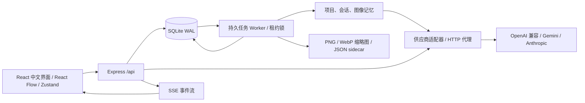

<div align="center">


# 拾光 · Shiguang

**本地优先的 AI 图像创作工作台 · A local-first AI image creation workbench**

多模型并发生图 · 无限画布分支迭代 · 图生图与遮罩 · 创作记忆 · 费用管理

[](https://github.com/tianyin231/shiguang/actions/workflows/ci.yml)
[](https://github.com/tianyin231/shiguang/releases)
[](LICENSE)
[](https://nodejs.org)


一份提示词连向多张图片，每张图独立连线。从任意图片点「修改这张图」即可生成新分支，保留原图与完整创作路径。

**[快速开始](#-快速开始) · [功能特性](#-功能特性) · [文档](#-文档) · [下载 Release](https://github.com/tianyin231/shiguang/releases)**

</div>

## ✨ 功能特性

- **无限画布** — 基于 React Flow：拖拽、框选、分组、撤销/重做、父子分支、版本快照与 JSON 导入导出，切页刷新后完整恢复。
- **多模型并发** — 一次提交「模型 × 提示词变体 × 尺寸 × 画质 × 张数」组合（单批最多 128 个任务）；事务落库的持久队列 + 租约锁，前端断开不丢任务，429 自动降并发冷却。
- **图生图与遮罩** — 参考图续作、mask 涂抹修改；模型能力不足时明确提示，只有手动允许才降级，绝不偷偷替换。
- **创作记忆** — 项目 / 会话 / 图像三层记忆，本地中文分词匹配自动注入提示词；会话本地压缩，不调用收费模型。
- **费用管理** — 按张 / 百万像素 / 百万 token 计价与质量倍率，预算预占与熔断，区分实际费用与估算，支持 CSV 导出。
- **多协议适配** — OpenAI 兼容 / Gemini / Anthropic，含原始代理端点；对话与视觉模型可润色提示词、理解图片。
- **图像工具箱** — 裁剪旋转、调色滤镜、压缩转换、文字水印、配色提取、色度键抠图、GIF 工具、精灵图、像素化、去水印、视频拆帧，全部本机处理。
- **零外部依赖部署** — 单进程 + Node 内置 SQLite（无 Redis、无 Prisma），Docker Compose 一键启动，也可拆分独立 worker。

## 📸 界面预览

| 作品图库 | 图像工具箱 |
| --- | --- |
|  |  |

## 🚀 快速开始

需要 Node.js **22.13 或更新版本**；已在 Windows / Node 22.23.1 验证。使用内置 `node:sqlite`，无需安装数据库服务；Node 22 可能提示 SQLite 仍是实验功能。

```powershell
git clone https://github.com/tianyin231/shiguang.git
cd shiguang
npm ci
Copy-Item .env.example .env
npm run dev
```

打开 **http://127.0.0.1:4327**。已有 `.env` 时保留自己的设置。端口冲突可修改 `PORT`。

Docker 部署：

```sh
docker compose up -d --build
```

更多部署方式（拆分 worker、Nginx 反代、环境变量）见 [docs/DEPLOY.md](docs/DEPLOY.md)。

### 演示模式

不想配置 API Key？点击首页「**试用演示**」即可体验完整流程。演示默认用代码生成固定几何占位图，只用于体验队列和界面——不调用模型、不产生费用，也不能用来判断真实图生图效果。可自行放入 `public/samples/workshop.png` 作为私有样例，该目录不会提交。

## 🧭 使用路径

1. 在「连接设置」填写供应商名称、Base URL、API Key 和接口类型。点击「发现模型」，勾选所需模型后保存；也可直接保存连接，稍后手动添加模型。
2. 在「模型管理」确认能力、尺寸、质量、单价。模型名推断仅作为初始标记，不代表 Key 已验证有权限。主动探测需点击费用确认。
3. 在画布输入提示词，设置每个组合张数、并发和预算，开始生成。更多选项支持 seed、提示词变体及尺寸/质量组合。
4. 从任意图片选择「作为参考图继续创作」，上传原图走图生图；具备 mask 能力时可以画遮罩。能力不足时明确提示，只有手动允许后才用元数据文生图降级。
5. 设置目录后，新图片写入新目录；原图仍从原路径访问。刷新与重开同一浏览器会恢复供应商、项目、任务和画布，无需重填 Key。

## 🏗️ 架构



采用 **React + TypeScript + Vite / Express / Node SQLite**，单个进程即可启动，并能把 worker 拆出。React Flow 提供无限画布，Zustand 管理前端状态，Sharp 处理存储图片。没有依赖 Redis、Prisma、外部字体或向量服务。

## ⚙️ 环境变量

| 变量 | 默认值 | 说明 |
| --- | --- | --- |
| PORT | 4327 | HTTP 端口 |
| HOST | 127.0.0.1 | 本地监听；容器或局域网部署用 0.0.0.0 |
| DATA_DIR | ./data | SQLite 数据库及 WAL 所在目录 |
| OUTPUT_DIR | ./outputs | 新设备默认输出目录，之后可在 UI 修改 |
| WORKER_ENABLED | true | HTTP 进程是否同时运行 worker |
| WORKER_CONCURRENCY | 6 | 每个 worker 最大执行槽数 |
| COOKIE_SECURE | false | HTTPS 部署可设 true |

## 📚 文档

| 文档 | 内容 |
| --- | --- |
| [docs/API.md](docs/API.md) | REST API 全表、请求示例、SSE 事件、原始代理与适配器对照 |
| [docs/DEPLOY.md](docs/DEPLOY.md) | 环境变量、生产部署、Docker、worker 拆分、Nginx 反代 |
| [docs/BEHAVIOR.md](docs/BEHAVIOR.md) | 任务组合、文件存储、费用计算与画布保存的详细行为 |
| [docs/DEVELOPMENT.md](docs/DEVELOPMENT.md) | 项目结构、数据模型、测试与验证 |

## 🔒 安全与隐私

浏览器只访问自己的后端；Key、任务、项目、记忆和费用保存在本地 SQLite，图片保存在后端指定目录，不会上传到第三方。本仓库仅包含源码与配置示例，不包含 API Key、用户图片、数据库或日志。

当前版本面向**本地或可信内网**：Key 明文存于服务端 SQLite，尚无账号系统，不适合直接暴露到公共互联网。

## 🤝 贡献

欢迎提交 Issue 或 Pull Request；提交前请运行 `npm test` 和 `npm run build`。请勿附带真实 Key、设备凭证、数据库或私人图片。

## 📄 许可证

[MIT License](LICENSE)
