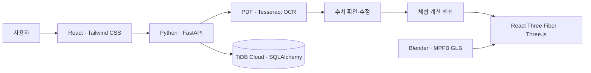
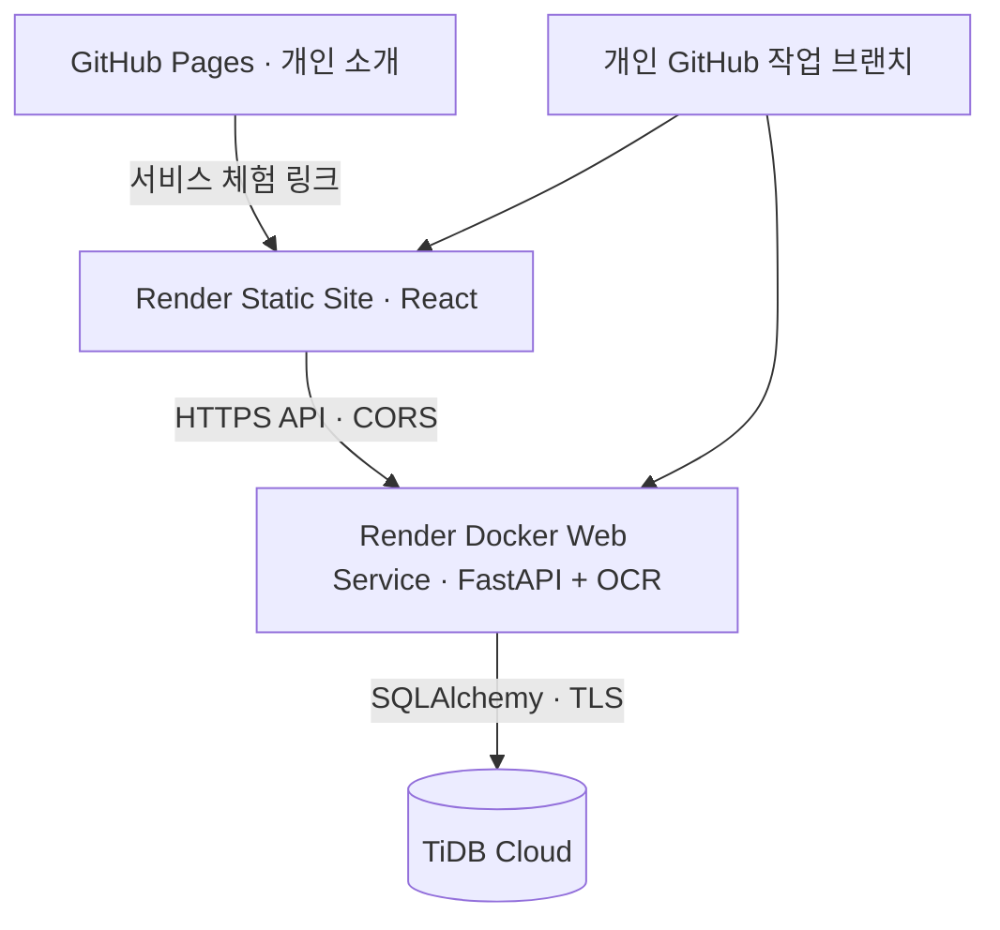

# ONFIT · 내 몸에 맞춰, 나답게 입다

**인바디 수치 기반 추정 체형과 3D 의류 피팅을 연결한 패션 서비스**


### [프로젝트 포트폴리오](https://tjdrms8353-spec.github.io/semiProject/) · [서비스 체험](https://onfit-web.onrender.com) · [API 문서](https://onfit-o49d.onrender.com/docs)

## 프로젝트 소개

### 채용 담당자를 위한 30초 요약

**Python/FastAPI로 입력 검증·계산·저장을 구성하고, React 3D 화면까지 연결한 기능 개발 경험**을 보여주는 프로젝트입니다.

- **개인 기여:** 회원·프로필·인바디·3D 피팅의 관련 API와 화면, Blender 자산 자동화, 통합 검증을 담당했습니다.
- **구현 깊이:** 단순 GLB 표시에서 그치지 않고 신체·의류 Shape Key를 제작하고 실제 정점 좌표 변화로 검증했습니다.
- **운영 고려:** OCR 실패·불완전한 입력·로그인 만료를 처리하고, 로컬과 Docker의 OCR 환경 차이를 구분했습니다.
- **협업 범위:** 상품 수집·가격 분석·공통 UI는 다른 팀원의 담당입니다. 팀 기능을 본인 성과로 합산하지 않습니다.

빠른 확인: [3D 피팅 체험](https://onfit-web.onrender.com/#/fitting) → [대표 코드](#대표-코드와-검증-근거) → [문제 해결 사례](#문제--원인--해결--검증).

ONFIT은 체형·취향에 맞는 패션 탐색과 가상 피팅을 제공하는 **4인 팀 프로젝트**입니다. 이 저장소는 **송성근의 담당 기능과 팀 통합 결과를 정리한 개인 포트폴리오**입니다.

인바디 결과지에서 키·체중·골격근량·체지방률을 확인하고, 이를 바탕으로 만든 개인 추정 체형을 마네킹에 적용합니다. 의류를 선택하면 신체와 의류의 Morph Target이 함께 갱신됩니다.

> 체형은 규칙 기반 시각적 추정이며 실제 인체의 정밀 복원이 아닙니다. 사용자가 세부 치수를 보정할 수 있습니다. 의류 표현은 원단 물리 시뮬레이션이나 검증된 사이즈 추천이 아닙니다.

## 사용 흐름

1. 서비스의 **3D 피팅** 메뉴에서 체형·마네킹을 선택합니다.
2. 신체 치수를 조절하고 의류별 **착용 / 벗기**, 색상을 선택합니다.
3. 로그인 후 인바디 파일을 분석하거나 **내 인바디 불러오기**로 저장된 수치를 가져옵니다.
4. 네 수치를 확인하고 **나의 체형 계산 → 나의 인바디 체형 적용**을 누릅니다.

마우스 드래그로 회전, 휠로 확대·축소, 오른쪽 드래그로 위치 이동이 가능합니다. Render 무료 API는 유휴 상태 이후 첫 응답이 늦을 수 있습니다. 외부 AI 기능은 서버 API 키와 제공사 사용 조건에 영향을 받습니다.

## 송성근 담당 구현

### 실제 구현 화면

| 정면 | 측면 |
| --- | --- |
|  |  |

로컬 앱의 **예시 체형 + 반팔 티셔츠·바지**를 직접 캡처했습니다. 실제 사용자 기록이나 착용 정확도 검증 자료가 아닙니다.

| 영역 | 구현 내용 |
| --- | --- |
| 회원·프로필 | 이메일·비밀번호 회원가입과 JWT 인증, 프로필 API, 같은 탭의 로그인 복원 |
| 인바디 | PDF·이미지 검증, OCR, 수치 확인·수정, 기록 저장·불러오기 |
| 체형 계산 | Python 계산 엔진 분리, 기존 체형 프리셋 + 개인 인바디 추정 체형 |
| 3D 피팅 | Blender/MPFB GLB, 7개 신체 부위별 Morph Target 연결 |
| 의류 | 반팔·긴팔·바지·아우터·후드 집업·모자, 여성형 의류, 독립적인 착용·색상 상태 |
| 사용성·통합 | 체형 변경 중 카메라 유지, 팀 API·UI 통합, Docker OCR 및 Render 분리 배포 구성 |

## 기술 구성



백엔드는 체형·의류 파라미터를 계산하고, 프론트엔드는 즉각적인 모델 변형과 카메라 조작을 처리합니다. 신체 치수(cm)와 시각적 가중치를 구분하며 슬라이더 이동마다 서버를 호출하지 않습니다.

| 분야 | 기술 |
| --- | --- |
| 화면·3D | React, Vite, Tailwind CSS, Three.js, React Three Fiber, Blender, MPFB |
| API·DB | Python, FastAPI, Pydantic, SQLAlchemy, TiDB Cloud |
| 문서·이미지 | Pillow, pypdfium2, pytesseract, Tesseract kor/eng |
| 검증·배포 | pytest, Node.js test runner, Vite, Render, Docker |

## 해결한 문제와 검증

- **체형 조절 시 카메라 초기화:** 모델 변형과 카메라 초기화 수명 주기를 분리했습니다.
- **복부·골반 독립 변형:** Blender 전용 Shape Key를 분리하고 실제 정점 좌표로 검사했습니다.
- **신체·의류 관통:** 의류별 변형 강도와 여유분을 분리했습니다. 극단 체형의 관통은 추가 보정 대상입니다.
- **OCR 실행 환경 차이:** Windows 설정과 배포용 Docker 환경을 구분하고 누락·오류를 사용자에게 표시합니다.
- **팀 통합:** 팀의 최신 AI 검색·모바일 UI를 보존하면서 개인 기능을 연결했습니다.

2026-11-11 통합 검증에서 **관련 백엔드 테스트 129개·프론트엔드 테스트 25개 및 두 화면 빌드**를 통과했습니다. 전체 테스트, 운영 성능, 모든 화면의 육안 검증이나 실측 정확도를 의미하지 않습니다.

원본 인바디 파일은 보관하지 않고 확인한 수치만 저장합니다. 상품 사진의 색상·디자인 적용은 기존 템플릿 기반 근사입니다. 별도 2D AI 피팅 추론 모델은 연결 완료로 표시하지 않습니다.

## 문제 → 원인 → 해결 → 검증

| 사례 | 문제와 원인 | 선택한 해결 방식 | 검증 및 남은 범위 |
| --- | --- | --- | --- |
| 카메라 회귀 | 체형을 조절하면 모델 구도 재계산이 사용자 카메라 상태를 덮어씀 | 카메라 세션과 모델 변형 갱신 분리, 모델 전환과 방향 버튼만 구도 변경 | orbit·zoom·target 보존 회귀 테스트. 모든 기기에서의 조작 검증은 별도 |
| 부위별 변형 | 기존 모델에 복부·골반의 독립 변형 데이터가 없음 | 실제 Blender Shape Key를 추가하고 기본 가중치를 보존한 채 연결 | 두 부위의 실제 정점 변화와 독립성 검사. 의학적 정확도 검증은 아님 |
| 인바디 분석 | OCR 설치·언어 데이터 누락 또는 문서 형식 차이로 추출 실패 | Windows 경로 설정과 Docker OCR 환경을 분리하고 수치 확인 단계를 제공 | 누락·범위 오류·파싱 관련 테스트. 모든 인바디 양식 인식은 미보장 |
| 새로고침 로그인 | 메모리의 로그인 상태가 새로고침 때 사라짐 | 같은 탭의 sessionStorage 토큰을 서버 `/me`로 검증해 복원 | 만료·401·일시 장애·로그아웃 테스트. 영구 로그인은 아님 |

## 대표 코드와 검증 근거

| 살펴볼 역량 | 구현 코드 | 관련 검사 |
| --- | --- | --- |
| 순수 계산과 API 책임 분리 | [body_engine.py](https://github.com/tjdrms8353-spec/semiProject/blob/integration/team-develop-20261106/Semiproject-front/backend/app/features/fitting/body_engine.py), [garment_engine.py](https://github.com/tjdrms8353-spec/semiProject/blob/integration/team-develop-20261106/Semiproject-front/backend/app/features/fitting/garment_engine.py) | [test_fitting.py](https://github.com/tjdrms8353-spec/semiProject/blob/integration/team-develop-20261106/Semiproject-front/backend/tests/test_fitting.py) |
| 입력 오류·문서 처리 | [extraction.py](https://github.com/tjdrms8353-spec/semiProject/blob/integration/team-develop-20261106/Semiproject-front/backend/app/features/inbody/extraction.py) | [test_inbody_extraction.py](https://github.com/tjdrms8353-spec/semiProject/blob/integration/team-develop-20261106/Semiproject-front/backend/tests/test_inbody_extraction.py) |
| 추정값과 측정값 구분 | [body_preview.py](https://github.com/tjdrms8353-spec/semiProject/blob/integration/team-develop-20261106/Semiproject-front/backend/app/features/inbody/body_preview.py) | [test_inbody_body_preview.py](https://github.com/tjdrms8353-spec/semiProject/blob/integration/team-develop-20261106/Semiproject-front/backend/tests/test_inbody_body_preview.py) |
| 카메라 상태와 렌더링 분리 | [glbCamera.js](https://github.com/tjdrms8353-spec/semiProject/blob/integration/team-develop-20261106/Semiproject-front/frontend/src/components/fitting/glbCamera.js) | [glbCamera.test.js](https://github.com/tjdrms8353-spec/semiProject/blob/integration/team-develop-20261106/Semiproject-front/frontend/src/components/fitting/glbCamera.test.js) |
| 인증 상태 복원 | [authSession.js](https://github.com/tjdrms8353-spec/semiProject/blob/integration/team-develop-20261106/Semiproject-front/frontend/src/services/authSession.js) | [authSession.test.js](https://github.com/tjdrms8353-spec/semiProject/blob/integration/team-develop-20261106/Semiproject-front/frontend/src/services/authSession.test.js) |

## 배포 구조와 선택 이유



프론트·백엔드를 분리하면 UI 변경과 API 변경을 각각 배포하고 장애 로그도 서비스별로 확인할 수 있습니다. 대신 API 주소·CORS 설정과 양쪽 응답 계약을 맞춰야 합니다. Docker는 파일 업로드 자체가 아니라 **Tesseract와 언어 데이터까지 포함한 실행 환경을 맞추기 위해** 사용합니다. GitHub Pages는 소개 페이지이며 API·DB를 실행하지 않습니다.

## 재현 가능한 관련 검사

의존성 설치 후 `Semiproject-front/backend`에서:

```powershell
.\.venv\Scripts\python.exe -m pytest tests/test_fitting.py tests/test_inbody_extraction.py tests/test_inbody_body_preview.py -q
```

`Semiproject-front/frontend`에서:

```powershell
node --test src/components/fitting/glbCamera.test.js src/services/authSession.test.js
npm.cmd run check:site
```

위 명령은 대표 검사 일부입니다. 앞의 129개·25개 수치는 2026-11-11 통합 시 선택한 더 넓은 검사 묶음의 결과이며 커버리지 비율이나 속도 개선 수치가 아닙니다.

## 팀 구성

| 이름 | 담당 |
| --- | --- |
| **송성근** | 회원·프로필, 개인맞춤 코디, 인바디, 3D 피팅 및 관련 프론트·백엔드 |
| 황상옥 | 공통 프론트엔드·UI |
| 안종범 | 상품 크롤링·동일 상품 매칭·가격 비교 |
| 이승호 | 가격 이력·구매 타이밍 분석·가격 수집 자동화 |

## 실행과 코드

최신 앱 소스는 **[integration/team-develop-20261106](https://github.com/tjdrms8353-spec/semiProject/tree/integration/team-develop-20261106)** 브랜치에 있습니다. Python·Node.js 및 패키지 설치 후 Windows 저장소 최상위에서 실행합니다.

```powershell
powershell.exe -NoProfile -ExecutionPolicy Bypass -File .\Start-ONFIT.ps1
```

- 로컬 화면: `http://127.0.0.1:5173/#/fitting`
- 로컬 API: `http://127.0.0.1:8000/docs`
- [실행·환경설정 안내](https://github.com/tjdrms8353-spec/semiProject/blob/integration/team-develop-20261106/Semiproject-front/README.md)
- [개발 작업일지](https://github.com/tjdrms8353-spec/semiProject/blob/integration/team-develop-20261106/docs/progress/송성근_개발_작업일지.md)
- [인바디 체형 설계](https://github.com/tjdrms8353-spec/semiProject/blob/integration/team-develop-20261106/Semiproject-front/docs/integration/인바디_추정체형_연결.md)
- [자산 출처·라이선스](https://github.com/tjdrms8353-spec/semiProject/tree/integration/team-develop-20261106/Semiproject-front/docs/assets)

실제 설정은 `Semiproject-front/backend/.env` 또는 배포 환경변수에 입력합니다. 비밀번호·API 키를 Git에 올리지 않으며 공용 DB에 초기화 SQL을 임의 실행하지 않습니다. 로컬 OCR에는 Tesseract와 kor/eng 언어 데이터가 필요합니다.

개별 MPFB/MakeHuman 자산과 의존성은 각각의 라이선스를 따릅니다. 프로젝트 전체의 별도 오픈소스 라이선스는 선언하지 않았습니다.
