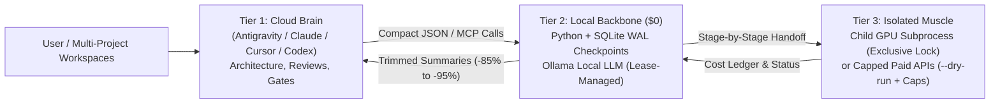

<p align="right">
  <strong>English</strong> | <a href="README.vi.md">Tiếng Việt</a>
</p>

# VieForge

**Code First, Local LLM Second, Cloud Last.**

[](https://github.com/vieforge/vieforge/actions/workflows/ci.yml)
[](https://pypi.org/project/vieforge/)
[](LICENSE)
[](pyproject.toml)
[](LEGAL_AND_COMPLIANCE.md)
[](skills/three-tier-orchestrator/references/hardware-profiles.md)
[](README.vi.md)
[](https://vieforge.dev)

<p align="center">
  <a href="https://vieforge.dev">
    
  </a>
</p>

Turn any consumer workstation into a **checkpointed, budget-guarded, multi-project local AI worker** to cut Cloud Agent quota and API spend by **70–90%**. Built on open **MCP (Model Context Protocol)** + **Agent Skill (`SKILL.md` / `AGENTS.md`)** standards for **Antigravity, Claude Code, Cursor, Codeium/Windsurf, Cline, VS Code Copilot, and Codex CLI**.

---

## Zero-Knowledge Setup (Just Ask Your AI Agent)

New to Git, Python, or MCP? You do not need to touch a terminal manually. Open **Antigravity, Claude Code, Cursor, Windsurf, or Codex CLI** and paste this single message:

> *"Clone `https://github.com/vieforge/vieforge`, read `AGENT_INSTALL.md`, run `python scripts/quick_setup.py`, and show me the Savings Receipt in plain language."*

Your AI agent will automatically detect your hardware, install the TierForge skill for your IDE, generate exact absolute-path MCP configs, and run a `$0` live demo.

---

## 3-Tier Hybrid Architecture



| Tier | Executor | Responsibilities | Target Cost |
| :--- | :--- | :--- | :---: |
| **Tier 1 (Brain)** | Cloud Agent (Antigravity / Claude / Cursor / Windsurf / Codex) | Architecture, schema design, code review, Approval Gates, root-cause debugging | Cloud Quota |
| **Tier 2 (Backbone)** | Python Stdlib + SQLite WAL + Local LLM (Ollama / OpenAI-compat) | Per-item checkpoints, SHA-256 deduplication, bulk extraction/JSON formatting, log trimming | **`$0.00`** |
| **Tier 3 (Muscle)** | OS-Isolated Local GPU Subprocess / Capped External APIs | Heavy local inference, media/data batching, paid APIs under `--dry-run`, `MAX_RETRY <= 2`, `MAX_JOB_USD`, `DAILY_USD_CAP` | **`$0` or Capped** |

---

## 5-Minute Quickstart (`$0`, Zero Dependencies)

```bash
# Option A: Install directly from PyPI (recommended)
pip install vieforge
vieforge setup

# Option B: Clone the repository
git clone https://github.com/vieforge/vieforge.git
cd vieforge
python scripts/quick_setup.py

# Or run the offline demos directly (works even without Ollama via --mock-llm):
python examples/01_batch_doc_processor/run_demo.py --dry-run
python examples/01_batch_doc_processor/run_demo.py --reset --mock-llm --simulate-interrupt-after 2
python examples/01_batch_doc_processor/run_demo.py --mock-llm
python examples/03_ci_log_triage/run_ci_triage.py --mock-llm --reset
```

Example **Savings Receipt** printed at the end of the resumed run:

```text
=== TierForge Savings Receipt (demo_01_batch) ===
Items processed : 5
Actual cost     : $0.0000 USD
Cloud baseline  : $0.0405 USD (external/text-frontier)
Estimated saved : $0.0405 USD (100.0%)
Context trimmed : 2169 -> 108 chars (-95.0%)
```

---

## Reproducible Token Savings Benchmark (`$0`, 0.3s)

Verify exact Cloud Agent token burn on your own machine (`ceil(chars / 4)` estimator):

```bash
python scripts/benchmark_token_savings.py
```

| Real-World Workload | Cloud-Only Tokens | VieForge Cloud Tokens | Reduction Factor | Saved |
| :--- | ---: | ---: | ---: | ---: |
| One-time Session Overhead (`SKILL.md` 691 + `AGENTS.md` 448 + MCP 320) | 0 | 1,459 | — | Paid once |
| 100-Document Batch Classification & JSON Extraction | 23,662 | 200 | **118.3x** | **-99.2%** |
| Noisy CI / Pytest Log + Traceback Compression (390 lines) | 11,150 | 998 | **11.2x** | **-91.0%** |
| 50-Item Job Crashed at 30/50 + SQLite Checkpoint Resume | 17,920 | 457 | **39.2x** | **-97.4%** |
| **COMBINED NET (incl. 1,459-token session overhead)** | **52,732** | **3,114** | **16.9x** | **-94.1%** |

> **Break-even transparency:** VieForge pays off its 1,459-token one-time session overhead after just **1 noisy CI log** or **3–5 batch items**. For quick 1-turn Q&A or single-file edits, you do not need to invoke VieForge. Run **`vieforge savings`** (or `vieforge savings --html savings.html`) to measure your real local token & USD savings and see your Usage Tier (`L0`–`L3`) — full empirical breakdown in [docs/REAL_WORLD_SAVINGS_BENCHMARK.md](docs/REAL_WORLD_SAVINGS_BENCHMARK.md).

---

## Multi-Agent Ecosystem Support

Run `vieforge install-skill --target all` (or target a specific IDE such as `--target codeium`, `--target claudecode`, `--target cline`) to install the `three-tier-orchestrator` skill and generate absolute-path MCP configs (preserving `.venv` symlinks on macOS/Linux):

| AI Agent / IDE | Skill Path / Target Flag | MCP Config Format | Repo Instructions |
| :--- | :--- | :--- | :---: |
| **Antigravity** | `~/.gemini/config/skills/three-tier-orchestrator` (`--target antigravity`) | JSON (`mcpServers`) | `AGENTS.md` + `SKILL.md` |
| **Claude Code** | `~/.claude/skills/three-tier-orchestrator` (`--target claude` / `claudecode`) | JSON + 1-line `claude mcp add` | `AGENTS.md` + `SKILL.md` |
| **Codeium / Windsurf** | `~/.codeium/windsurf/skills/three-tier-orchestrator` (`--target codeium` / `windsurf`) | JSON (`~/.codeium/windsurf/mcp_config.json`) | `AGENTS.md` + `SKILL.md` |
| **Cursor** | `~/.cursor/skills/three-tier-orchestrator` (`--target cursor`) | JSON (`~/.cursor/mcp.json`) | `AGENTS.md` + `SKILL.md` |
| **Cline / Roo Code** | `~/.cline/skills/three-tier-orchestrator` (`--target cline` / `roo`) | JSON (`mcpServers`) | `AGENTS.md` + `SKILL.md` |
| **VS Code / GitHub Copilot** | Project-level config | JSON (`.vscode/mcp.json` `servers` schema) | `AGENTS.md` |
| **Codex CLI** | `~/.agents/skills/three-tier-orchestrator` (`--target codex`) | TOML (`~/.codex/config.toml`) | `AGENTS.md` |

To start the MCP server (compatible with both **`mcp 2.x` `MCPServer`** and **`mcp 1.x` `FastMCP`**), run `pip install -U "vieforge[mcp]"` and `vieforge doctor` to verify your setup.

---

## Multi-Project Concurrency Safety

Running 3+ projects simultaneously in Antigravity or Claude Code on one workstation? `core/concurrency.py` prevents cross-workspace race conditions using 100% stdlib OS advisory locks (`msvcrt` on Windows, `fcntl` on macOS/Linux):

- **Ref-Counted Ollama VRAM Lease (`OllamaLeaseManager`):** `LLMRouter.batch_session()` keeps your local model warm during a batch (avoiding 5–10x cold-start reloads) and only triggers `keep_alive=0` unload when the **last** active project releases its lease. Dead PIDs are pruned automatically.
- **Exclusive Tier 3 GPU Queue (`exclusive_gpu_lock`):** Heavy GPU subprocesses serialize cleanly across workspaces instead of colliding on an 8 GB VRAM card.
- **Atomic Daily Spend Ledger:** `CostTracker` wraps `daily_spend.json` in a cross-process lock + atomic `os.replace`, preventing lost spend records across parallel runs.
- **Project-Scoped Checkpoints:** `scoped_job_id(project_id, job_id)` + SQLite WAL (`busy_timeout=15000ms`) isolates job state when multiple workspaces share a database.

---

## Hardware Profiles & Zero OS-Mutation Policy

TierForge **never** modifies OS services, Windows Registry, network/IPv6 stacks, or system pagefiles. All memory hygiene runs strictly in application space.

| Profile | Recommended Local Model | Batch / VRAM Strategy | Min Free VRAM Guard |
| :--- | :--- | :--- | :---: |
| **CPU-Only (16–32 GB RAM)** | `qwen2.5:3b` / `llama3.2:3b` | `batch_session()` + JSON auto-retry (<= 2) | CPU fallback |
| **8 GB VRAM (RTX 3060 Ti / 4060)** | `qwen2.5:7b` (Q4_K_M) | Stage-by-stage isolation; unload Ollama before Tier 3 GPU | `4096 MB` |
| **12–16 GB VRAM (RTX 4070)** | `qwen2.5:7b` / `14b` | Subprocess isolation per stage | `6144 MB` |
| **24 GB+ VRAM (RTX 3090 / 4090)** | `qwen2.5:14b` / `32b` | High-throughput batching + `exclusive_gpu=True` | `10240 MB` |
| **Apple Silicon (16–64+ GB)** | `7b` (16 GB) / `14b–32b` (32 GB+) | Unified memory subprocess isolation | Leave >= 4 GB headroom |

---

## Clean-Room Comparison & Companion Synergy

TierForge's core is **100% MIT-licensed Python stdlib** with an automated clean-room auditor (`python -m core.license_audit`) that blocks `BUSL-1.1`, `AGPL-3.0`, and `CC-BY-NC` dependencies.

| Capability | TierForge Harness (`MIT`) | `rtk-oss` (`Apache-2.0`) | `ppgranger/token-saver` (`Apache-2.0`) |
| :--- | :---: | :---: | :---: |
| SQLite per-item checkpoint & `$0` resume | **Built-in** | No | No |
| Budget caps (`--dry-run`, job/daily USD) | **Built-in** | No | No |
| Multi-project GPU VRAM lease & subprocess isolation | **Built-in** | No | No |
| Worker stdout/traceback compression | **Built-in (`output_trimmer.py`)** | Companion CLI (shell proxy) | Companion CLI (context saver) |
| Commercial-safe clean-room license | **MIT (100% stdlib)** | Apache-2.0 *(avoid BUSL-1.1 std `rtk`)* | Apache-2.0 |

> **Companion Setup:** `scripts/preflight_check.py` detects optional `rtk-oss` (Apache-2.0) and `token-saver` (Apache-2.0) side-by-side without vendoring their source code.

---

## Zero-Cost Architect Handoff & Optional BYOA Companion

- **Pattern A — Zero-Dependency Prompt Handoff (100% Enterprise-Safe):** Export a compact spec/audit prompt (e.g., via `scripts/audit_step.py`), paste it into any Web AI to draft a Blueprint, and hand the Blueprint back to TierForge for local execution.
- **Pattern B — Optional Personal BYOA Browser Bridge:** For personal productivity on your own machine, `extensions/tierforge-bridge/` provides an auditable, localhost-only (`127.0.0.1:19876`) Manifest V3 bridge. See [LEGAL_AND_COMPLIANCE.md](LEGAL_AND_COMPLIANCE.md) — **enterprise/high-volume commercial workloads should use official paid APIs via Tier 3 budget guards rather than Web UI automation.**

---

## Verification & Cross-OS Quality Gate

VieForge is continuously verified across **Ubuntu Linux, macOS, and Windows** (Python 3.10 & 3.12) via a [2-Axis Cross-OS Quality Gate](docs/CROSS_OS_QUALITY_GATE.md) that tests clean wheel installation outside the repo, real multi-process OS locks (`fcntl` / `msvcrt`), and 100% token benchmark parity:

```bash
# Run full unit test suite (pytest)
uv run --extra dev pytest -v

# Run 2-Axis quality audit (5 Core Contracts + Performance/DX score + portability scan)
uv run python scripts/audit_step.py --step verify

# Run full clean-wheel E2E + multi-process OS lock check locally
uv run python scripts/verify_cross_os.py run --step local_check --out data/os_report_local.json
```

> **Local LLM Backends:** `LLMRouter` works natively with **Ollama** (`http://127.0.0.1:11434`, with `keep_alive=0` VRAM lease hygiene) and auto-detects **OpenAI-compatible** local servers (**LM Studio** `:1234/v1`, **llama.cpp** `:8080/v1`, **vLLM** `:8000/v1`) via `TIERFORGE_LLM_BASE_URL` / `TIERFORGE_LLM_API_STYLE=auto`.

### Open-Core Roadmap & Enterprise Readiness
- **MIT Core (Always Free & Open Source):** 3-Tier orchestration engine (`core/`), SQLite WAL checkpointing & response cache (`TIERFORGE_LLM_CACHE_DB`), Ollama/OpenAI-compat lease manager, clean-room output trimmer with automatic **secret redaction** (`redact_secrets=True`), OpenTelemetry `gen_ai.*` JSONL tracing (`emit_genai_span`), pluggable local RBAC/audit hook (`core/policy_guard.py`), non-root container (`Dockerfile` + `compose.yml`), MCP server (`mcp 2.x` & `1.x`), and multi-IDE skill installer.
- **Pro / Enterprise Extensions (Commercial Add-ons):** Multi-node LAN/GPU worker pool, team-wide spend dashboards, approval webhooks, SAML/OIDC SSO & OPA policy packs. See [Enterprise & Commercialization Architecture](docs/ENTERPRISE_ARCHITECTURE.md).

See [LICENSE](LICENSE) and [LEGAL_AND_COMPLIANCE.md](LEGAL_AND_COMPLIANCE.md) for full licensing and compliance terms.
- **Website:** [https://vieforge.dev](https://vieforge.dev)
- **Contact:** `hello@vieforge.dev` | **Security:** `security@vieforge.dev`

---

### Support the Project
VieForge is **100% MIT-licensed and free forever**. If it saves you Cloud API budget, you can [buy the maintainer a coffee on Ko-fi](https://ko-fi.com/aivieforge) to help cover local test hardware and maintenance costs.

### Trademark Notice
The source code in this repository is licensed under the **MIT License**. The **VieForge** name, logo, and associated brand marks are not licensed under MIT and remain the property of **VieForge Contributors**. Forks and derivative works must use a distinct name and may not imply official endorsement.
