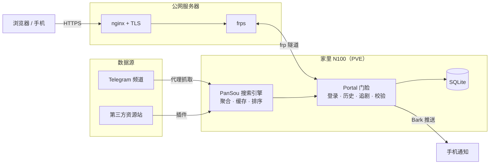

<div align="center">

# 觅影 · MiYing

### 自托管的网盘影视聚合检索站

聚合上游 [PanSou](https://github.com/fish2018/pansou-web) 抓取的 Telegram 频道与第三方资源站，
按画质（4K 原盘 / REMUX / 杜比视界…）排序，只给你能直接打开的网盘链接。
外层再包一层 **portal 门脸**：长效登录、跨设备历史 / 收藏 / 追剧、失效链接过滤、
海报代理与豆瓣补全、限流与告警。

[](LICENSE)
[](https://www.python.org/)
[](https://fastapi.tiangolo.com/)
[](https://docs.docker.com/compose/)
[]()

**仅索引公开的网盘分享链接，不存储、不转码、不传播任何视频文件。**

</div>

---

## 界面预览

**桌面 · 首页与搜索结果**

<p align="center">
  
  
</p>

**资源详情 · 列表视图**

<p align="center">
  
  
</p>

**我的收藏 · 追剧更新**

<p align="center">
  
  
</p>

**手机端（响应式）**

<p align="center">
  
</p>

## 快速开始

**需要**：一台常开主机（Docker / Docker Compose v2）、（可选）用于回源 Telegram 图床的代理。

### 一键部署（推荐）

```bash
git clone https://github.com/wangjiespark316/miying.git
cd miying
bash scripts/install.sh        # 交互式设置管理员，自动生成 JWT、构建启动
```

### 手动部署

```bash
cp docker-compose.example.yml docker-compose.yml
# 编辑 docker-compose.yml：填入 AUTH_USERS、JWT_SECRET（openssl rand -hex 32）、
# BARK_KEY、POSTER_PROXY、上游频道 / 插件、代理等
docker compose up -d --build
curl http://localhost:8981/portal/health    # {"ok":true,...}
```

- portal 监听 `8981`（容器内 80），上游 pansou 监听 `8980`。
- 前端 `web/index.html` 用任意静态服务器托管，把 `/api`、`/portal` 反代到 portal（见 `deploy/nginx.conf`）。

## 功能特性

- **聚合搜索**：百度 / 夸克 / 阿里 / UC / 天翼 / 115 / 迅雷 / 123 / 光鸭 / PikPak / 磁力等多来源，按画质分排序、按 URL 去重；磁力按 btih 哈希去重。
- **混合 FTS5 预索引**：定时把豆瓣热榜、高频搜索词、追剧剧名与画质标杆词的结果写入本地 SQLite（trigram 全文索引 + LIKE 兜底，适配中文与英文标题）；搜索先查本地（约百毫秒级秒开），不足或未命中再回源 PanSou，结果后台异步回填（SWR），前端无感。全程只调 PanSou 自己的搜索接口，**不连 Telegram、不申请 api_id/api_hash、不跑 userbot、无封号风险**。
- **长效登录**：portal 自签 HS256 令牌，默认 180 天有效；多用户 + 管理员，账号走环境变量。
- **跨设备同步**：搜索历史、收藏、追剧订阅全部存服务端 SQLite，不依赖单浏览器。
- **追剧更新**：订阅剧目后后端定时（默认 2 小时）轮询，发现新资源经 **Bark** 推送到手机。
- **失效链接过滤**：搜索后并发校验排序前列的分享页，自动隐藏确认失效的链接。
- **海报体验**：Telegram 图床经同源代理回源（可挂代理绕墙）；失败 / 缺图自动走豆瓣补全。
- **热门榜**：豆瓣实时热门电影 / 剧集，点击即搜；首页画质快捷入口。
- **安全风控**：登录防爆破、按 IP 限流、Bark 滥用告警；完整 CSP / HSTS / X-Frame-Options 等安全头，敏感路径显式 404。
- **响应式**：单文件原生前端，桌面与手机（含 375px 窄屏）均可用。

## 架构



## 公网访问

| 方式 | 说明 | 配置 |
| --- | --- | --- |
| **frp 内网穿透**（默认） | 家里无公网 IP，frpc 把 portal 映射到公网服务器，nginx 做 TLS | `deploy/frpc.example.toml` |
| **公网服务器直跑** | 机器自带公网 IP，nginx 直接反代 | `deploy/nginx.conf` |
| 纯内网使用 | 只在家里局域网访问，无需公网 | 直接访问 `:8981` |

完整部署 / 加固 / QA 记录见 [`deploy/部署说明.md`](deploy/部署说明.md)。

## 部署位置选择

| 方案 | 成本 | 说明 |
| --- | --- | --- |
| **家里 N100 + frp** | 零额外成本 | 后端在国内、验证网盘链接快，数据自主（本项目默认） |
| 境外 VPS（香港 / 新加坡） | ¥20–40/月 | 直连 TG 无需代理、自带公网 IP，跨境验证网盘略慢 |
| Oracle Cloud 免费档 | ¥0 | 永久免费，注册需信用卡、ARM 实例难抢 |

## 性能 / 容量（实测）

端到端阶梯压测（实时搜索、不命中缓存的最坏情况）：

| 同时搜索 | 平均响应 | p95 | 失败 |
| --- | --- | --- | --- |
| 20 人（舒适区） | 2.9s | 4.2s | 0 |
| 40–60 人 | 4.0–4.5s | 5.4s | 0 |
| **100 人** | 4.6s | 6.1s | **0** |

- 吞吐天花板约 **18–20 请求/秒**；系统是「逐渐变慢」而非「突然崩」。
- 搜索是极低频、瞬时动作，可支撑几百注册用户、日常 100–200 人在线。

## 目录结构

```
miying/
├── portal/
│   ├── app.py                 # FastAPI 门脸：登录/历史/收藏/追剧/校验/限流/海报代理
│   ├── Dockerfile             # portal 镜像（python:3.12-slim + uvicorn）
│   └── requirements.txt
├── web/
│   └── index.html             # 单文件前端（原生 HTML/CSS/JS）
├── scripts/
│   └── install.sh             # 一键部署脚本
├── deploy/
│   ├── nginx.conf             # 公网 nginx 站点示例（安全头 + 反代）
│   ├── frpc.example.toml      # frp 内网穿透示例
│   └── 部署说明.md             # 完整部署/加固/QA 记录
├── assets/                    # README 截图
├── docker-compose.example.yml
├── .env.example
└── LICENSE
```

## 安全须知（自托管）

- **绝不要**把真实的 `docker-compose.yml`、`.env`、`*.db`、代理凭证提交到仓库（已在 `.gitignore`）。
- `JWT_SECRET` 用 `openssl rand -hex 32` 生成且长度 ≥ 32，否则 portal 拒绝启动。
- `AUTH_USERS` 用强密码；管理员账号对限流豁免。
- 海报代理 `/portal/img` 有意不鉴权（`` 不带令牌），靠域名 + 协议白名单防 SSRF，不要放开任意 URL。

## 技术栈

- **上游**：[fish2018/pansou-web](https://github.com/fish2018/pansou-web)（镜像 `ghcr.io/fish2018/pansou-web:latest`）
- **门脸**：FastAPI + Uvicorn + httpx + SQLite
- **前端**：原生 HTML/CSS/JS（无构建、无框架），豆瓣公开接口补全海报
- **部署**：Docker Compose + nginx + （可选）frp

## 免责声明

本项目仅用于学习与个人自托管的检索索引，不托管任何受版权保护的内容；所有链接均来自第三方公开页面，版权归原作者所有。请于当地法律允许、且遵守各网盘服务条款的前提下使用，因不当使用产生的后果由使用者自行承担。
