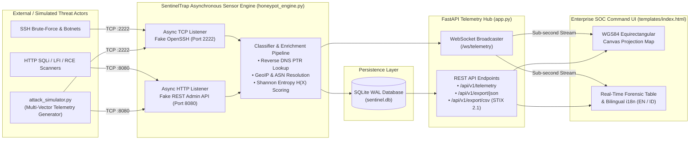

# SentinelTrap: Threat Intelligence Honeypot & Global Attack Surface Observer

[](https://fastapi.tiangolo.com/)
[](https://www.python.org/)
[](https://peps.python.org/pep-0008/)
[](https://oasis-open.github.io/cti-documentation/)
[](https://opensource.org/licenses/MIT)

**SentinelTrap** is an enterprise-grade, low-interaction deception and threat intelligence platform engineered to capture, classify, enrich, and visualize unauthorized reconnaissance and exploitation attempts in real time. Built entirely on Python's asynchronous `asyncio` networking primitives and **FastAPI**, SentinelTrap exposes instrumented decoy listeners for **SSH (`TCP/2222`)** and **REST Admin API (`TCP/8080`)** services while streaming enriched forensic telemetry to a high-density, low-latency Security Operations Center (SOC) web interface.

---

<!-- Live Telemetry & Threat Map Preview -->
<p align="center">
  
</p>

---

## Executive Summary & Operational Use Cases

Modern security operations teams require visibility into pre-exploitation reconnaissance and automated credential-stuffing campaigns before adversaries reach production workloads. SentinelTrap provides a zero-dependency, self-contained sensor node designed for:

1. **Proactive Threat Hunting & Perimeter Telemetry**: Deploy on DMZ segments or cloud edge VPCs to identify scanning ASNs, Tor exit nodes, and automated botnet droppers (Mirai, Mozi, Kinsing) probing non-standard SSH and administrative REST endpoints.
2. **SOC Analyst Training & Blue-Team Exercises**: Utilize the bundled `attack_simulator.py` engine to replay realistic, multi-vector adversarial campaigns (SQL Injection, Directory Traversal/LFI, Log4Shell/JNDI RCE, and SSH dictionary brute-force) with deterministic Shannon payload entropy scoring.
3. **Automated Local IoC Extraction (STIX 2.1 & JSON)**: Export captured Indicators of Compromise (IoCs) directly into **OASIS STIX 2.1** compliant CSV patterns (`[ipv4-addr:value = '...' AND network-traffic:dst_port = ...]`) or structured JSON bundles for immediate ingestion into SIEM, SOAR, or Threat Intelligence Platforms (OpenCTI, MISP, Splunk).

---

## System Architecture



### ASCII Data-Flow Pipeline

```text
+-----------------------------------------------------------------------------------+
|                        ADVERSARIAL & SIMULATED TRAFFIC                            |
|     [SSH Brute-Force / Mirai Dropper]        [SQLi / Path Traversal / JNDI RCE]   |
+---------------------+-----------------------------------------+-------------------+
                      |                                         |
                      v (TCP Port 2222)                         v (TCP Port 8080)
+---------------------+-----------------------------------------+-------------------+
|                        HONEYPOT ENGINE (honeypot_engine.py)                       |
|  1. Banner Emulation (OpenSSH_8.9p1 / nginx 401 Bearer Realm)                     |
|  2. Asynchronous Reverse PTR Resolution + Deterministic GeoIP/ASN Mapping         |
|  3. Shannon Entropy H(X) Calculation & Regex Signature Classification             |
+-----------------------------------------+-----------------------------------------+
                                          |
                    +----------------------+----------------------+
                    |                                             |
                    v (WAL Persistence)                           v (Async Callback)
+------------------+------------------+       +------------------+------------------+
|       SQLITE DATABASE (sentinel.db) |       |   WEBSOCKET HUB (/ws/telemetry)     |
|  Indexed on: timestamp, ip, severity|       |   Sub-second JSON event push        |
+------------------+------------------+       +------------------+------------------+
                    |                                             |
                    +----------------------+----------------------+
                                          |
                                          v
+-----------------------------------------+-----------------------------------------+
|                ENTERPRISE WEB COMMAND INTERFACE (http://127.0.0.1:8000)           |
|  • 4 KPI Telemetry Cards  • WGS84 World Projection Map  • STIX 2.1 CSV / JSON     |
|  • Real-Time Bilingual Switcher (English & Bahasa Indonesia)                      |
+-----------------------------------------------------------------------------------+
```

---

## Project Directory Structure

```text
SentinelTrap-Enterprise/
├── app.py                  # FastAPI asynchronous server, WebSocket hub & STIX/JSON exporters
├── honeypot_engine.py      # Low-interaction SSH (2222) & HTTP (8080) listeners + SQLite WAL engine
├── attack_simulator.py     # Multi-vector adversarial traffic generator with global GeoIP origins
├── requirements.txt        # Pinned production Python dependencies
├── run_demo.bat            # One-click Windows environment bootstrapper & process orchestrator
├── README.md               # Enterprise technical documentation
|
├── static/
│   ├── logo.png            # Local brand mark asset (with automatic inline SVG fallback)
│   ├── styles.css          # Slate/Zinc dark-mode styling & high-contrast status badges
│   └── app.js              # WebSocket client, WGS84 canvas map renderer, i18n engine (EN/ID)
└── templates/
    └── index.html          # Single-page Enterprise Security Command Interface
```

> **Customizing the Navigation Brand Logo (`static/logo.png`)**:
> Place any square PNG logo (`128x128` or `256x256` RGBA recommended) at `static/logo.png`. If `static/logo.png` is removed or unavailable, the navigation header automatically falls back to a clean inline vector shield icon without broken image indicators.

---

## Deployment Guide

### Option 1: Single-Click Windows Execution (`run_demo.bat`)

On Windows workstations, double-click `run_demo.bat` or run it from Command Prompt / PowerShell:

```bat
.\run_demo.bat
```

The automation script performs the following steps deterministically:
1. Validates that **Python 3.9+** is installed and accessible on `PATH`.
2. Creates an isolated `.venv` virtual environment if one does not already exist.
3. Installs all dependencies from `requirements.txt`.
4. Launches `app.py` (which binds ports `8000`, `2222`, and `8080`) alongside `attack_simulator.py`.
5. Opens your default browser to `http://127.0.0.1:8000` and cleanly terminates background workers when you exit.

### Option 2: Manual Step-by-Step CLI Deployment (Linux / macOS / Windows)

1. **Create and activate a virtual environment**:
   ```bash
   python3 -m venv .venv
   # Linux / macOS:
   source .venv/bin/activate
   # Windows PowerShell:
   .\.venv\Scripts\Activate.ps1
   ```

2. **Install dependencies**:
   ```bash
   pip install --upgrade pip
   pip install -r requirements.txt
   ```

3. **Start the SentinelTrap FastAPI & Honeypot Core**:
   ```bash
   python app.py
   ```

4. **Start the Adversarial Traffic Simulator (in a second terminal)**:
   ```bash
   python attack_simulator.py --burst 14 --min-delay 2.0 --max-delay 4.5
   ```

5. **Access the Web Command Interface**:
   Open `http://127.0.0.1:8000` in any modern browser. You can also test the honeypot listeners directly from your terminal:
   ```bash
   # Probe the HTTP REST Admin Honeypot (Port 8080)
   curl -i "http://127.0.0.1:8080/api/v1/admin/users?id=1'%20UNION%20SELECT%201,password%20FROM%20users--"

   # Probe the SSH Honeypot (Port 2222)
   nc 127.0.0.1 2222
   ```

---

## SQLite Database Schema (`sentinel.db`)

All captured incidents are persisted in `sentinel.db` using SQLite Write-Ahead Logging (`PRAGMA journal_mode=WAL`) for concurrent read/write performance:

```sql
CREATE TABLE IF NOT EXISTS telemetry_events (
    id INTEGER PRIMARY KEY AUTOINCREMENT,
    timestamp TEXT NOT NULL,          -- ISO-8601 UTC timestamp (millisecond precision)
    source_ip TEXT NOT NULL,          -- Originating IPv4/IPv6 address
    reverse_ptr TEXT NOT NULL,        -- Resolved DNS PTR record or edge fallback
    country TEXT NOT NULL,            -- Resolved country name
    iso_code TEXT NOT NULL,           -- Two-letter ISO-3166 country code
    city TEXT NOT NULL,               -- Resolved city name
    latitude REAL NOT NULL,           -- WGS84 decimal latitude
    longitude REAL NOT NULL,          -- WGS84 decimal longitude
    asn TEXT NOT NULL,                -- Autonomous System Number & ISP organization
    targeted_protocol TEXT NOT NULL,  -- 'SSH/2222' or 'HTTP-API/8080'
    dst_port INTEGER NOT NULL,        -- Destination listener port (2222 or 8080)
    attack_method TEXT NOT NULL,      -- Classified signature (e.g., 'SQL Injection (SQLi)')
    credentials TEXT NOT NULL,        -- Captured username:password, Bearer token, or API key
    payload TEXT NOT NULL,            -- Raw request line, command string, or exploit body
    entropy REAL NOT NULL,            -- Calculated Shannon entropy H(X) in bits per character
    severity TEXT NOT NULL,           -- 'Low', 'Medium', or 'Critical'
    user_agent TEXT NOT NULL          -- Client SSH banner or HTTP User-Agent header
);
```

---

## Exported JSON Payload Specification (`/api/v1/export/json`)

Exporting via the **Export JSON** action button (`GET /api/v1/export/json`) produces a standardized threat intelligence bundle:

```json
{
  "schema_version": "2.4.0",
  "platform": "SentinelTrap Enterprise Threat Intelligence Honeypot",
  "exported_at": "2026-11-07T02:15:00.124Z",
  "summary_metrics": {
    "total_events": 142,
    "unique_ips": 89,
    "critical_breaches": 47,
    "avg_entropy": 4.38,
    "protocols": {
      "HTTP-API/8080": 82,
      "SSH/2222": 60
    },
    "top_countries": [
      { "country": "Germany", "iso_code": "DE", "cnt": 21 },
      { "country": "Russia", "iso_code": "RU", "cnt": 18 }
    ]
  },
  "total_exported_events": 142,
  "ioc_records": [
    {
      "id": 142,
      "timestamp": "2026-11-07T02:14:58.412Z",
      "source_ip": "185.220.101.44",
      "reverse_ptr": "node-44.tor-exit.calyxinstitute.org",
      "country": "Germany",
      "iso_code": "DE",
      "city": "Frankfurt",
      "latitude": 50.1109,
      "longitude": 8.6821,
      "asn": "AS205100 F3 Netze e.V.",
      "targeted_protocol": "HTTP-API/8080",
      "dst_port": 8080,
      "attack_method": "SQL Injection (SQLi)",
      "credentials": "Bearer eyJhbGciOiJIUzI1NiIsInR5cCI6IkpXVCJ9.admin",
      "payload": "GET /api/v1/admin/users?id=1%27%20UNION%20SELECT%20username,password_hash%20FROM%20information_schema.tables-- HTTP/1.1",
      "entropy": 4.612,
      "severity": "Critical",
      "user_agent": "sqlmap/1.7.11#stable (https://sqlmap.org)"
    }
  ]
}
```

---

## Security Policy

### Isolation & Deception Design
- **Low-Interaction Emulation**: SentinelTrap emulates protocol handshakes and HTTP responses in pure Python memory without spawning system shells (`/bin/sh`, `cmd.exe`) or evaluating untrusted input.
- **Parameterized SQL Queries**: All database writes and filter queries in `honeypot_engine.py` use strict parameterized SQLite statements (`?` placeholders) to prevent secondary SQL injection against the collector database.
- **Output Escaping**: All captured payloads, reverse PTR records, and headers rendered in the forensic UI are sanitized via strict HTML entity encoding prior to DOM insertion.
- **Non-Privileged Port Binding**: Default listeners bind to non-privileged ports (`2222`, `8080`, `8000`) so the service never requires `root` or `Administrator` privileges.

---

## License

Distributed under the **MIT License**.
