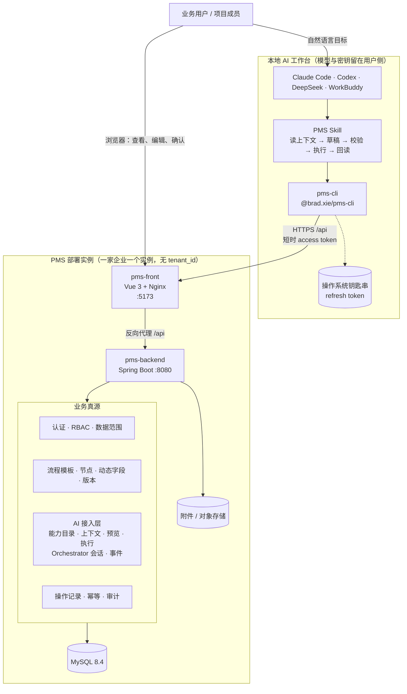
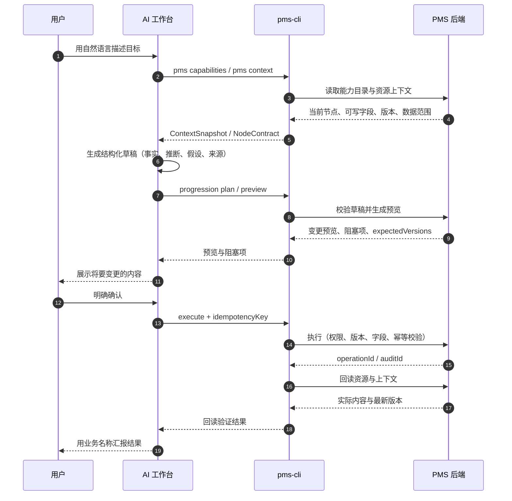

# PMS：让 AI 参与项目管理的自部署系统

PMS 是面向**单个企业**的自部署项目管理系统。除了浏览器界面，它还提供一条受控的 AI 协作通道：用户在 Claude Code、Codex、DeepSeek、WorkBuddy 等本地 AI 工作台里用自然语言描述目标，AI 通过 `pms-cli` 读取真实项目上下文、准备变更、执行并回读结果。

一个部署实例只服务一家企业，不使用 `tenant_id`，也不拆微服务。AI 不持有第二套业务规则，所有权限、流程、字段、版本、幂等和审计仍由 PMS 后端统一裁决。

`1.2.0` 把 AI 协作闭环纳入发行包：需求、项目、专题、故事四类资源的统一推进入口，项目/专题的持久化 Orchestrator 会话，草稿来源与版本绑定，执行后的回读验证，以及 V70–V73 数据库迁移。

[](https://github.com/xiebinJava/pms-distribution/releases)
[](https://github.com/xiebinJava/pms-distribution/actions/workflows/validate.yml)
[](LICENSE)

---

## 一、逻辑思路：AI 表达，PMS 定事实

AI + PMS 不是把聊天框塞进系统，也不是让模型直接读写数据库。它把工作拆成三层，每层只做自己擅长的事：

| 层 | 负责 | 不负责 |
| --- | --- | --- |
| **本地 AI 工作台**<br>Claude Code / Codex / DeepSeek / WorkBuddy | 理解自然语言、澄清目标、读取上下文、生成结构化草稿、向用户解释结果 | 不持有 PMS 密码，不直接访问数据库，不决定权限，不伪造业务事实 |
| **`pms-cli` 连接器** | 把 AI 的意图翻译成 PMS 命令：读取能力与上下文、生成预览、执行、回读 | 不复制业务规则，不调用模型 API，不保存模型密钥，不猜测节点或字段 |
| **PMS 后端** | 唯一的业务真源：身份、RBAC/数据范围、流程模板、节点、动态字段、版本、幂等、审计 | 不保存模型 API Key，不训练模型，不替用户做业务决策 |

### 一次 AI 写入是怎样完成的

```text
用户用自然语言说出目标
  → AI 先读取 capabilities 和当前资源 context
  → AI 基于真实节点、字段和版本生成结构化草稿
  → PMS 校验草稿来源、字段白名单、权限和版本
  → 生成预览（preview），列出将要变更的内容和阻塞项
  → 用户明确确认，或按低/中风险策略执行
  → 携带幂等键写入，产生 operationId / auditId
  → 回读资源与上下文，验证变更确实生效
  → AI 用业务名称向用户汇报结果
```

### 四条不能省略的边界

1. **先读后写。** AI 必须先读当前能力目录和资源上下文，不能猜节点 ID、字段 key、组件或版本。
2. **先预览后执行。** 高风险操作必须先展示目标资源、节点、字段、版本和变更内容；低/中风险写入也必须来自当前对话的明确意图。
3. **一次请求一个幂等键。** 重复请求不产生第二次业务效果；版本过期时返回冲突，不自动盲目重试。
4. **回读才算成功。** 写入成功但无法回读证明时，结果标记为 `WRITE_RESULT_UNKNOWN`，只能使用原幂等键重新核验，不能伪报成功。

### AI 可以推进哪些对象

当前统一 Agent 推进入口覆盖四类核心资源：

```text
需求 ──可关联──▶ 项目 / 专题 / 故事
项目 ──开发与迭代控制──▶ 专题 ──具体流程节点──▶ 故事
迭代 ──关联──▶ 项目 / 专题 / 故事
系统版本 ──由迭代关联
```

- **需求**：读取澄清节点、补齐分析、区分事实/推断/假设，保存后回读。
- **项目**：读取项目节点与流程上下文，更新节点字段或原子完成节点。
- **专题**：按专题流程节点补齐交付内容，并校验与关联项目的关系。
- **故事**：补齐开发/测试节点字段，完成节点并回读验收状态。

迭代、系统版本、组织与权限仍以 PMS 页面和管理命令为主；AI 不会绕过这些对象的既有业务规则。

---

## 二、使用方法

### 1. 启动 PMS

需要 Docker Engine / Docker Desktop 和 Compose v2，建议至少分配 2 GiB 内存。默认数据库是 MySQL 8.4。

```bash
git clone https://github.com/xiebinJava/pms-distribution.git
cd pms-distribution
./scripts/bootstrap.sh
```

打开 <http://localhost:5173>。首次空库会创建初始管理员：

| 项 | 值 |
| --- | --- |
| 登录邮箱 | `admin@example.com` |
| 密码 | `PmsAdmin123!` |

请立刻修改该密码。MySQL 与 JWT 等基础设施密钥由脚本随机生成，写入未被 Git 跟踪的 `.pms-bootstrap-secrets`。

当前发行版本：[`1.2.0`](https://github.com/xiebinJava/pms-distribution/releases/tag/v1.2.0)。镜像在 GHCR，可匿名拉取，支持 `linux/amd64` 和 `linux/arm64`。

也可直接下载 [tar.gz 安装包](https://github.com/xiebinJava/pms-distribution/releases/download/v1.2.0/pms-1.2.0.tar.gz)、[zip 安装包](https://github.com/xiebinJava/pms-distribution/releases/download/v1.2.0/pms-1.2.0.zip) 和 [SHA256SUMS](https://github.com/xiebinJava/pms-distribution/releases/download/v1.2.0/SHA256SUMS)。把两个安装包与校验文件放在同一目录，运行 `sha256sum -c SHA256SUMS`（macOS 使用 `shasum -a 256 -c SHA256SUMS`）核对后再解压安装。

### 2. 安装并登录 AI 连接器

`pms-cli` 是 AI 工作台与当前 PMS 实例之间的连接器，不是另一个 PMS 服务。项目地址：[xiebinJava/pms-cli](https://github.com/xiebinJava/pms-cli)，npm 包：[`@brad.xie/pms-cli`](https://www.npmjs.com/package/@brad.xie/pms-cli)。

本机需要 Node.js 22 或更高版本：

```bash
npm install -g @brad.xie/pms-cli
export PMS_BASE_URL=http://localhost:5173/api
pms doctor --format json
pms auth login
pms auth status
```

Windows PowerShell 设置地址：

```powershell
$env:PMS_BASE_URL = "http://localhost:5173/api"
```

`PMS_BASE_URL` 必须是纯 URL，不要粘贴 Markdown 链接。`pms auth login` 会打开 PMS 登录页，使用 PKCE 回调换取短时访问令牌；长期 refresh token 只保存在操作系统凭据管理器，不会打印到终端。

### 3. 安装工作台 Skill

Skill 告诉 AI 什么时候读取上下文、什么时候生成草稿、什么时候必须预览、哪些操作需要用户明确确认。真正的权限和业务校验仍由 PMS 后端执行。

Codex：

```bash
pms skill install --global
pms doctor --format json
```

Claude Code、WorkBuddy 等本地工作台可以将 [`skills/pms-project-management/SKILL.md`](https://github.com/xiebinJava/pms-cli/blob/release/skills/pms-project-management/SKILL.md) 复制到各自的用户级 Skill 目录。Skill 只调用 `pms`，不依赖 PMS 源码目录。

> ChatGPT 网页版无法直接调用用户电脑上的本地 CLI；请使用支持本地命令的 AI 工作台。

### 4. 用自然语言发起工作

安装并登录后，在 AI 聊天窗口里直接描述目标。AI 会先读取 PMS 真源，必要时向你提问，然后给出计划或预览。

**查询项目**

```text
读取当前 PMS 中我参与的项目，按交付风险排序，告诉我每个项目阻塞在哪个节点、负责人是谁。
```

**创建项目**

```text
先读取当前可用的项目类型和流程模板。缺少的必填信息先问我。
然后创建项目“AI Native PMS”，描述是“让 AI 参与项目管理全生命周期”，
优先级中，开始日期 2026-10-12，结束日期 2026-11-30。
创建后回读项目详情和实际绑定的流程上下文。
```

**分析需求并保存**

```text
读取需求“统一登录”的当前流程节点、可写字段和上下文版本，
分析目标、用户场景、验收标准和待决策问题。
保存前先把准备写入的内容给我看，我确认后再保存，并回读需求详情。
```

**推进故事或项目节点**

```text
读取故事“登录页联调”的当前节点和必填字段。
测试结论是“主流程通过，验证码异常场景待补”，构建版本 1.2.0，
报告地址见附件说明，遗留问题为“验证码过期提示不明确”。
补齐字段并完成节点，完成后回读节点状态和实际写入内容。
```

面向用户的回复默认使用项目、需求、专题、故事的**名称**和节点名称，内部 ID 只保留在机器可读结果里。

### 5. 手动验证连接器

如果暂时没有可用的 AI 工作台，可以直接在终端验证：

```bash
pms capabilities --format json
pms search project --keyword 订单 --format json
pms get project 7 --format json
pms context project 7 --format json
pms context requirement 23 --view focused --node-id 299 --format json
pms dashboard summary --format json
```

写操作分为“只读计划”和“明确执行”两步。低/中风险、且用户已明确要求写入的场景，可以使用统一推进入口在本次调用内生成 fresh preview 并执行：

```bash
# 只读：读取当前节点的真实上下文
pms scenario progression run story 34 --intent READ_CONTEXT --format json

# 只读：校验草稿并生成预览
pms scenario progression run story 34 \
  --intent UPDATE_NODE_FIELDS --execute-mode plan \
  --node-id <node-id> \
  --draft-json '<agent-progression/v2 draft>' \
  --format json

# 写入：必须提供幂等键；适用于用户已明确要求写入的低/中风险操作
pms scenario progression run story 34 \
  --intent UPDATE_NODE_FIELDS --execute-mode auto \
  --node-id <node-id> \
  --draft-json '<same draft>' \
  --idempotency-key story-34-node-<node>-1 \
  --format json
```

项目创建同样先计划、后执行：

```bash
pms scenario project-create plan \
  --arguments-json '{"name":"AI Native PMS","description":"让 AI 参与项目管理全生命周期"}' \
  --format json

pms scenario project-create execute \
  --arguments-json '{"name":"AI Native PMS","description":"让 AI 参与项目管理全生命周期"}' \
  --idempotency-key project-ai-native-pms-1 \
  --format json
```

`plan` 和 `READ_CONTEXT` 不写入数据；`auto` / `confirm` 才会写入。重复请求必须复用同一个幂等键，连接器不会自动重试写操作。

需要跨进程恢复时，使用持久化 Orchestrator 会话。会话、计划、预览、确认和事件都保存在 PMS，CLI 本身不保存状态：

```bash
pms scenario resource-orchestrator create project 42
pms scenario resource-orchestrator turn <conversation-id> \
  --message "补充当前节点说明" \
  --draft-json '<resource-node/v1 draft>' \
  --node-id <node-id>
pms scenario resource-orchestrator preview <plan-id>
pms scenario resource-orchestrator confirm <plan-id> --idempotency-key <key>
pms scenario resource-orchestrator resume <conversation-id>
```

`resume` 只读取会话和事件游标，并投影下一步动作（补充信息、确认、重试原幂等键或读取结果），不会自行创建写入。

### 6. 安全边界

- PMS 后端是身份、权限、流程、动态字段、版本、幂等和审计的唯一真源。
- CLI 使用当前登录用户的身份执行，所有读取和写入都重新经过数据范围校验。
- AI 草稿不能修改受保护字段，例如所属系统、负责人、状态、起止日期；来源引用必须来自本次上下文快照。
- access token 只在 CLI 进程内存中使用；refresh token 只进入操作系统凭据管理器；Token 不写入 stdout、日志或错误堆栈。
- 模型凭据留在外部工作台，不进入 PMS 后端，也不配置在 CLI 中。
- 写入成功后必须回读验证；无法证明写入结果时，不得用新幂等键再次写入。

### 7. 常见问题

- **`pms: command not found`**：重新打开终端，确认 npm 全局 bin 目录已加入 `PATH`，或执行 `npm prefix -g` 检查安装位置。
- **`auth status` 反复弹钥匙串**：在系统弹窗中允许当前终端或 `node` 访问 `pms-cli`，必要时重新执行 `pms auth login`。
- **`doctor` 显示地址错误**：检查 `PMS_BASE_URL` 是否为 `http://localhost:5173/api` 或实际部署地址，不能带 Markdown 方括号和圆括号。
- **AI 只能给出草稿**：先运行 `pms capabilities --format json` 和对应资源的 `pms context`，确认当前账号拥有目标流程节点的写权限。
- **提示版本冲突**：说明上下文已变化。重新读取上下文和预览，不要用新幂等键盲目重试。

---

## 三、整体架构图



### AI 写入闭环



### 组件职责

| 组件 | 职责 | 运行位置 |
| --- | --- | --- |
| `pms-front` | 浏览器界面、人工查看与确认、`/api` 反向代理 | PMS 实例，默认 `5173` |
| `pms-backend` | 认证、RBAC、数据范围、流程模板、节点、动态字段、版本、幂等、审计、AI 接入层 | PMS 实例，容器网络 `8080` |
| MySQL 8.4 | 业务数据、流程状态、AI 会话/计划/事件、审计 | PMS 实例数据卷 |
| `pms-cli` | 本地连接器：读取、预览、执行、回读 | 用户本机 |
| AI 工作台 | 自然语言理解、草稿生成、结果解释 | 用户本机或企业选定的模型服务 |

---

## 四、界面预览

<p align="center">
  
</p>

<p align="center">
  
  
</p>

<p align="center">
  
</p>

<p align="center">
  
  
</p>

<p align="center">
  
</p>

<p align="center">
  
</p>

<p align="center">
  
  
</p>

<p align="center"><sub>截图来自隔离演示实例，使用虚构数据，不包含真实业务或人员信息。</sub></p>

---

## 五、能做什么

| 模块 | 说明 |
| --- | --- |
| AI 协作 | 通过 `pms-cli` 读取、预览、执行和回读需求、项目、专题、故事节点；支持持久化会话恢复 |
| 工作台 | 汇总当前账号的任务、参与项目和最近评论，不是全公司总览 |
| 项目交付 | 流程节点流转（立项、需求范围、方案评审、计划与风险等），任务挂在节点上 |
| 流程模板 | 按流程类型维护可发布版本，配置节点字段、业务组件和默认模板 |
| 需求管理 | 接收、澄清、整合、排期、开发、验收和上线，功能需求绑定所属系统 |
| 研发管理 | 管理专题、故事，按各自流程模板推进节点、负责人、排期与任务 |
| 迭代计划 | 独立或项目内迭代，关联故事和任务，维护系统、版本、负责人、排期与状态 |
| 系统版本 | 维护系统与版本、发布日期、状态和变更记录 |
| 企业项目看板 | 组织级项目组合、交付健康、风险与里程碑视图 |
| 组织与人员 | 主职组织树、角色权限、邀请开通、批量导入 |
| 协作与治理 | 评论、通知、反馈、审计日志 |
| 可选登录 | 默认使用本地密码，也可接入 LDAP / OIDC |

一个部署实例只服务一家企业，没有 `tenant_id`。

---

## 六、配置与运维

### 常用命令

```bash
./scripts/status.sh
./scripts/logs.sh backend
./scripts/backup.sh
./scripts/upgrade.sh 1.2.0
```

升级前先更新本仓库的安装脚本，再执行升级命令。升级会先备份，数据库迁移至 V73。脚本默认用仓库目录名作为 Compose 项目名（本仓库为 `pms-distribution`）。

隔离环境请让每条命令使用同一组变量：

```bash
COMPOSE_PROJECT_NAME=pms-staging ENV_FILE=.env.staging COMPOSE_FILE=compose.yaml ./scripts/bootstrap.sh
COMPOSE_PROJECT_NAME=pms-staging ENV_FILE=.env.staging COMPOSE_FILE=compose.yaml ./scripts/status.sh
```

停止服务但保留数据：

```bash
docker compose --env-file .env -f compose.yaml down
```

不要使用 `down -v`，除非你明确要删除数据库和附件。

### 端口与 CORS

改入口端口时，至少同步这三项：

```bash
PMS_PORT=5173
PMS_PUBLIC_BASE_URL=http://localhost:5173
PMS_CORS_ALLOWED_ORIGINS=http://localhost:5173,http://127.0.0.1:5173
```

`bootstrap.sh` 会在 `PMS_PORT` 不是 `5173`、且 CORS / 公网地址仍是示例值时，自动改成当前端口。

### 生产环境至少需要

- `PMS_DEPLOYMENT_ENV=production`
- 由密钥管理器注入的 `PMS_JWT_SECRET`
- 非默认的数据库和管理员密码
- 正式域名、HTTPS 和受限的 `PMS_CORS_ALLOWED_ORIGINS`
- SMTP、对象存储、备份策略和监控告警

完整说明见 [生产配置](docs/operations/production.md)。

`1.2.0` 沿用 1.1.0 的两项 Spring MVC 限定例外，适用条件、依据与复核期限见 [安全适用性评估](https://github.com/xiebinJava/pms-backend/blob/main/docs/security/1.1.0-spring-mvc-assessment.md)。这不代表依赖已修复；其他 HIGH / CRITICAL 安全门禁保持启用。

### 支持范围

| 项目 | 当前发行路径 |
| --- | --- |
| 容器运行时 | Docker Engine / Docker Desktop / Colima + Compose v2 |
| 数据库 | 仅 MySQL 8.4 |
| 前端入口 | Nginx 容器，默认 `5173` |
| 后端入口 | 仅容器网络可见，默认 `8080` |
| 生产 HTTPS | 由企业反向代理或 Ingress 负责 |
| AI 工作台 | 支持本地 CLI 的 Claude Code、Codex、DeepSeek、WorkBuddy 等 |

完整组合见 [支持矩阵](docs/operations/support-matrix.md)。

---

## 七、仓库关系

```text
pms-distribution   安装、升级、备份、发行文档（你在这里）
pms-backend        Spring Boot API、迁移、AI 接入层、后端镜像
pms-front          Vue / Nginx 前端和前端镜像
pms-cli            AI 工作台连接器（npm: @brad.xie/pms-cli）
```

发行仓库只引用经过测试的镜像版本，避免复制源码造成版本漂移。

---

## 八、文档

| 文档 | 说明 |
| --- | --- |
| [生产配置](docs/operations/production.md) | 上线前必须完成的安全与运行配置 |
| [升级](docs/operations/upgrade.md) | 备份、升级和失败回滚 |
| [备份与恢复](docs/operations/backup-restore.md) | 数据库与附件归档 |
| [故障排查](docs/operations/troubleshooting.md) | 常见启动、登录和迁移问题 |
| [支持矩阵](docs/operations/support-matrix.md) | 当前支持与不支持的组合 |
| [发布镜像](docs/operations/release-images.md) | GHCR 发布顺序与校验 |
| [干净环境冒烟验收](docs/operations/clean-machine-smoke-test.md) | 发布前必过清单 |
| [1.1.0 发布验收记录](docs/operations/release-1.1.0-verification.md) | 安装、升级和备份恢复的历史验收范围 |
| [1.1.0 安全适用性评估](https://github.com/xiebinJava/pms-backend/blob/main/docs/security/1.1.0-spring-mvc-assessment.md) | 两项 Spring MVC 限定例外与复核期限 |
| [变更记录](CHANGELOG.md) | 版本变更 |
| [pms-cli 安装说明](https://github.com/xiebinJava/pms-cli/blob/release/docs/installation.md) | AI 连接器安装与登录 |
| [pms-cli 安全模型](https://github.com/xiebinJava/pms-cli/blob/release/docs/security-model.md) | 身份、令牌与写入边界 |
| [AI Orchestrator 设计](https://github.com/xiebinJava/pms-backend/blob/main/docs/agent-contracts/orchestrator/ai-orchestrator-v1.md) | 会话、计划、预览、执行与回读契约 |
| [贡献指南](CONTRIBUTING.md) | 如何提交改动 |
| [安全策略](SECURITY.md) | 漏洞私下报告 |

问题跟踪用 Issues，使用讨论用 [Discussions](https://github.com/xiebinJava/pms-distribution/discussions)。

## 许可证

Apache-2.0，详见 [LICENSE](LICENSE) 和 [NOTICE](NOTICE)。第三方镜像和依赖仍受其各自许可证约束。
