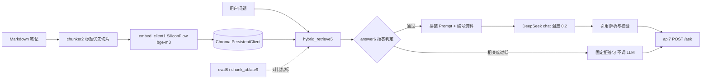
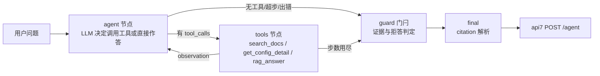

# opengauss-rag

openGauss **配置问答助手**：固定 RAG 链路 + 单 Agent（工具调用）。

语料来自开源实习中的 B 兼容 / Dolphin MySQL 协议 / Peewee 适配笔记，目标是让分散的配置说明变成**可检索、可引用、不足可拒答**的问答服务；在此基础上增加一个**单 Agent**，让模型自己决定用哪个工具，并用代码层门闩保证「没有证据不下结论」。

> 小样本离线评测与 demo，**不是**生产级准确率，也未做生产部署。

## 背景

参与 openGauss 开源适配时发现：B 库创建、schema 与 PyMySQL `database` 同名、`enable_dolphin_proto` / native 密码等配置点散落在文档与个人笔记中，新手很难一次查准。本项目将个人笔记与任务速查（`personal/peewee-notes.md`、`personal/opengauss-peewee-cheatsheet.md`）切片入库，提供：

- 混合检索（BM25 + 向量 + 加权 RRF + 标识符提权）
- 基于资料的生成与 `[n]` 引用
- 检索层代码拒答（相关度过低时不调用大模型）
- **单 Agent + 3 个工具 + LangGraph 状态图 + 证据/拒答门闩**
- FastAPI：`POST /ask`（RAG 基线）与 `POST /agent`（Agent）
- 离线评测：RAG（检索/拒答/切片消融）与 Agent（工具选择/参数/任务成功/引用/拒答/延迟）

## 架构

### 固定 RAG 链路（`POST /ask`）



### 单 Agent（`POST /agent`）



**门闩（guard）三条规则**（代码实现，可被单测证明，不依赖提示词）：

1. 工具层已判拒答 → 用 `answer6.REFUSE_MESSAGE` **覆盖模型话术**，清空引用；
2. 已有证据（观测到资料片段）→ 放行模型答案；
3. 零证据 → 领域问题**确定性回退** `rag_answer`（有据则替换、判拒答则拒答），非领域问题直接拒答（`no_evidence`）。

**工具（3 个，均为已有能力的薄封装）**

| 工具 | 作用 | 复用点 |
|------|------|--------|
| `search_docs(query, k)` | 只检索，返回 hit 与分数 | `HybridRetriever.search` |
| `get_config_detail(name)` | 配置项精确向检索（正文需含该配置名） | 同上 |
| `rag_answer(query, k)` | 完整 RAG：检索→拒答→生成→引用校验 | `answer6.answer` |

**步数上限**：`max_steps`（默认 3，接口 1~6）；最后一轮不再提供 tools 强制收口，路由再兜一层，另有 `recursion_limit`。

### 代码流水线（文件名编号 = 执行顺序）

| 文件 | 职责 |
|------|------|
| `src/embed_client1.py` | SiliconFlow 嵌入客户端（含超时/SSL 重试） |
| `src/chunker2.py` | Markdown 标题优先切片，默认 max_chars=1200 / overlap=120 |
| `src/ingest3.py` | 切片 → 嵌入 → 入库 `opengauss_docs` |
| `src/retrieve4.py` | 纯向量检索冒烟 |
| `src/hybrid_retrieve5.py` | BM25 + 向量，加权 RRF + snake_case 提权 |
| `src/answer6.py` | 拒答判定 → Prompt → LLM → 引用校验 |
| `src/api7.py` | FastAPI：`GET /health`、`POST /ask`、`POST /agent` |
| `src/eval8.py` | RAG 离线评测：Recall@k + OOS 拒答 |
| `src/chunk_ablate9.py` | 切片长度消融（临时集合 `opengauss_c*`） |
| `src/peek_signals.py` | 打印 bm25_raw / vec_dist，用于阈值标定 |
| `src/ask_smoke.py` | HTTP smoke（`httpx`，`trust_env=False`） |
| `src/agent_eval.py` | Agent 离线评测：26 题 8 指标 |
| `src/agent_cli.py` | Agent 交互式命令行（`:help` / `:tools` / `:quit`） |

### Agent 扩展包（`src/agent/`）

| 文件 | 职责 |
|------|------|
| `src/agent/schemas.py` | `ToolResult` 统一返回（ok / data / error_code / latency_ms） |
| `src/agent/tools.py` | 3 个工具 + `TOOL_SPECS` + `call_tool` 注册表 |
| `src/agent/tool_calling.py` | 最小 Tool Calling 循环 + LLM 调用与退避重试 |
| `src/agent/state.py` | `AgentState`（消息、步数、工具日志、拒答、引用等） |
| `src/agent/graph.py` | LangGraph 状态图：agent ⇄ tools → guard → final |
| `src/agent/service.py` | 服务层：Pydantic 出入参 + `run_agent_service` |

## 技术选型（简要）

| 选择 | 原因 |
|------|------|
| RAG 主链路手写（requests + 自建函数） | 链路短、可调试、出错点可定位 |
| Agent 用 LangGraph（仅做编排） | 状态与分支显式化、路由可单测、天然有递归上限；LLM 调用仍是自己封装的 |
| Chroma PersistentClient + cosine | 本地向量库，成本低，和 bge-m3 匹配 |
| BM25 + 向量 + 加权 RRF | 标识符配置项靠词法，自然语言靠语义；无标识符时向量权重更高 |
| 检索层拒答（BM25 原始分 / 向量距离） | 不能只靠 System Prompt；中文单字 BM25 会虚高，故用 OR 规则 |
| Agent 增加 guard 门闩 | 工具调用是「建议」不是「强制」，必须用代码保证零证据不下结论 |
| DeepSeek `requests` 直调 | 无框架黑盒，便于控制 messages、超时与重试 |
| API 注入单例 `HybridRetriever` | `/ask` 与 `/agent` 共用，避免每次请求重建 BM25 |
| Agent LLM 可切换 provider（`AGENT_LLM_*`） | 单一厂商 Key 故障不影响整条链路验证 |

## 快速开始

### 环境

- Python 3.10+
- 已创建 venv（示例使用仓库内 `.venv`）

```powershell
cd opengauss-rag
python -m venv .venv
.\.venv\Scripts\activate
pip install -r requirements.txt
copy .env.example .env
# 编辑 .env，填入 SILICONFLOW_API_KEY 与 DEEPSEEK_API_KEY
```

**切勿提交 `.env`**（已在 `.gitignore`）。

### 入库

```powershell
python src\ingest3.py
```

预期：打印每个文件的 upsert 进度；当前语料（笔记 + 速查）约 **120** chunks，以 `collection_count` 实际输出为准。

### 命令行问答

```powershell
python src\answer6.py "enable_dolphin_proto 是干什么的？"
python src\answer6.py "今天西安天气怎么样？"
```

第二条应输出 `refused=True`，原因多为 `low_bm25` 或 `high_vector_distance`。

### 交互式命令行（最方便试 Agent）

```powershell
.\.venv\Scripts\python src\agent_cli.py                          # 进入对话模式
.\.venv\Scripts\python src\agent_cli.py --once "enable_dolphin_proto 是干什么的？"
.\.venv\Scripts\python src\agent_cli.py --max-steps 4            # 调步数上限（1~6）
```

对话模式内：直接输入问题；`:tools` 看工具；`:help` 帮助；`:quit` 退出。输出含 `refused / tools_used / 每次调用的参数与来源 / steps / citations / 延迟`。

### HTTP 服务

```powershell
.\.venv\Scripts\python -m uvicorn api7:app --app-dir src --reload --port 8000
```

另开终端：

```powershell
.\.venv\Scripts\python src\ask_smoke.py
```

- `GET /health` → `status=ok`、`chunks`
- `POST /ask`（RAG 基线）、`POST /agent`（单 Agent）
- 文档页：`http://127.0.0.1:8000/docs`

`POST /agent` 示例：

```powershell
.\.venv\Scripts\python -c "import httpx; c=httpx.Client(timeout=180, trust_env=False); d=c.post('http://127.0.0.1:8000/agent', json={'query':'enable_dolphin_proto 是干什么的？'}).json(); print(d['refused'], d['tools_used'], d['steps'], d['citation_valid'])"
```

### Docker

```powershell
# 需要本机已安装 Docker Desktop
copy .env.example .env        # 填好两个 Key
python src\ingest3.py         # 先在宿主机入库，生成 ./data/chroma
docker compose up --build
curl http://127.0.0.1:8000/health
```

- 密钥通过 `env_file` 注入，**不打进镜像**（`.env` 在 `.dockerignore` 中）
- 向量库以只读卷挂载复用，容器内不重复嵌入
- 如需在容器内入库：`docker compose run --rm api python src/ingest3.py`
- 未在本仓库验证镜像构建（开发机未安装 Docker）；**启动命令与路径假设已用「模拟容器目录 + 环境变量注入」在宿主机验证**（`api7:app --app-dir src`、`CHROMA_DIR=/app/data/chroma`、`/health` 与两个接口均正常）

### 离线评测与消融

```powershell
python src\eval8.py            # RAG：纯向量 vs 混合 + 越界拒答
python src\chunk_ablate9.py    # 切片长度消融
python src\agent_eval.py       # Agent：26 题 8 项指标（真实调用模型）
```

报告：

- `docs/eval_report.md`、`docs/chunk_ablate.md`、`docs/badcases.md`
- `docs/agent_eval_report.md`、`docs/agent_eval_raw.json`、`docs/agent_badcases.md`
- API smoke：`docs/api_smoke_results.txt`

### 单元测试

```powershell
.\.venv\Scripts\python -m pytest tests -q     # 当前 59 passed
```

覆盖：工具层返回契约、Tool Calling 消息序列、图的流转与步数收口、门闩三规则、工具/LLM 重试、API 出入参与 `/ask` 回归、CLI 入口。测试全部离线（注入假检索器 + monkeypatch 大模型出口），不消耗 API 额度（`--durations` 最长 0.05s）。

## 拒答规则（当前实现）

```text
no_hits
或 max(bm25_raw_score) < 2.0          → low_bm25
或 min(vector_distance) > 0.52        → high_vector_distance
```

阈值来自 `peek_signals` + 评测集标定。语料扩充到约 120 chunks 后，库外中文题 BM25 明显虚高，`DIST_MIN` 从 0.55 收紧为 **0.52**；语料再变必须重标。

## 评测结果（仓库内实测，非生产）

### RAG：纯向量 vs 混合（语料 ~120 chunks；8 来源题 + 4 越界题）

| 方法 | Recall@1 | Recall@3 |
|------|----------|----------|
| 纯向量 | 87.50% | 100% |
| 混合 BM25+向量 | 100% | 100% |

- 纯向量 Top1 失败例（扩语料后）：S6 认证异常类问题；混合检索 8/8 进 Top1  
- 越界题代码层拒答：**4/4（100%）**（`DIST_MIN=0.52` 重标定后）

### RAG：切片长度消融（混合检索，关键词 Recall）

| max_chars | chunks | Recall@1 | Recall@3 |
|-----------|--------|----------|----------|
| 400 | 42 | 100% | 100% |
| 800 | 24 | 100% | 100% |
| 1200 | 20 | 100% | 100% |
| 1600 | 18 | 100% | 100% |

在关键词 Recall 口径下 400–1600 打平；该口径**偏松**，不能证明切片对生成质量无影响。生产默认保留 **1200**。

### Agent：26 题（20 语料内 + 6 库外），真实调用模型

| 指标 | 最近一次运行 | 说明 |
|------|--------------|------|
| Task Success Rate | 100% | 拒答行为符合预期 + 答案命中关键信息（排除基础设施故障） |
| Tool Selection Accuracy | 100% | 语料内问题是否调到可接受工具 |
| Parameter Accuracy | 100% | 配置名 / 查询关键词是否正确 |
| Citation Valid Rate | 100% | `citation_valid=true` 占比 |
| Citation Coverage | 65% | 语料内回答真的带 `[n]` 的比例（**已知缺口**） |
| OOS Refusal Rate | 100% | 库外问题被拒答 |
| Infrastructure Error Rate | 0% | LLM/网络故障题占比（不计入模型能力） |
| Avg Tool Calls / Steps | 1.54 / 1.81 | — |
| Latency | avg 7.1s，p50 7.5s，p95 12.4s | 分布差异大，均值参考意义有限 |

**跨轮波动是真实存在的**：同一套题四次运行的 task_success 为 100% / 96.15% / 96.15% / 100%，引用覆盖率 75% / 65% / 60% / 65%（原因是 LLM 采样非确定性、工具路径不同、边界题在阈值附近翻转）。相关失败样本与原因见 `docs/agent_badcases.md`。

## 限制与后续

- 语料以个人笔记 + 任务速查为主（约 120 chunks），官方文档未大规模入库
- 关键词 Recall 与「答案命中关键词」都不能替代生成质量评测；无人工标注的答案正确率/幻觉率
- **Agent 引用覆盖率 65%**：Agent 直接总结工具观察结果，未强制 `[n]` 引用（已作为指标量化，未隐藏）
- **假拒答风险**：`low_bm25` 阈值在中文提问上会偶发误判（见 badcase ABC-9），阈值应随语料重标
- Agent 可能对已检索内容添油加醋：**未实现逐句溯源校验**
- 未做 cross-encoder 重排；标题短块偶尔排位偏高
- 拒答阈值依赖当前语料分布，扩充后必须重跑 `peek_signals` / `eval8` / `agent_eval`
- **未做生产部署**：无鉴权、无限流、无并发压测、无观测；Dockerfile 已提供但未在本机验证构建（本机未安装 Docker）
- Agent 为**单 Agent**：不做 Multi-Agent、不做 MCP

## 相关项目

openUBMC API 文档一致性校验（纯 Python diff，无大模型）见独立目录/仓库：`ubmc-doc-check`。

## License

个人学习项目，代码可自由查看；openGauss 文档与笔记版权归原作者与社区规则约束。
