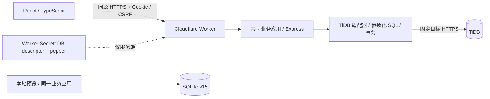

# SakuraEdu · Sakura Dashboard

[](https://github.com/yanyu03/Sakura_DashBoard/actions/workflows/ci.yml)

学校组织关系、教师协作与教学业务工作台。**1.0Sakura** 是一个可以本地运行、带迁移和验证证据的全栈工程预览：前端采用 React / TypeScript，线上通过 Cloudflare Workers 访问 TiDB，本地用 SQLite 独立复现业务。

[English](README.en.md) · [在线入口](https://sakura.250221.xyz/?design=1.0Sakura) · [作品案例 / 面试阅读](docs/PORTFOLIO.md) · [完整文档](docs/README.md) · [MIT](LICENSE)


截图来自开发期演示库，用于展示界面风格；当前默认本地安装为空库。线上入口保留认证，不提供共享管理员密码；完整评审建议克隆后运行本地版本。

## 这个项目解决什么

学校中的权限不只是“管理员 / 普通用户”：同一个老师可以是班主任、学科组成员，也可以兼任负责人。项目把组织树、人员、账号、带有效期的任职和实际任课关系分开建模，让“某位主任可以安排哪些老师的课”与“可以读哪些学生资料”分别判断。

课表从个人草稿到提交、共享、审批，再生成正式课时；审批时重新验证任教资格、任职有效性、教师 / 班级 / 教室冲突及记录版本。共享课表不会顺带授予其他模块的访问权。

## 当前能力与边界

| 领域 | 已实现 | 当前边界 |
| --- | --- | --- |
| 注册与登录 | 图形验证码、空库首位管理员、不可变用户名、Cookie 会话、CSRF、分级冷却 | 登录角色仍为 admin / teacher；无密码自助找回 |
| 组织关系 | 学校与多级组织、同一人员多岗、任职有效期、组织范围、任教资格目录 | 组织身份不等于家长 / 学生端已交付 |
| 协同排课 | 私有草稿、教研室共享、负责人审批、自审拦截、冲突检查、调代课、ICS | 周模板、单双周和完整校历仍在设计阶段 |
| 教学业务 | 基础资料、作业发布与批阅、文本教案及修订、成绩 CSV 预览与幂等导入 | 无附件 OCR、外部 AI 自动评分或综合教务系统承诺 |
| 学生与沟通 | 名册、考试轨迹、联系人、站内消息 / 待办、辅导记录 | queued 不代表短信或家长消息已经送达 |
| 存储与安全 | SQLite v15 增量迁移、TiDB 平移、受限数据库账号、Worker Secret、加强密码哈希、日志脱敏 | 尚未完成多学校全模块租户隔离及容量 / 灾备验收 |

私有教案及未共享草稿已限制所有者；已发布班级资料按任教范围协作。`visibility=school` 的公开教案仍需收紧机构边界。不能将目前的逻辑作用域描述为每账号物理分库。

## 本地开始

使用 **Node.js 24 LTS**（最低 22.12）和 npm；不需要 TiDB、CF、AI Key 或桌面上的私有配置文件。

```bash
git clone https://github.com/yanyu03/Sakura_DashBoard.git
cd Sakura_DashBoard
npm ci
npm run dev
```

访问 `http://127.0.0.1:3000/?design=1.0Sakura`，进入注册页创建第一个管理员。数据库默认在 `.local-data/portfolio/sakura_edu.sqlite`，后续启动保留原数据；默认不创建演示账号。按“学期 → 课程 / 教师 / 班级 → 任课关系 → 组织与任职 → 课表提交审批”体验完整流程。

端口、系统原生依赖和历史演示入口的区别见 [快速开始](docs/GETTING-STARTED.md)。`npm run dev:legacy` / `dev:standard` 是早期本地演示入口，会创建历史样例，不用于生产部署。

## 运行结构



线上不把数据库密码交给浏览器。请求采用有界超时，结果不明的写入 / COMMIT 不自动重放；临时数据故障返回 503，前端保留已登录状态与待确认输入。设计取舍与真实限制见 [系统架构](docs/ARCHITECTURE.md)。

## 验证与证据

```bash
npm run lint
npm run build
npm run test:auth
npm run test:organization
npm run test:schedule-sharing
npm run test:first-registration
```

离线测试使用隔离的本地库，不访问线上业务数据。Windows 另可运行 `npm run test:security-hardening` 验证 DPAPI 和密码边界；云端集成需要独立测试库和操作者凭据，不能把生产地址当作测试目标。

2026-10-29 已留存：SQLite 88 项业务回归、TiDB 22 组业务回归与 9 组组织排课、11 项安全专项、6 项真实 Worker 安全检查及 8 项线上冒烟。**它们覆盖不同层次、不同测试时间，不是当前 CI 的累计成绩，也不构成压力测试。** 证据和复现命令见 [验证指南](docs/TESTING.md)。

## 面向代码评审者

| 想了解 | 阅读入口 |
| --- | --- |
| 项目背景、关键难题、可讲述的设计取舍 | [作品案例](docs/PORTFOLIO.md) |
| 账号 / 人员 / 任职如何分离，权限如何收敛 | [架构](docs/ARCHITECTURE.md)、[组织 ADR](docs/architecture/ADR-0001-school-organization.md) |
| 排课工作流与自审、冲突、并发保护 | [协同排课](docs/verification/schedule-sharing/README.md)、[组织实现](docs/verification/organization/README.md) |
| API、认证及错误处理 | [接口指南](docs/API.md) |
| 从零部署、Secret、迁移和恢复 | [部署手册](docs/DEPLOYMENT.md)、[安全说明](SECURITY.md) |
| 已知限制及下一步 | [路线图](docs/ROADMAP.md)、[更新记录](CHANGELOG.md) |

核心代码集中在 `server/auth.ts`、`organizationCore.ts`、`scheduleSharing.ts`、`schedules.ts`、`server/tidb/` 与 `cloudflare/worker.ts`；界面位于 `src/components/`，设计规范见 [1.0Sakura CSS 标准](docs/DESIGN-sakuraedu-1.0Sakura.md)。

## 来源、贡献与许可

项目由 Google Stitch / AI Studio 的界面原型逐步演进，作者推动需求和学校组织模型，开发过程使用 AI 辅助编码、测试及文档整理。具体能力以可运行代码和验证证据为准，不以“全部人工逐行编写”作为项目主张。来源与素材边界见 [NOTICE](NOTICE.md)。

本项目代码和文档采用 [MIT 许可证](LICENSE)；第三方组件保留各自许可。贡献前请读 [CONTRIBUTING](CONTRIBUTING.md)。安全问题请按 [SECURITY](SECURITY.md) 私下报告，勿提交真实学校数据、密码、Token 或数据库导出。
