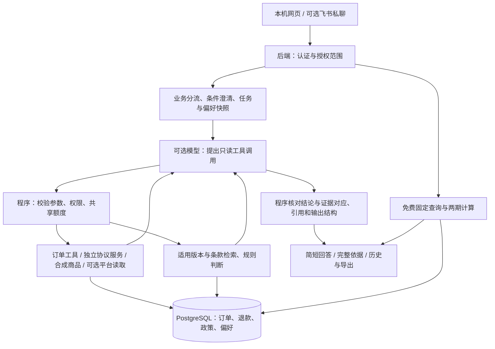

# 订单与售后核查助手

面向**买家查询本人订单与适用政策、商家核对授权店铺金额变化**的只读应用。它把数据库事实、政策条件判断与模型解释分开：模型决定调用哪些已允许的工具并组织语言，程序负责身份、数据范围、金额计算、规则校验和执行限额。

本仓库是可运行的个人工程演示，默认使用明确标注的合成订单、商品和政策。可选 Shopify（电商平台）开发店商家只读接入；默认不联网读取平台、不调用付费模型，不执行支付、退款、改价或设备操作。公开源码不代表服务已部署到公网。

当前版本含商品推荐、泛政策查询、售后顺序协作、新入口偏好，以及受控政策撤回/更正和历史依据状态核对。各项实际验证与限制见[验收记录](docs/validation.md)。

## 一次售后查询长什么样

同一笔合成订单 `O_SUPPORT_OK`：**用户提问 → 读取授权订单 → 匹配适用政策 → 输出带依据的结论**。

以下是公开前端组件的局部截图：使用一份已保存的合成任务结果脱敏重放，额外添加步骤标题、展开滚动区便于阅读；不是本次重新调用模型，也不是线上店铺订单。问题、回答与引用原文保持一致，订单工具图仅保留本例的合成业务字段，移除了本机路径和运行标识。默认免费演示可核对事实与规则；生成新的聊天回答仍需自行启用模型配置。

**1. 提问：同时给出订单、判断时刻、商品状态和退货原因。** “未穿着、吊牌完好”属于用户自述，需要与后台事实区分。


<details>
<summary>2–3. 展开查看：程序实际读取了哪些订单事实和政策条款？</summary>

**2. 订单事实：** 当前买家只读本人订单，得到支付时刻、收货时刻、品类与定制状态；这些是演示数据库中的合成记录。


**3. 适用政策：** 根据店铺、品类和订单支付时刻匹配11月版本。退货资格、定制例外与运费分别有条款支持；可按文件与行号回查[完整演示政策](knowledge/2026-11-shoes.md)。


</details>

**4. 交付结论：** 同时保留期限、必要条件、例外、未核实事实及引用。页面说明“仍需售后核验”，不会把回答当成退货批准或执行退款。


想复现规则核查，可从下方[免费启动步骤](#快速开始无模型无付费请求)运行 `demo.py check`，固定观察时刻和预期见[合成售后样例](samples/support/expected.json)。

## 能做什么

| 功能 | 当前实现与边界 |
|---|---|
| 订单、退款明细 | 买家只读本人订单；商家只读预授权店铺。金额以整数分计算，退款截止不含边界。 |
| 买家售后 | 读取订单支付/收货事实，按支付时政策版本判断退货资格与运费；保留定制商品例外、用户自述和缺失信息。 |
| 泛政策与订单售后分流 | 没有订单也能查受控鞋类一般规则，按政策查询时刻选版本；具体订单仍按支付时版本判断。两种时间不能混用。 |
| 买家商品推荐 | 对合成商品快照按预算、币种、尺码、材质等硬条件筛选；可关联 T恤退货条款，排除定制或资料未知的候选。不等于实时库存、真实平台商品或退货批准。 |
| 政策生命周期 | 管理员撤回或同区间更正；新请求只用当前有效稿，交付前复核。旧报告保留，另示依据状态及下载包。详见[管理与边界](docs/policy-lifecycle.md)。 |
| 政策检索 | 按店铺、类别、业务时间先过滤；保留完整条款与出处。默认关键词；可选嵌入＋关键词融合。 |
| 两期比较、有限调查 | 程序计算净额和渠道贡献；核查已记录退款原因，区分已核实、自述和无证据，不把相关性写成因果。 |
| 对话与交付 | 缺条件先澄清，显示任务进展，支持取消、历史查看、完整结果导出。 |
| 跨会话偏好 | 金额格式和详略，按账号＋角色隔离；新任务冻结快照，本次要求可临时覆盖，不回写长期设置。推荐、泛政策和平台入口共用该机制；元/分偏好只用于人民币，不换汇。 |
| 执行方案对照 | 旧金额/政策并行保留；售后可先取得订单事实，冻结交接给政策解释分支，有限补查并共享预算。另有受限短程序和授权快照 SQL（结构化查询语言）对照，无稳定收益承诺。 |
| 可选平台读取 | Shopify（电商平台）开发店订单成功交易、退款截止和当前退款政策；商家账号需独立店铺绑定。尚无平台买家身份绑定、真实商品推荐及完整售后判断。 |
| 可选飞书入口 | 预登记本人私聊身份映射为演示角色；收到、执行、回复分开记录，不是开放注册机器人。 |

当前仅支持受控鞋类规则及合成 T恤商品政策、有限条件识别和小规模数据。商家选品尚未实现。不能将演示政策当成真实平台承诺。未验证部分见[能力边界](docs/boundaries.md)。

## 请求怎样经过系统



工具协议使用 MCP（Model Context Protocol，模型上下文协议）的独立网络服务；服务端重新核对专用凭据。模型拿不到数据库管理员密码，聊天自报买家或店铺编号不会改变权限。

## 快速开始：无模型、无付费请求

需要 **Docker（容器运行环境）及 Compose（多服务管理工具）**、Python 3。推荐 Python 3.12。Python 只用于便捷入口；应用依赖会安装在镜像内，不要求宿主安装数据库或 Node（JavaScript 运行环境）。首次构建需要联网下载官方镜像和锁定依赖；这些安装不是模型调用。

在克隆后的仓库根目录执行：

```sh
python3 demo.py prepare
python3 demo.py up
python3 demo.py check
```

- `prepare` 生成独立随机凭据到 `local/demo.env`，已存在则保留，不打印密码。
- `up` 构建镜像、启动独立数据库、执行迁移、导入合成订单/退款/售后事实、两份鞋类政策和一份 T恤政策共九个条款片段、创建演示登录及协议凭据。
- `check` 读取这套新数据库，核对金额、授权、旧/新政策、泛政策、商品与政策关联、缺信息、关键词检索、退款调查、真实内部协议和 HTTP（超文本传输协议）接口。**没有模型或嵌入调用；不是模型回答质量评测。**本次独立新卷的15项检查已实际通过。

打开 **http://127.0.0.1:18180**。运行下面命令仅在本机显示登录凭据，粘贴到网页登录框：

```sh
python3 demo.py token
```

不要把凭据发到聊天、截图、提交版本库。演示账号可选择买家 `B001` 或商家 `S001`，均只读。网页“订单核查”和“两期金额变化”可免费使用；聊天及模型解释默认关闭，提交时会明确提示配置未启用。

端口冲突或想并行验证另一套时，在**新的** `local/demo.env` 中设置 `DEMO_PORT=18190`、`DEMO_PROJECT_NAME=my-second-demo`、`DEMO_IMAGE=my-second-demo:local`。不同项目名使用不同数据卷；不要更改已有项目名冒充数据已丢失，不共享正式项目凭据。

### 样例与事前预期

| 输入/操作 | 预期 |
|---|---|
| 免费核查 `O001`，退款截止 `2026-11-03T00:00:00+08:00` | 支付125元，退款40元，净额85元。 |
| 用同一截止查 `O404` | 当前授权范围内未找到；不泄露订单在其他范围是否存在。 |
| `demo.py check` 固定观察时刻下核查 `O_SUPPORT_OK` | 按11月政策，未穿着且吊牌完好为用户自述；满足演示条件，尺码原因运费由买家承担。 |
| 核查 `O_SUPPORT_UNKNOWN` | 缺少收货事实，应澄清，不能凭空算有效期。 |
| R05 固定两期退款样例 | 退款从1500分到4500分；增加3000分。已核实尺码记录增加2000分，不能把全部增额归因为尺码。 |
| `demo.py check` 在目录快照时刻筛选 M码棉质 T恤，预算30 USD，并要求有适用退货条款 | 仅返回合成规格 `V-A`，标价25.00 USD；定制规格排除、定制状态未知不算满足条件。 |
| `demo.py check` 查询2026-11-20的鞋类一般政策 | 取得11月版本，不读取订单、不承诺本单可退。 |

具体固定观察时间与预期在 [`samples/support/expected.json`](samples/support/expected.json)，不会用电脑今天的日期悄悄改变回归答案。启用模型后示例：“判断时间2026-11-18T08:00:00+08:00，O_SUPPORT_OK 尺码不合适，未穿着、吊牌完好，能否退货，运费谁承担？”

### 停止与恢复

```sh
python3 demo.py status
python3 demo.py stop
python3 demo.py up
# 或移除本项目容器和网络，仍保留数据卷：
python3 demo.py down
```

以上只管理本 Compose（多服务管理）项目的网页、协议服务、数据库和初始化容器，不停止其他 Docker（容器运行环境）项目。该默认部署没有动态执行容器权限；若另行使用 Mac 本机短程序模式，须核查遗留动态任务容器。**不要加 `-v`，不要删除 `database` / `runtime` 卷**，否则会丢失数据或凭据。退出整个 Docker Desktop 会影响其他容器项目。

## 技术选择与目录

第一次读代码可先沿一条业务链走，不必同时阅读所有运行器：

| 想了解什么 | 建议阅读顺序 |
|---|---|
| 启动与免费验收 | [`demo.py`](demo.py) → [`deploy_init.py`](deploy_init.py) → [`demo_check.py`](demo_check.py) |
| 订单售后与政策依据 | [`app_server.py`](app_server.py) → [`support_runtime.py`](support_runtime.py) → [`buyer_support_service.py`](buyer_support_service.py) → [`policy_kb.py`](policy_kb.py) → [`support_claims.py`](support_claims.py) |
| 退款增加与原因证据 | [`sales_analysis.py`](sales_analysis.py) → [`refund_investigation.py`](refund_investigation.py) → [`refund_investigation_runtime.py`](refund_investigation_runtime.py) |

`tests/` 保存回归检查；多智能体、短程序、快照 SQL 及平台连接是有限对照或可选入口，可按需阅读。当前源码仍主要平铺在根目录。历史与偏好处理、分析与调查的单次模型请求已分别集中到公共模块；业务重试、证据判断和回退仍由各入口控制。

- Python、FastAPI（网页接口框架）、Pydantic（类型与结构校验）、SQLAlchemy（数据库访问）及 PostgreSQL（关系数据库）保存结构化事实；SQL 参数绑定和授权过滤由程序实现。
- 小政策库把条款文本/元数据/可选向量保存在 PostgreSQL（关系数据库），按有限候选做精确计算。当前初始化九个片段，无需专用向量数据库；无默认重排序模型。
- 模型工具循环使用显式状态与共享限额；未安装 LangGraph（状态图框架）。检索文本不授予执行权限，模型输出需再次校验。
- 任务记录保存在本机运行卷，数据库与运行卷一起保留。重启会把未完成任务标成中断，不保证从任意步骤自动续跑。

```text
app_server.py / serve.py        接口、授权、任务入口
agent_runtime.py               单模型工具循环与共享执行边界
runtime_context.py             共用历史裁剪、可信偏好与本次覆盖
model_request.py               分析/调查共用单次模型请求、计量与严格JSON解码
condition_state.py             查询条件来源、更新与澄清
support_conditions.py          售后意图与用户自述
buyer_support_service.py       订单事实和售后规则
policy_documents.py / policy_kb.py  政策解析、版本选择、条款检索
policy_lifecycle.py / policy_admin.py  受控撤回、更正、管理预览
policy_review.py                   历史依据状态核对，不重写报告
general_policy*.py                泛政策条件与查询，不判断具体订单
catalog_*.py / shopping_runtime.py 合成商品筛选、关联政策与受限模型工具循环
shopify_*.py                     可选开发店身份边界、连接与交易事实
support_claims.py / support_collaboration.py  结论证据对应、售后顺序交接与有限补查
display_preferences.py            显示格式，不修改金额、不换汇
refund_service.py / merchant_service.py  买家/店铺只读查询
sales_analysis.py / refund_investigation.py  固定计算和原因记录核查
mcp_order_client.py / mcp_order_server.py   协议客户端/服务端
multi_agent_runtime.py / programmatic_runtime.py / snapshot_sql_runtime.py  有限对照
preference_store.py / memory_capture.py    跨会话偏好与候选记忆
task_store.py / execution_budget.py        过程记录、取消与预算
web/                            本机页面
sql/ / samples/ / knowledge/    表结构、可公开样本和政策
compose.verify.yaml / deploy_init.py / demo*.py  独立演示与恢复入口
tests/ / evaluation/            开发回归与评测材料（两者分开）
```

## 可选配置

默认不加载模型、嵌入或飞书凭据。先完成免费演示，再按[可选服务说明](docs/optional-services.md)显式启用。所有真实密钥放 `local/` 或本机安全位置，不提交。每天任务上限、调用次数与词元预留是程序限制，**不是服务商硬金额预算**。

新商品聊天入口需在自己的模型配置中显式打开合成目录开关。无需模型的目录观察可运行 `python catalog_recommendations.py --demo`；该命令只读随仓库附带的合成快照，不代表真实商品和平台连接已经通过。

## 测试与验证

宿主离线逻辑测试（安装依赖时需联网，执行测试不需要模型密钥或业务数据库）：

```sh
python3 -m venv .venv
.venv/bin/python -m pip install -r requirements.lock.txt
.venv/bin/python -B -m unittest discover -s tests -p 'test_*.py'
node --test tests/test_web_*.mjs
```

Windows 的虚拟环境命令不同，且本项目尚未完成 Windows 全链路验收，不把语法可运行当作平台通过。自动测试 CI（Continuous Integration，持续集成）只跑离线套件，仓库不保存付费服务密钥。真实模型质量、环境验收及局限以[验收记录](docs/validation.md)为准，不把单元测试数当成用户任务准确率。

代码采用 [MIT许可证](LICENSE)，依赖与数据来源见 [第三方说明](THIRD_PARTY_NOTICES.md)。UCI（加州大学欧文分校）公开数据来源许可仅约束相应数据，不替代项目代码许可证。
