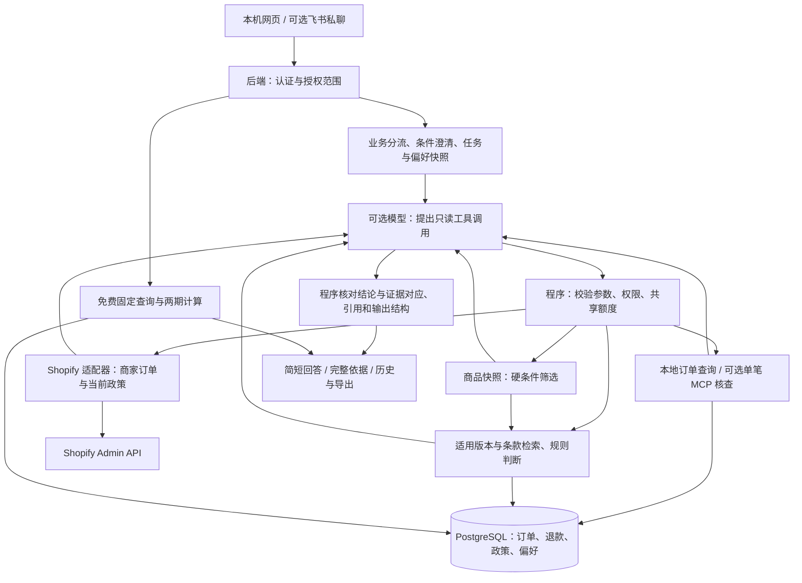

# Order Policy Assistant · 订单与售后分析平台

面向电商买家与商家的订单核查和售后分析应用：**买家查询订单、退货条件与运费规则，商家核对收款、退款和两期金额变化，结果附带业务事实与政策引用，便于回查。**

项目以 Python、FastAPI（接口框架）和 PostgreSQL（关系数据库）为基础，通过 MCP（Model Context Protocol，模型上下文协议）提供受授权控制的订单工具，结合 RAG（Retrieval-Augmented Generation，检索增强生成）组织政策依据。模型负责请求工具和解释结果；程序负责权限、金额计算、适用条件与引用校验。

[功能与接入范围](#功能与接入范围) · [系统架构](#系统架构) · [快速开始](#快速开始) · [代码导航](#技术选择与目录) · [验证记录](docs/validation.md)

## 从问题到可追溯的回答

同一笔合成订单 `O_SUPPORT_OK`：**用户提问 → 读取授权订单 → 匹配适用政策 → 输出带依据的结论**。

以下截图来自应用前端，使用合成订单的保存结果重放，展示同一条请求的完整处理过程。截图来源与复现方式见[展示说明](docs/validation.md#界面展示来源)。

**1. 提问：同时给出订单、判断时刻、商品状态和退货原因。** “未穿着、吊牌完好”属于用户自述，需要与后台事实区分。


<details>
<summary>2–3. 展开查看：程序实际读取了哪些订单事实和政策条款？</summary>

**2. 订单事实：** 工具在当前买家的授权范围内读取支付时刻、收货时刻、品类与定制状态。


**3. 适用政策：** 根据店铺、品类和订单支付时刻匹配11月版本。退货资格、定制例外与运费分别有条款支持；可按文件与行号回查[完整演示政策](knowledge/2026-11-shoes.md)。


</details>

**4. 交付结论：** 给出退货条件与运费说明，保留期限、定制例外、待核实事实及逐项引用。完整原文与工具明细可展开查看或导出。


按[快速开始](#快速开始)运行 `demo.py check` 可复现规则核查；[合成售后样例](samples/support/expected.json)给出了固定观察时刻和预期结果。

## 功能与接入范围

| 功能 | 处理方式 |
|---|---|
| 订单与退款核查 | 按买家或店铺授权读取明细，以整数最小货币单位计算收款、退款与净额，保留币种和截止时间。 |
| 买家售后咨询 | 根据支付时政策版本、收货事实与商品状态判断资格和运费，缺少条件时继续澄清。 |
| 政策检索与引用 | 先按店铺、品类和业务时间过滤，再检索完整条款；支持关键词和可选嵌入融合，资格、运费、例外分别绑定依据。 |
| 政策更正与撤回 | 管理员维护受控政策版本，交付前复核有效状态；保留历史报告并提供当前依据状态与附件。[管理说明](docs/policy-lifecycle.md)。 |
| 两期分析与退款调查 | 计算金额变化与渠道贡献，核查退款原因记录，并区分已核实原因、用户自述和证据缺口。 |
| 商品筛选与一般政策 | 按预算、币种、尺码、材质筛选目录快照并关联退货条款；支持无订单号的一般政策查询。 |
| 对话、记忆与交付 | 条件跨轮续接，按账号与角色保存显示偏好；提供任务进度、取消、历史和完整结果导出。 |
| 多角色协作 | 支持金额与政策并行，以及订单事实→政策解释的顺序交接；共享调用预算、校验交接内容并限制补查次数。 |

**数据与平台接入：** 本地 PostgreSQL 承载订单、退款和政策业务链，仓库附合成数据便于复现。Shopify（电商平台）适配已在开发店验证商家订单、成功交易、退款和当前退款政策读取；买家售后与商品推荐当前使用本地合成数据，平台客户登录与商品接入属于后续扩展。查询工具均为只读。

飞书私聊、受限短程序及快照 SQL（结构化查询语言）提供按需配置的入口。配置方式见[可选服务](docs/optional-services.md)，适用范围和后续条件集中在[能力边界](docs/boundaries.md)。

## 系统架构



单笔订单核查可通过独立 MCP（Model Context Protocol，模型上下文协议）服务调用，服务端依据专用凭据确定数据范围；售后流程使用本地订单事实函数。政策选择和金额计算由业务程序完成，模型接收经过筛选的事实与条款，输出经校验后保存并交付。

## 快速开始

需要 **Docker（容器运行环境）及 Compose（多服务管理工具）**、Python 3（推荐 3.12）。应用和数据库在容器内运行，首次构建需联网下载镜像与依赖。默认启动使用合成数据，模型、嵌入和外部平台连接均关闭，基础核查无需付费服务。

在克隆后的仓库根目录执行：

```sh
python3 demo.py prepare
python3 demo.py up
python3 demo.py check
```

- `prepare` 生成独立随机凭据到 `local/demo.env`，已存在则保留，不打印密码。
- `up` 构建镜像、启动数据库与应用，执行迁移，导入合成订单、退款、售后事实与三份政策，并建立样例账号和协议凭据。
- `check` 完成15项业务与接口检查，覆盖金额、授权、政策版本、条件澄清、商品条款、退款调查及内部 MCP 调用。

打开 **http://127.0.0.1:18180**。运行下面命令仅在本机显示登录凭据，粘贴到网页登录框：

```sh
python3 demo.py token
```

凭据仅保存在本机，勿提交版本库。样例账号可选择买家 `B001` 或商家 `S001`。网页“订单核查”和“两期金额变化”可直接使用；聊天与模型解释需按[模型配置说明](docs/optional-services.md#1-deepseek-模型)启用。

需要并行运行另一套实例时，在独立目录的 `local/demo.env` 中配置不同的 `DEMO_PORT`、`DEMO_PROJECT_NAME` 和 `DEMO_IMAGE`，以隔离端口、容器与数据卷。

### 样例与事前预期

| 输入/操作 | 预期 |
|---|---|
| 免费核查 `O001`，退款截止 `2026-11-03T00:00:00+08:00` | 支付125元，退款40元，净额85元。 |
| 用同一截止查 `O404` | 当前授权范围内未找到；不泄露订单在其他范围是否存在。 |
| `demo.py check` 固定观察时刻下核查 `O_SUPPORT_OK` | 按11月政策，未穿着且吊牌完好为用户自述；满足演示条件，尺码原因运费由买家承担。 |
| 核查 `O_SUPPORT_UNKNOWN` | 缺少收货事实，应澄清，不能凭空算有效期。 |
| R05 固定两期退款样例 | 退款从1500分到4500分；增加3000分。已核实尺码记录增加2000分，不能把全部增额归因为尺码。 |
| `demo.py check` 在目录快照时刻筛选 M码棉质 T恤，预算30 USD，并要求有适用退货条款 | 仅返回合成规格 `V-A`，标价25.00 USD；定制规格排除、定制状态未知不算满足条件。 |
| `demo.py check` 查询2026-11-20的鞋类一般政策 | 取得11月版本，不读取订单、不承诺本单可退。 |

固定观察时间与预期见 [`samples/support/expected.json`](samples/support/expected.json)。启用模型后可提问：“判断时间2026-11-18T08:00:00+08:00，O_SUPPORT_OK 尺码不合适，未穿着、吊牌完好，能否退货，运费谁承担？”

### 停止与恢复

```sh
python3 demo.py status
python3 demo.py stop
python3 demo.py up
# 或移除本项目容器和网络，仍保留数据卷：
python3 demo.py down
```

以上命令管理当前实例；数据与凭据保存在 `database` / `runtime` 卷中。再次 `up` 可复用，删除数据卷会清除对应数据。短程序模式的独立运行要求见[可选服务](docs/optional-services.md#4-短程序和快照查询)。

## 技术选择与目录

可以沿以下业务链阅读代码：

| 想了解什么 | 建议阅读顺序 |
|---|---|
| 启动与免费验收 | [`demo.py`](demo.py) → [`deploy_init.py`](deploy_init.py) → [`demo_check.py`](demo_check.py) |
| 订单售后与政策依据 | [`app_server.py`](app_server.py) → [`support_runtime.py`](support_runtime.py) → [`buyer_support_service.py`](buyer_support_service.py) → [`policy_kb.py`](policy_kb.py) → [`support_claims.py`](support_claims.py) |
| 退款增加与原因证据 | [`sales_analysis.py`](sales_analysis.py) → [`refund_investigation.py`](refund_investigation.py) → [`refund_investigation_runtime.py`](refund_investigation_runtime.py) |

公共模块集中处理历史裁剪、可信偏好与模型请求；各业务入口维护自己的重试、证据校验和失败回退。`tests/` 保存对应回归检查。

- Python、FastAPI（网页接口框架）、Pydantic（类型与结构校验）、SQLAlchemy（数据库访问）及 PostgreSQL（关系数据库）保存结构化事实；SQL 参数绑定和授权过滤由程序实现。
- 政策文本、元数据与可选向量统一保存在 PostgreSQL（关系数据库）；先筛选适用范围，再对候选条款计算相关性，便于核对版本与来源。
- 模型工具循环采用显式状态和共享限额，程序校验工具参数、授权范围、结论及引用。
- 任务过程与结果持久化在运行卷；重启后可查询历史，未完成任务标记为中断。

```text
app_server.py / serve.py        接口、授权、任务入口
agent_runtime.py               单模型工具循环与共享执行边界
runtime_context.py             共用历史裁剪、可信偏好与本次覆盖
model_request.py               分析/调查共用单次模型请求、计量与严格JSON解码
condition_state.py             查询条件来源、更新与澄清
support_conditions.py          售后意图与用户自述
buyer_support_service.py       订单事实和售后规则
policy_documents.py / policy_kb.py  政策解析、版本选择、条款检索
policy_lifecycle.py / policy_admin.py  受控撤回、更正、管理预览
policy_review.py                   历史依据状态核对，不重写报告
general_policy*.py                泛政策条件与查询，不判断具体订单
catalog_*.py / shopping_runtime.py 合成商品筛选、关联政策与受限模型工具循环
shopify_*.py                     可选开发店身份边界、连接与交易事实
support_claims.py / support_collaboration.py  结论证据对应、售后顺序交接与有限补查
display_preferences.py            显示格式，不修改金额、不换汇
refund_service.py / merchant_service.py  买家/店铺只读查询
sales_analysis.py / refund_investigation.py  固定计算和原因记录核查
mcp_order_client.py / mcp_order_server.py   协议客户端/服务端
multi_agent_runtime.py / programmatic_runtime.py / snapshot_sql_runtime.py  有限对照
preference_store.py / memory_capture.py    跨会话偏好与候选记忆
task_store.py / execution_budget.py        过程记录、取消与预算
web/                            本机页面
sql/ / samples/ / knowledge/    表结构、可公开样本和政策
compose.verify.yaml / deploy_init.py / demo*.py  独立演示与恢复入口
tests/ / evaluation/            开发回归与评测材料（两者分开）
```

## 可选配置

按[可选服务说明](docs/optional-services.md)启用 DeepSeek 模型、硅基流动嵌入、Shopify 读取或飞书。密钥放在 `local/` 或本机安全位置；调用量、词元与费用控制的配置说明一并列在文档中。

商品聊天入口需打开目录配置开关；也可用 `python catalog_recommendations.py --demo` 查看合成目录的筛选结果，无需模型。

## 测试与验证

宿主离线逻辑测试（安装依赖时需联网，执行测试不需要模型密钥或业务数据库）：

```sh
python3 -m venv .venv
.venv/bin/python -m pip install -r requirements.lock.txt
.venv/bin/python -B -m unittest discover -s tests -p 'test_*.py'
node --test tests/test_web_*.mjs
```

CI（Continuous Integration，持续集成）自动运行离线 Python 与网页逻辑测试。已有验证包括 Apple 芯片 Mac 原生环境、Linux ARM64 容器独立新卷启动，以及开发店商家读取；Windows 等环境的完整运行尚待验证。具体环境、模型评测、失败与修复记录见[验收记录](docs/validation.md)。

欢迎运行样例，并通过 [Issues（问题反馈）](https://github.com/yapengl490-cmd/order-policy-assistant/issues)提交复现步骤、预期与实际结果；请使用合成数据并移除凭据。

代码采用 [MIT许可证](LICENSE)。依赖署名与数据的独立许可见[第三方说明](THIRD_PARTY_NOTICES.md)。
