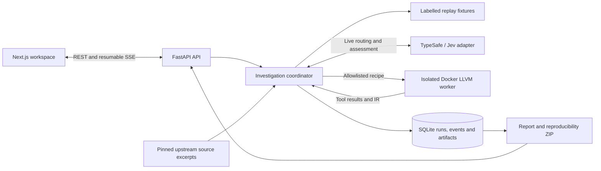

# LLVM BugSquad

A local LLVM investigation workbench combining model-assisted triage, isolated compiler execution, and traceable evidence.

**Status:** The TypeSafe/Jev adapter and Docker worker are implemented; live API and end-to-end compiler verification remain pending. The default replay mode demonstrates the workflow with clearly labelled synthetic results and requires no API key or Docker.

## Why this project exists

Investigating an optimizer report means connecting a reduced input, an expected transformation, a precise compiler build, and the evidence produced by tools. BugSquad brings those pieces into one workspace so routing decisions, execution failures, source references, and unresolved hypotheses remain inspectable.

The project explores how AI-assisted developer tooling can support systems debugging while keeping compiler observations authoritative.

## Architecture



The backend owns provider credentials, orchestration, persistence, and process control. The frontend presents investigation history, streamed progress, routing decisions, source context, IR, and exported evidence. Replay uses prepared fixtures instead of contacting the provider or running LLVM.

## Engineering Highlights

- **Controlled execution:** fixed `opt`, `FileCheck`, and focused `lit` recipes run in non-root Docker containers with networking disabled, a read-only root filesystem, resource limits, and cancellation. Uploaded `RUN` comments are never executed.
- **Auditable model decisions:** the Jev adapter validates structured choices and probabilities, records the resolved model and input hash, bounds requests, retries transient failures, and redacts credentials. Low-confidence routing requests review.
- **Durable orchestration:** SQLite stores runs, ordered events, and artifact bodies. Transactional admission, request fingerprints, and idempotency keys prevent conflicting submissions; interrupted work receives an explicit outcome after restart.
- **Resumable progress:** server-sent events use sequence IDs so the UI can reconnect without restarting the investigation.
- **Traceable results:** manifests include input and artifact hashes, tool commands, and build identity. Source excerpts cite an exact upstream commit and pass integrity checks; exports retain replay/live labels.

## Tech Stack

| Domain | Technologies |
| --- | --- |
| Backend | Python, FastAPI, Pydantic, SQLite |
| Interface | Next.js, React, TypeScript, server-sent events |
| Systems tooling | Docker, LLVM 19.1.7, `opt`, `FileCheck`, `lit`, CMake/Ninja image build |
| AI integration | TypeSafe/Jev HTTP adapter for routing and evidence assessment |
| Validation | pytest API tests and worker/provider contract tests |

## How It Works

1. Submit an issue description, reduced LLVM IR, expected behavior, and build selection, or choose a replay fixture.
2. In live mode, select a manual pass or ask Jev to route the report. Supported compiler recipes cover dead-store elimination (DSE) and InstCombine; other or uncertain reports request further review.
3. Resolve the selected worker image to an immutable image ID, verify the IR, run the selected pass, and evaluate supplied `CHECK` directives with FileCheck and a focused lit test.
4. Collect tool output, optimized IR, pinned source context, and a model assessment when configured. The diagnosis currently summarizes evidence deterministically and separates facts from hypotheses.
5. Inspect the event history, cancel active work, or export a ZIP containing the report, manifest, events, and available artifacts.

A FileCheck mismatch is an observed expectation failure, not proof of semantic miscompilation. Runs without executable expectations do not claim a reproduced defect.

## Setup

Use Node.js 20.9+ and Python 3.11+. Run these commands from the repository root.

```sh
git clone https://github.com/yashwant938/LLVMBugSquad.git
cd LLVMBugSquad
```

**Linux / macOS**

```sh
python3 -m venv .venv
.venv/bin/python -m pip install -r backend/requirements.lock.txt
npm ci
npm run dev
```

**Windows PowerShell**

```powershell
python -m venv .venv
.\.venv\Scripts\python.exe -m pip install -r backend/requirements.lock.txt
npm ci
npm run dev
```

Open [the workspace](http://127.0.0.1:3000). The launcher starts both services and waits for API health; Ctrl+C stops them. State persists in `.data/bugsquad.sqlite3`. API documentation is available at [localhost:8000/docs](http://127.0.0.1:8000/docs).

### Optional live execution

Start a Linux Docker engine, then build the pinned baseline image:

```sh
.venv/bin/python worker/build.py --variant baseline --jobs 2
```

On Windows, use `.\.venv\Scripts\python.exe` instead. Building LLVM requires substantial time and disk space.

Copy `.env.example` to `.env`, configure `TYPESAFE_API_KEY` on the server, and restart `npm run dev`. `TYPESAFE_MODEL` defaults to `jev-latest`. Explicitly select live execution in the UI. Manual routing can run the compiler without a Jev key; model assessment then records its unavailability.

The service is local and single-user, with no authentication. Keep it bound to loopback. See [Operations](docs/OPERATIONS.md) for configuration, Windows compiler compatibility, the API, and live setup; see [worker documentation](worker/README.md) for isolation limits and build provenance.

## Example

Create a synthetic DSE investigation through the API:

```sh
curl -X POST http://127.0.0.1:8000/api/runs \
  -H 'Content-Type: application/json' \
  -d '{"title":"DSE replay","mode":"replay","fixture_id":"dse-alias"}'
```

Use the returned `id` to inspect `/api/runs/{id}`, stream `/api/runs/{id}/events`, or download `/api/runs/{id}/export`. The run retains `mode: "replay"` and `synthetic: true`. The UI also includes healthy InstCombine, incomplete-report, provider-unavailable, and worker-timeout replay scenarios.

## Engineering Challenges

- **Executing untrusted input:** accept bounded IR, constrain the supported passes, and isolate compiler processes instead of executing commands embedded in reports.
- **Preserving evidence across failures:** persist ordered progress and partial artifacts, distinguish timeout from cancellation, and report when container cleanup cannot be confirmed.
- **Keeping AI output accountable:** retain provider decisions separately from measured compiler results and distinguish baseline source context from a locally modified candidate build.

### Validation

```sh
.venv/bin/python -m pytest backend/tests tests -q
npm run typecheck
npm run build
node --check scripts/dev.mjs
```

Use `.\.venv\Scripts\python.exe` for pytest on Windows. Provider and worker tests use controlled substitutes; they do not establish live Jev compatibility or LLVM correctness. [Acceptance tracking](docs/acceptance.md) records the remaining validation gates.

## Future Improvements

- Complete live Jev and Docker validation with inspectable, redacted evidence bundles.
- Demonstrate baseline-pass/candidate-fail behavior for the deliberately seeded DSE mutation and evaluate routing on held-out reports.
- Add a deadline across the whole investigation and automated CI checks.
- Explore evidence-grounded generative diagnosis and validated patch workflows; neither is currently implemented.
- Add authentication and run ownership before supporting a public or multi-user deployment.
