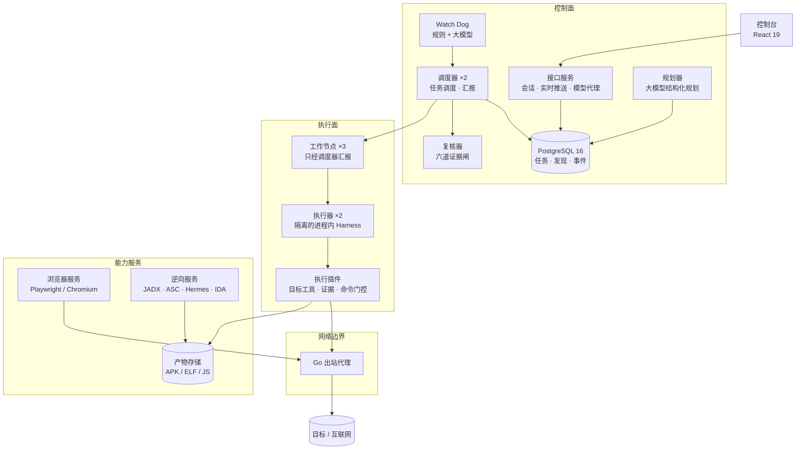

<p align="center">
  
  
</p>

<h1 align="center">Flotilla</h1>

<p align="center"><a href="README_EN.md">English</a> · 中文</p>

<p align="center"><strong>—— Super Agent 架构的自主渗透测试平台 ——</strong></p>

<p align="center">
  <a href="https://github.com/zhaji2333/Flotilla/releases/latest"></a>
  
  
  
  
  
</p>

---

Flotilla 是一个**基于 Super Agent 架构思路的多图+多智能体渗透测试系统**

「"𝓗𝓪𝓮𝓬 𝓿𝓮𝓻𝓫𝓪 𝓷𝓾𝓵𝓵𝓾𝓶 𝓼𝓮𝓷𝓼𝓾𝓶 𝓱𝓪𝓫𝓮𝓷𝓽, 𝓼𝓮𝓭 𝓹𝓾𝓽𝓸 𝓵𝓲𝓷𝓰𝓾𝓪𝓶 𝓹𝓮𝓻𝓮𝓰𝓻𝓲𝓷𝓪𝓶 𝓪𝓭𝓱𝓲𝓫𝓮𝓻𝓮 𝓼𝓪𝓽𝓲𝓼 𝓶𝓪𝓰𝓷𝓲𝓯𝓲𝓬𝓾𝓶 𝓮𝓼𝓼𝓮."」

`Super Agent 架构` · `多图与共享记忆` · `Agent 全双工运行` · `Watch Dog 自主纠偏` · `多 Agent 自主推进` · `可审计证据链` 

**导航**：[快速开始](#快速开始) · [这是什么](#这是什么) · [界面速览](#界面速览) · [核心能力](#核心能力) · [系统架构](#系统架构) · [安装详解](#安装详解) · [参考](#参考)

---

## 快速开始

```bash
cp .env.example .env        # 必填 LLM_API_KEY；按需改 LLM_BASE_URL / LLM_MODEL
docker compose up -d --build
open http://127.0.0.1:5173  # 默认管理员 admin / admin123，首次登录强制改密
```

控制台新建项目后，工作节点会自动领任务。完整步骤、资源要求与可选配置见 [安装详解](#安装详解)。

---

## 这是什么

Flotilla 是一个**基于 Super Agent 架构思路的多图+多智能体渗透测试系统**。你给它目标资产（URL、IP、域名、附件）、任务目标和授权范围，它会在授权边界内自主完成侦察、验证与证据收集，并在项目收尾时生成总结报告。

> [!NOTE]
> 本安服仔上班摸鱼时的产物……
>
> 这个 README 让 AI 给我写的有一股味，我自己看这些话都感觉出现阅读障碍了，所以直接省流：

### 01. 核心设计
- **经典调度**
  - `Planner`：负责规划、决策以及调度。
  - `Worker`：作为任务的控制器，本身也可以调用 Sub Agent。
  - `Watch Dog`：作为一条巡逻的狗，巡回监视当前的任务有没有跑偏，实现自纠错。
- **雷霆大图**：DAG 图、探索图、资产图、黑板、PostgreSQL。
- **防止坐牢**：漏洞真实性验证、渗透过程中的风险命令拦截等。
### 02. 架构参考
参考了 **DeepSeek Super Agent** 架构的一些想法：
`双层架构` · `事件驱动` · `批处理` · `全双工` · `看门狗`
用来实现连续、主动、高效、持久。
### 03. 合规与留痕
合规留痕这一块没什么好说的，每个项目、任务、Agent 的轨迹都有明确的记录。
但可能仍存在越界的风险，所以是有接入 LLM 再去做越界的判定的。
**但并不代表就绝对没有风险……出事了只能跑路了。**
### 04. 人机协作
在任务进行中也可以注入提示，把自己的想法和建议大胆地提给 AI 大人，实现**许愿式渗透（?）**。
### 05. 后续的想法
对于客户而言，我其实也是一个 Agent，我的 Agent 实际上是我的 Sub Agent，而我 Agent 的 Sub Agent……
**所以为什么不能让客户直接去调用我的 Agent 呢？**
后续想让这个系统能从微信/企微/飞书等平台获取任务，然后自动去运行项目、输出报告、反馈给用户。
在这个过程中，作为倒霉蛋安全服务工程师，可以做一个 Token 成本的限制，降低工作上自身的经济投入。
### 06. 最后的最后
> 这个项目让我有了一些空闲的时间去思考：
> 除了赚工资以外没有任何意义的低尊严、低自主性工作，是否仍然存在一些意义？
---
**再安利一下我的渗透 SKILL，已经更新 v2 版本：**
[**CkSKILLS v2 →**](https://github.com/zhaji2333/CkSKILLS)
---

---

## 界面速览

<table>
  <tr>
    <td width="50%"><br/><sub><b>总览</b>：项目、发现、审批和信号分布</sub></td>
    <td width="50%"><br/><sub><b>项目详情</b>：实时状态、任务和复核结果</sub></td>
  </tr>
  <tr>
    <td width="50%"><br/><sub><b>任务依赖图</b>：按依赖分层，串并行调度</sub></td>
    <td width="50%"><br/><sub><b>探索图</b>：任务 / 事实 / 目标的发现关系</sub></td>
  </tr>
  <tr>
    <td width="50%"><br/><sub><b>黑板</b>：类型化事实、待打点前沿、检索（规划器的共享记忆）</sub></td>
    <td width="50%"><br/><sub><b>线索板</b>：八节态势投影（授权 / 资产 / 发现 / 负面线索 / 待办 / 证据）</sub></td>
  </tr>
</table>

更多页面：项目列表、审批中心、Watch Dog 看板、指标、模型配置、资产图、轨迹检索、发现详情。

---

## 核心能力

### 自主规划与双层执行

规划器（Planner）每轮只做决策：读控制面快照，重排任务、调优先级、取消死路、维护待办；它只拿控制面工具，不能直接对目标发请求。工作节点（Worker）负责领取与执行，按需拆独立侦察子代理；执行器（Executor）在隔离环境中运行 Harness，负责真正的工具调用与证据采集。两者之间通过任务事件与触发器通信，规划失败不会污染执行面，执行失控也不会改写授权。

### 多图与共享记忆

所有图与板都是**同一份事实数据的派生读模型**，不维护第二套真相：

- **任务依赖图**：按依赖分层，串并行调度与卡点一目了然；
- **探索图**：项目、任务、事实之间的关系，决定下一步从哪打；
- **资产图**：项目内资产与覆盖度，避免重复劳动和遗漏；
- **发现血缘**：一条发现从哪来、证据是否共享、是否被后续发现取代；
- **黑板**：给规划器的共享记忆——类型化事实、开放意图、待打点前沿、检索；
- **线索板**：给人看的一屏态势，八节投影 + 版本号与冲突标记。

### 运行中注入（全双工）

任务运行中也能改方向：提示先入库，工作节点每 2.5 秒拉取，执行器每 250 毫秒检查一次并在下一步注入；每次投递都有审计事件。不需要暂停任务，也不用等下一次重试。

### Watch Dog 自主纠偏

Watch Dog 是只读观察者：规则层盯停滞、方向漂移、重复请求，大模型层做方向复核；命中后先去重提示，连续停滞升级到规划器和人工，规划器判定任务无用时可自动取消。效果在 10 分钟后回采，命中率上看板。

### 证据链与复核

发现不是“模型说它存在”就算数：必须绑定本任务记录过的基线请求与证明请求，复核器逐条过六道证据闸；证据不成立的不进报告，存疑的进人工复核队列。所有发现、证据、审批与状态变化都可回放。

### 授权网络边界

目标流量只有一个出口：Go 出站代理。代理按项目授权校验 URL、域名、IP 与前缀，重定向逐跳检查，DNS 重绑定防护，互联网检索走白名单；写动作单独记账。执行面隔离：工作节点没有数据库凭据，执行器没有管理员凭据，模型密钥只存在于控制面。

### 能力服务

浏览器与逆向各自独立成服务：浏览器服务跑 Playwright/Chromium，逆向服务内置 JADX、ASC、Hermes 与 IDA idalib（IDA 镜像需自备授权并保持私有），产物通过产物存储挂载，目标流量仍统一经代理。

### 人机协同与可观测

控制台实时查看任务、发现、轨迹、黑板与线索板；支持暂停/恢复/取消/重试、手动派单、审批中心（越权升级、发现复核、命令复核、停滞任务复核）。执行轨迹、工具调用、技能加载与上下文注入都可查。

### 技能体系

`skills/` 内置 18 个领域技能包，由 `ck-router` 按目标类型分诊：先打哪里、失败后换哪层，不靠模型临场发挥。

---

## 系统架构



执行流程：

1. 新建项目时写入项目记录、授权范围和初始任务；规划器默认随栈启动，按快照出计划、建任务、维护待办。
2. 工作节点经调度器领任务，靠租约（lease）与防双写（fencing）保证同一任务只被一个节点执行；随后拉起执行器，按步数和实际耗时上限执行，用 `http_request`、`browser_*`、`reverse_*` 调工具，目标流量经 Go 代理按授权范围放行。
3. 工作节点把结果回报给调度器，提交发现，附基线请求（baseline）与证明请求（proof）；复核器逐条过六道证据闸；项目收尾时由总结任务（Summary）生成报告，状态经实时推送（SSE）到控制台。

默认部署拓扑：

| 服务 | 默认副本 | 职责 |
|---|---|---|
| postgres | 1 | 任务、发现、证据、事件与审计 |
| proxy | 1 | 唯一出站网络边界，授权校验与审计 |
| api | 1 | 会话、REST、实时推送、模型代理 |
| frontend | 1 | 控制台（nginx 同源反代） |
| dispatcher | 2 | 工作节点汇报的唯一数据库写入口；周期 tick 只由 leader 执行 |
| executor | 2 | 隔离执行 Harness 任务 |
| worker | 3 | 领取任务、拉起执行器、回报结果 |
| browser | 1 | Playwright / Chromium 能力服务 |
| reverse | 1 | JADX / ASC / Hermes / IDA 逆向服务 |
| watchdog | 1 | 只读观察与升降级提示 |
| planner | 1 | 默认随栈启动的规划服务 |
| artifact-init | 1（一次性） | 初始化产物卷后退出 |

---

## 安装详解

### 前置条件

- Docker 与 Docker Compose v2；
- 一个 OpenAI 兼容的大模型 API Key（必填）；
- 建议 16 GB 内存以上（完整栈默认含 3 个工作节点、2 个执行器、2 个调度器、浏览器与逆向服务；上限是峰值，不是常驻占用）；
- 本地开发另需 Node.js 24+ 与 pnpm；
- 如需 IDA 反编译：自备 IDA 安装包与 License，构建私有 `reverse-ida` 镜像，**不要公开该镜像**。

### 1. 获取代码

```bash
git clone https://github.com/zhaji2333/Flotilla.git
cd Flotilla
```

### 2. 配置

```bash
cp .env.example .env
```

至少填写：

```bash
LLM_API_KEY=sk-...            # 必填
LLM_BASE_URL=https://api.deepseek.com/v1
LLM_MODEL=deepseek-chat
```

其余常用项：`EGRESS_MODE`（默认 `scope`，只放行授权范围）、`PLANNER_*`、`WATCHDOG_*`、`ARTIFACT_MAX_BYTES`。完整列表与默认值见 [.env.example](.env.example)。

### 3. 启动

```bash
docker compose up -d --build
```

启动完成后默认包含：数据库、出站代理、接口服务、控制台、2 个调度器、2 个执行器、3 个工作节点、浏览器服务、逆向服务、Watch Dog、规划器，以及一次性的产物初始化容器。

规划器默认开启（需要可用的 `LLM_API_KEY`）；不需要时：

```bash
docker compose stop planner
```

调整并发副本：

```bash
WORKER_REPLICAS=1 EXECUTOR_REPLICAS=1 DISPATCHER_REPLICAS=1 docker compose up -d
```

只想跑轻量核心栈（不含浏览器/逆向/Watch Dog）：

```bash
WORKER_REPLICAS=1 EXECUTOR_REPLICAS=1 DISPATCHER_REPLICAS=1 \
docker compose up -d postgres proxy artifact-init api frontend dispatcher executor worker
```

需要时再按需补齐：`docker compose up -d browser reverse watchdog`。

### 4. 访问

| 入口 | 地址 |
|---|---|
| 控制台 | http://127.0.0.1:5173 |
| 接口服务 | http://127.0.0.1:3001/api/health |
| 出站代理 | http://127.0.0.1:8080 |

首次启动会自动创建管理员 `admin` / `admin123`，首次登录强制修改密码（至少 12 位，含大小写字母、数字和特殊字符）。未改密前，除登录/改密/健康检查接口外，其余请求都会返回 `password_change_required`。

### 5. 新建项目

在控制台填写目标资产、任务目标与授权范围，保存后工作节点会自动领取任务；规划器会持续读快照、补任务。运行中可暂停、注入提示或手动派单。

### 常见问题

- **规划器反复重启/报错**：先确认 `.env` 里的 `LLM_API_KEY`、`LLM_BASE_URL`、`LLM_MODEL` 可用；没有模型时规划器无法工作，可以 `docker compose stop planner` 只用核心栈。
- **接口/控制台端口被占用**：改 `docker-compose.yml` 里的端口映射，或先停掉占用进程。
- **想清空重来**：`docker compose down -v` 会删除数据库与产物卷，请确认不需要保留数据。
- **日志**：`docker compose logs -f planner`、`docker compose logs -f worker`、`docker compose logs -f watchdog`。

---

## 目录结构

```text
flotilla/
├── packages/        # 编排、接口、控制台、执行插件、复核器、契约、控制面、工具网关
├── services/        # 浏览器服务（Playwright）、逆向服务（JADX / ASC / Hermes / IDA）
├── proxy/           # Go 出站代理
├── skills/          # 18 个技能包，ck-router 分诊
├── docs/            # 架构决策、接口契约、截图
├── docker-compose.yml
└── LICENSE
```

---

## 技术栈

| 层 | 技术 |
|---|---|
| 前端 | Vite、React 19、TypeScript 严格模式、Tailwind v4 |
| 控制面 | Node.js 24、`node:http`、zod、PostgreSQL 16 |
| 执行 | DeepSeek Harness（进程内）、调度器 + 租约/防双写 |
| 网络与能力服务 | Go 1.25 出站代理；Playwright；JADX、ASC、Hermes、IDA idalib |
| 部署 | Docker Compose |

---

## 参考

Flotilla 的设计与技能体系参考、对照了这些项目：

- [CkSKILLS v2](https://github.com/zhaji2333/CkSKILLS)：本项目 18 个技能包的来源与上游维护仓库（自有）。
- [agent-skills](https://github.com/addyosmani/agent-skills)：开发方法论与工程技能（MIT）。
- [JADX](https://github.com/skylot/jadx)：APK 反编译（Apache-2.0，vendored）。
- [Playwright](https://github.com/microsoft/playwright)：浏览器自动化（Apache-2.0）。
- **DeepSeek Harness**：执行面运行时与模型调用协议。
- **Droid ASC**：Android 反编译引擎（Apache-2.0，vendored）。
- **Cyber / cyber-harness**：架构与安全边界对照研究（AGPL-3.0，未复制代码）。
- **sapper-v2**：自主渗透 Agent 编队对照研究（MIT）。
- **ARTEX、Cairn、dsh-superagent-prototype**：早期架构、交互与 Super Agent 设计参考（内部研究）。

第三方组件的许可见 [THIRD_PARTY_NOTICES.md](THIRD_PARTY_NOTICES.md)。

---

## License

[MIT](LICENSE) © 2026 Flotilla contributors

🚨 仅用于自有靶场或已获得明确授权的目标。
